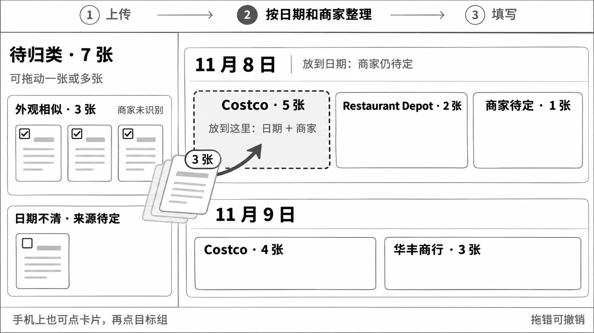

# 多文件录入开发计划：按采购日期与商家整理

> 2026-11-21 方案稿，供开发前审核。范围覆盖前端与后端；本文是计划，不表示功能已经实现。现有单据审核、采购确认和价格历史规则仍以 `imp_notes.md`、`stru_dev.md`、`struct.md`、`backend/README.md` 及代码为准。实施中的决定和验收结果按现有约定追加到 `impl_record.md`。

## 1. 本次要解决的问题与已确定的产品决定

餐厅用户一次上传十几份混合文件，可能包括 PDF、JPG/JPEG、PNG、HEIC、CSV、XLSX。现有上传入口把所选图片/PDF 当作**一张发票的多个文件**；CSV/XLSX 则走独立表格导入。用户需要的是将这批内容整理成可审核的采购数据，而不是把所有文件塞进一张发票。

**分类只有两个主要业务维度：实际采购日期、商家来源。**「同一天、同一商家」构成整理页的最小组；一个组可以包含多张不同发票、不同文件的页或表格行。一份 PDF 的不同页可以进入不同日期/商家组。文件归属、页序和文件名只作为推断线索与回看原件的信息，不成为界面上的一级分类。

流程为：**混合上传 → 按日期和商家整理 → 在组内填写与确认 → 进入采购价格历史**。整理不等于入账；现有的人工逐行确认、整单收口、原始证据和修改日志继续生效。允许先处理已经整理好的组，待定内容留在批次里以后再办。

桌面端采用左侧待归类卡片、右侧「日期 → 商家」目标组。支持单张和多选拖拽；拖到日期标题只定日期，拖到某日期下的商家组则同时确定两项。手机端以「点卡片/选多张 → 点目标组」完成同一操作，拖动可作为快捷方式，不能是唯一入口。财务人员另有表格视图，两种界面使用同一份批次与审核数据。

下图是已讨论的低保真结构，不是最终视觉稿：



纯文本结构：

```text
待归类（可勾选多张、拖动）       11 月 8 日
  相似的 3 张，商家未知   ───→    Costco / Restaurant Depot / 商家待定
  日期不清，商家未知             11 月 9 日
                                   Costco / 华丰商行 / 商家待定
拖到日期标题：只定日期；拖到商家组：日期与商家一起确定。
```

## 2. 调研结论与本项目的实际限制

- [Dext 的说明](https://help.dext.com/en/articles/416691-what-information-does-dext-extract-from-costs-and-sales-documents)指出，它会参考账户中相似的历史单据选择商家，人工纠正会影响后续匹配；[商家别名](https://help.dext.com/en/articles/106015-how-to-manage-suppliers-in-dext)用于把不同写法归到同一来源。这启发本项目保存用户确认过的来源映射，但不能把视觉相似当成事实。
- [Atlassian 拖拽指南](https://atlassian.design/components/pragmatic-drag-and-drop/design-guidelines)建议多选拖动使用带数量的叠放预览、明确显示可拖动区域；[W3C 的拖拽替代操作](https://www.w3.org/WAI/WCAG22/Techniques/general/G219)要求能通过点选等方式完成同一操作。因此整理页提供拖拽、多选批量移动和点选目标组，三者执行同一后端命令。
- 版式相似可帮助形成待确认的「相似一堆」；它不能证明商家相同。[模板文档研究](https://vldb.org/pvldb/vol14/p997-tata.pdf)说明同一模板常共享布局，而[发票识别研究](https://cs229.stanford.edu/proj2016/report/LiuWanZhang-UnstructuredDocumentRecognitionOnBusinessInvoice-report.pdf)指出相似版式的细小差异会造成误配。本项目只把相似性用于建议和批量人工命名，自动归组的条件须由本项目样本验证。
- 当前 `src/integrations/dashscope.py` 的 `CONTENT_PROMPT` **没有询问 `supplier`**。解析器将缺键标为 `NOT_ASKED`，不能把当前来源为空解释为「模型识别失败率 70%」。现有基准结果绑定旧提示词 SHA `12e0246b0377`；改提示词后旧准确率只能保留为历史基线，须重新评测。
- `ocr_routes` 按已知来源选提取路径和 `date_order`。若来源未知，美式数字日期也可能因日/月歧义保留为空；新流程必须能在**没有来源路由**时先处理来源与日期候选，不能形成「先知道商家才能识别日期、先有日期才能归商家」的循环。
- `invoice_files` 目前一份文件只归一张 `invoice`，并以 `sha256` 全局判重；`POST /api/invoices` 的多文件含义是同一张单据的多页。CSV/XLSX 目前以一个 `entry_source='import'` 的审核容器保存整份表。这些结构不能直接表达「一份 PDF 的不同页或一份 CSV 的不同行进入不同日期/商家组」。

## 3. 来源识别：新增模型输出与人工纠正

### 3.1 模型应回答什么

为单据抬头/零售小票补充商家识别。要求识别**卖方/开票方/商家**，明确排除买方、收货方、付款方及商品品牌。只有纸面确实出现时才给候选；看不清时标为不可读，纸面没有时标为缺失，不依据食材、历史价格或上传日期补造来源。

中英文同时印出时，**用于分组和展示的名称优先取纸面上的英文名；没有英文名才取纸面上的中文名**。不把中文自行翻译成英文，也不凭英文缩写扩写法定名称。建议让模型分别返回纸面英文名、中文名及可得的原文证据，再由后端统一选择展示名；原始两个读法都留在识别证据中。两模型不一致、无法判断谁是卖方、或模型只给翻译而纸面无对应文字时，保留候选并要求人工确认。

实施时需同步修改提示词、适配器解析、统一识别契约映射、跨模型裁决、草稿证据、API 响应、前端候选呈现、提示词版本记录和相关回归测试。旧基准样本与旧 SHA 不覆盖；新提示词以新 SHA 记录。评测按现有印刷件、手写件、零售小票、数字 PDF 分层；缺逐项真值的类别只报告可核对的行为和覆盖范围，不编造准确率。数字 PDF 优先利用文字层；不能假定新提示词在所有类别上同样有效。

### 3.2 来源读不出时如何减少人工工作

来源建议按可解释线索分层提供，而不是要求用户逐张手填：

1. **纸面直接读出**：保留文字/页码证据，提出商家候选；不是自动入账。
2. **同文件参考**：同一文件中已有用户确认的商家时，为其他页提出候选；若某页明确写着不同来源，单页证据优先。
3. **历史来源与别名**：规范化大小写、空白和用户确认过的中英文/简称写法，避免 `Costco`、`COSTCO` 分成两组。相似名称只建议，不自动合并不同商家。
4. **相似外观的待办堆**：没有可读商家的扫描件按可解释的版式特征形成候选堆，展示缩略图供用户扫视；用户可移出例外，再给整堆选择一次来源。首版先验证固定模板/布局特征，是否需要图像嵌入模型由实测决定。
5. **仍然未知**：留在某日期下的「商家待定」或全局待归类区；可继续处理其他内容。人工确认一次后，记住来源和适用线索，供后续批次建议使用。

“十张 JPG 中七张来源未知”是用户此前描述的使用经验，**不是已测量的 OCR 失败率**；那组 JPG 不在当前仓库，后续开发不以取得它们为前置。能取得人工真值时，评测分别统计纸面没有来源、纸面有但模型未读出、模型读错、提示词未询问；无法判定的类别明确写“未测”，不阻断功能开发。

## 4. 整理页的交互细则

- 待归类卡片只突出缺少的关键项、原件缩略图和建议依据，例如「纸面读出」「参考同文件」「与历史单据外观相似」。点击卡片打开原件预览；卡片上的操作保持精简，移动与更多操作收在一个菜单中。
- 拖动一张到日期标题：只写日期，来源仍为未知；拖动到该日期下的商家卡片：同时写日期和来源。日期/商家组是大面积投放目标，拖动时高亮可投区域，非法目标不接收。多选时显示叠放预览和张数。
- 拖错后可立即撤销；批量移动只改变被选中的项目，后端一次提交并返回逐项结果。刷新和换设备后保持结果；两个会话同时修改时使用版本号提示冲突，不默默覆盖。
- 手机端先点选一张或多张，再点目标日期或商家组；日期未列出时保留日期选择器。要验证长按拖动与页面滚动、PDF 预览手势是否冲突；手机功能不依赖拖拽。
- 财务表格视图按同一分类状态筛选、多选与批量改值；上方/侧边可看原件。它与卡片视图共用后端分类命令，切换视图不复制草稿。
- 系统可先把高可信候选**显示**在相应组里，但必须保留「系统建议／人工确认」区别。确认采购行前应能看见并改正组的日期与来源。来源不明不会变成一个编造的商家名。

## 5. 后端边界与数据流

建议增加持久化的上传整理批次，而不在上传第一张文件时立即创建正式的单据草稿：

```text
上传批次 → 原文件引用 → 可归类内容（PDF 页、图片、表格行）
                         ↓ 日期/商家候选、依据、人工决定、版本
                  按（采购日期，规范化来源）展示为组
                         ↓ 进入填写
                 复用现有发票草稿/导入行、逐行确认与采购记录
```

原件字节只存一次；一个可归类内容要能回指其文件与页码或表格行号。日期/商家组是**整理视图与工作队列**，不等于一张发票：同组可能有几张真正的发票，单据总额、重复提示与收口仍分别处理；不能把同组金额合成伪发票。混合页（同一页确实含不同日期/来源）进入例外审核，可在行级设置覆盖值，不强行给整页一个错误组。

API 至少需要：创建/恢复批次、逐文件上传与处理状态、读取分页的待办和分组、批量改日期/商家并带版本、撤销最近一次分类操作、把已整理内容送入现有审核、从组回看原件。具体 URL 和表结构在实施步骤中细化。OCR 与解析后台执行；浏览器关闭不丢任务。整理阶段已得到的识别结果应复用，避免送入单据草稿后对同一页重复调用模型。

现有 `source_name_normalized` 可继续作为已确认采购记录的比较口径，但来源别名/模板记忆需要有独立、可更正的映射。商家名未确认前，不应仅凭相似度为它应用某商家的 `ocr_routes`；用户确认来源后，可用该商家的 `date_order` **重新解析已保存的日期原文**，不必为此重复 OCR。已入账后若改组，必须显式更新相关采购记录并保留修改日志，不能只移动界面卡片。

## 6. AI coding 执行约定与总清单

每个 `Mxx` 是**一次相对独立的 coding 任务**。把本文件交给 AI 时明确指定当前步骤；完成该步及其必要的共用代码即可。后端继续采用 API → Service → Repository 分层，原件处理放 `documents/`，外部模型调用放 `integrations/`。不要把示意 API 或表名当成未经核对的最终契约：在对应步骤内先查现有实现，再定迁移与接口，记录取舍。

**本地文件读取约定（Windows、仓库路径含中文）**：从仓库根目录执行命令，引用实际文件路径；PowerShell 读取中文 Markdown 时使用 `Get-Content -LiteralPath <路径> -Encoding UTF8`，写入时也明确使用 UTF-8。路径要先核对，例如开发说明位于 `backend/docs/stru_dev.md`，不要把根目录下找不到同名文件误判为文档缺失。命令报 `helper_unknown_error: setup refresh had errors` 时，表示执行器尚未成功启动，不能据此判断文件内容、路径或权限有问题；先用最小只读命令确认执行环境，必要时换用获准的执行方式，并如实记录仍未知的底层原因。中文路径需要正确引用和编码处理，但没有证据表明它导致了该执行器错误。

**可用材料边界（2026-11-21 用户确认）**：本计划只以当前 `backend/samples/real/` 的材料为真实样本来源，不再要求用户补交十张 JPG、跨来源 CSV 或其他原件。已有样本能验证的内容用真实样本；缺失的版式和跨组边界用明确标为合成的夹具做代码、接口与浏览器功能测试。样本不足、OCR 凭据缺失或设备不可用时，写清未测范围，但不得把取得额外材料设为开发或步骤完成的前置。优先交付可操作、可恢复、可回看原件的完整功能；不能用合成结果宣称真实 OCR 准确率。

每步交付须写出：修改文件、迁移或接口变更、使用的样本与验证命令、真实运行结果、未覆盖的风险。将记录追加在该步的「验证记录」后；新实现的详细取舍和被否决方案仍追加到 `impl_record.md`。**子项开发完成并通过相应验证后，立即把该子项的 `- [ ]` 改成 `- [x]`；该步全部子项、测试和本计划按现有材料可完成的验收要求满足后，立即把总清单中的该步骤改成 `- [x]`，不等待用户另行审核。未完成或未验证的项保持 `- [ ]`，并在验证记录中说明原因。** 真实 OCR、历史结果回放、合成测试和浏览器操作分别记录；缺少真实材料不阻断已实现功能的验收，也不能把合成测试写成真实识别结论。

下表中的「可独立」指可与同阶段其他任务分别开发、分别验收；共享文件发生冲突时仍须顺序合并。现有单张录入是回归基线，不因新批次功能而消失。

- [x] **M00 现有样本清单与基线**（前置：无；研究与评测）
- [x] **M01 模型提取商家**（前置：M00；后端 OCR；可与 M02 独立）
- [x] **M02 整理批次的数据与存储边界**（前置：无；后端基础；可与 M00、M01 独立）
- [x] **M03 图片/PDF 的批次摄入**（前置：M02；后端文件处理）
- [x] **M04 CSV/XLSX 的批次摄入**（前置：M02；后端表格处理；可与 M03 独立）
- [x] **M05 分类候选与日期解析**（前置：M01、M03、M04；后端识别流程）
- [x] **M06 人工归组、批量移动与撤销**（前置：M02、M03；后端分类命令；可用人工候选独立于 M05 开发）
- [x] **M07 商家记忆与相似堆**（前置：M05、M06；后端建议；可与前端任务独立）
- [x] **M08 分组内容接入现有审核**（前置：M03、M04、M06；后端审核桥接；不依赖 M07）
- [x] **M09 前端混合上传与批次恢复**（前置：M03、M04；可与 M05—M08 的后端开发独立）
- [x] **M10 前端卡片整理页与移动端操作**（前置：M06、M09；可用固定候选先开发，不依赖 M07）
- [x] **M11 前端财务表格视图**（前置：M06、M09；与 M10 共用 API，可独立开发）
- [x] **M12 前后端闭环与现有样本验收**（前置：M01—M11）

### M00：现有样本清单与基线

- [x] 盘点当前 `samples/real/`，按页/图片建立带文件校验值的私有清单；沿用已有真值并标明其来源与未复核字段。逐项补全实际采购日、买卖方和正确归组只在现有原件足以可靠判定且后续步骤需要时进行，不以补齐 83 项为 M00 完成条件。客户原件与逐项标注只放忽略目录。
- [x] 对旧响应做可重复回放，将主提示词未问 `supplier` 单列为 `not_asked`；纸面缺失、模型漏读、读错仅在有可核对真值与对应模型输出时统计。印刷扫描、手写、小票、数字 PDF 分层列出覆盖和未测范围，不把少数清晰件外推到全部图片。
- [x] 定义商家候选正确率、错误归组率、未归组率、每批人工操作次数和完成时间的统一口径；把同文件跨日期/跨商家、双语商家、买卖方并列、模糊日期、跨来源 CSV 列为后续合成回归场景，不要求仓库中已有对应客户原件。
- **验收**：可复查的现有样本清单、数据边界、回放命令、旧配置基线及明确的未测范围均已提供；M00 是开发基线，不代表已测得新提示词的商家准确率。后续步骤可直接开工。
- **验证记录（2026-11-21；按当日用户确认的材料边界调整 M00 范围）**：
  - 修改 `backend/tools/eval_multifiles_m00.py`、`backend/tests/test_eval_multifiles_m00.py`、本节及 `backend/docs/impl_record.md`；在被 Git 忽略的 `backend/samples/real/m00/` 生成 `manifest.json`（逐项清单与待复核标注）和 `baseline.json`（历史响应回放）。没有迁移、接口或运行时 OCR 改动。工作树原有改动均保留。
  - 样本清单实际覆盖 83 个内容单元：印刷扫描 6 页、中文手写扫描 68 页、零售小票 4 张、数字 PDF 5 页；现有逐字段旧真值仅覆盖印刷 6 页与小票 4 张。清单记录文件 SHA-256、原文件/页引用及待填的实际采购日、纸面日期、卖方英文/中文、买方、纸面是否有来源和正确归组。83 项均为 `pending_original_review`，旧 GT 原文仅作标注草稿，不能当作已复核 M00 真值。`samples/real/` 实查没有 CSV，也没有可识别为用户所说那十张典型 JPG 的整组材料；现有 4 张小票不能替代那组 JPG。
  - 实际命令（仓库根目录下先 `cd backend`）：`& .\.venv\Scripts\python.exe tools/eval_multifiles_m00.py inventory`；`... init`；`... replay --out samples/real/m00/baseline.json`；`& .\.venv\Scripts\python.exe -m pytest tests/test_eval_multifiles_m00.py -q`。结果：清单创建 83 项；回放两个模型各有 78 份旧响应，提示词 SHA 均为 `12e0246b0377`，共 156 次内容单元×模型的 `supplier` 为“未询问”（手写 136、印刷 12、小票 8）；数字 PDF 5 页×2 模型没有这一配置的旧 OCR 响应。测试 3 项通过。旧 GT 的 10 页中来源状态暂记 7 个 `recognized`、3 个 `unreadable`，尚未逐张复核，不能把后者直接解释成“纸面没有”。本轮是**历史结果回放**，没有真实 OCR 调用，也没有浏览器操作。
  - 后续统一计量口径：商家候选正确率＝已人工复核单元中正确的非空来源候选数 ÷ 可判真伪的非空候选数；同时报告纸面确有且可读来源的候选覆盖率。`not_asked`、无响应、真值未复核、纸面不可读的模型猜名分别单列，不进准确率分母。错误归组率＝自动放入日期/商家组且组不符人工真值的单元数 ÷ 自动放组且可核对的单元数；未归组率＝分类建议后仍缺日期或商家的可归组单元数 ÷ 全部可归组单元数。每批人工操作次数按用户发起的确认/移动命令计，多选一次记一操作并另记受影响单元数；整理耗时从处理完成可开始整理到用户完成该批整理，另报 OCR 等待时间。日期以实际采购日为分组真值，纸面原文单存；同文件跨组以页/行为单元。结果按印刷、手写、小票、数字 PDF 分层，兼报分子分母，不跨层外推。
  - 范围限制而非开发阻塞：83 项原件尚未按所有新字段逐项复核；现有材料没有十张典型 JPG、跨来源 CSV 等边界原件。旧提示词未问来源，不能量出新提示词的真实识别率；批次界面尚未开发，不能量操作数和耗时。M00 的现有样本基线已满足调整后的验收；M01、M02 可开工。缺失场景在对应功能步骤用合成回归验证，真实效果只在当前可核对样本上报告。

### M01：模型提取商家

- [x] 修改 `src/integrations/dashscope.py` 的内容提示词与输出解析：要求区分卖方/商家与买方，分别读纸面英文、中文商家名；保留原始两种写法，由后端按「有纸面英文取英文，否则取中文」产生 `source_name` 候选。不翻译、不臆造、不把未知写成某个商家。
- [x] 将商家原文、模型分歧、页码和可得证据接入现有识别契约、草稿证据和响应；英文/中文取舍只影响展示及规范化来源，原文不被覆盖。两模型冲突与“纸面没有”要能区分。
- [x] 更新提示词版本/SHA、依赖旧 SHA 的测试和评测工具；旧评测结果保留为历史配置。在当前可核对原件上重跑新配置并检查日期、明细数值和行匹配是否退化；没有 OCR 凭据时用合成响应验证契约与回归，并明确记载真实新配置准确率未测。缺凭据不阻断已实现的商家识别功能交付，不得将旧 SHA 的结果算作新配置成绩。
- **验收**：合成契约测试覆盖英文+中文同印时选纸面英文、仅中文时选中文、买方英文不能冒充卖方、无来源时保持未知；现有原件能核对的情形补真实样本验证。旧准确率不会被标成新配置的结果，未测的真实准确率明确标空。
- **验证记录（2026-11-21；用户审核后已勾选 M01 总项及三个子项）**：
  - 修改 `backend/src/contracts.py`、`backend/src/integrations/dashscope.py`、`backend/src/integrations/crosscheck.py`、`backend/src/services/extraction.py`、`backend/tools/eval_adapter.py`、`backend/tools/eval_multifiles_m00.py`、新增 `backend/tools/eval_multifiles_m01.py`、`backend/tests/test_ocr_adapter.py`、`backend/tests/test_extraction_service.py`、`backend/tests/test_eval_multifiles_m00.py`、`frontend/src/features/invoices/evidence.ts`、`frontend/src/features/invoices/InvoiceHeaderEditor.vue`、`backend/README.md`、本文件和 `backend/docs/impl_record.md`。在现有未提交工作树上增量修改；无迁移、无新增 URL。`GET /api/invoices/{id}` 的现有 `recognition.raw_document_fields.fields` 增加 `supplier_english`、`supplier_chinese`、`supplier_evidence` 及裁决证据，`source_name` 仍是待核对候选。
  - 提示词新 SHA 为 `67fb7df1217b`；步骤 07 的旧提示词和既有 156 份来源未询问的历史响应仍属于 `12e0246b0377`。M00 私有清单和旧回放文件实存于 `backend/samples/real/m00/`；本轮 `& .\.venv\Scripts\python.exe -m pytest tests/test_eval_multifiles_m00.py -q` 通过。合成测试覆盖双语优先英文、仅中文、买方英文不能代替卖方、纸面无来源与模型分歧、原文进入草稿和 API 输出。
  - 实际验证命令：在 `backend/` 运行 `& .\.venv\Scripts\python.exe -m pytest tests/test_ocr_adapter.py tests/test_extraction_service.py tests/test_eval_multifiles_m00.py tests/test_extraction_api.py -q`（当前工作树下 80 项通过）；`& .\.venv\Scripts\python.exe -m pytest -q`（最终重跑全套通过，退出码 0）；`$env:PYTHONIOENCODING='utf-8'; & .\.venv\Scripts\python.exe tools/eval_adapter.py replay --out samples/real/m00/m01_legacy_adapter_replay.json`（通过，报告及日志在被忽略目录）。在 `frontend/` 运行 `npm run typecheck`、`npm run build:h5`（均通过）。`git diff --check` 退出码 0。完整测试中途曾因同一工作树的 M02 新表与旧表清单测试不同步而失败两项；相关测试更新后重跑全绿，本轮未改 M02 代码。首次回放因 Windows 控制台 GBK 无法输出警告符号而在打印阶段报 `UnicodeEncodeError`，设 `PYTHONIOENCODING=utf-8` 后完整通过。
  - **历史结果回放**：覆盖旧 GT 的 6 张印刷页与 4 张零售小票，并运行旧响应的空白格、行容量、税率列误读检查；本地数字 PDF 文字层 5 页解析出 29 行（无 OCR 调用）。旧配置印刷字段预填精度 80/82、正确留空 6、错 2，报告 SHA 是 `12e0246b0377`。这些是旧配置回归基线，不能写成新提示词成绩。
  - **用户明确授权后的真实 OCR**：在 `backend/` 运行 `$env:PYTHONIOENCODING='utf-8'; & .\.venv\Scripts\python.exe tools/eval_adapter.py live --out samples/real/m00/m01_live_adapter.json`，工具在 `live` 模式读取 `.env`，报告 SHA `67fb7df1217b`。对现有旧 GT 的 6 张印刷页和 4 张小票真调两模型；六项检查均通过，印刷字段预填精度仍为 80/82（97.6%），日期 7/9、总额 10/10 与旧回放相同，行容量、空白格、税率列误读检查通过。**具体退化**：08 号小票的 `unit` 税码误报由旧响应 3 处增至新响应 14 处；现有小票路径不预填字段，这些误报只留在原始证据，不能宣称识别没有退化。报告和日志只在被忽略的 `samples/real/m00/`。
  - **商家真实样本核对**：人工查看当前两张中英双语印刷页与两张顶部未见商家名的小票；运行 `tools/eval_multifiles_m01.py --sample <当前原件路径> ... --out samples/real/m00/m01_supplier_spot.json`（实际 4 个 `--sample` 路径和 SHA 留在私有报告），两模型对 4 张真调，原始响应只存私有报告。两张双语页均读出纸面英文卖方并排除纸面买方；两张小票没有编造来源候选。两张印刷页的商品行数分别与纸面 1 行、2 行相符；未对全部 83 单元做逐行匹配真值。第 03 号页的中文名仅有末尾句点差异，商家名称比较忽略首尾标点但保留两个原文；`tools/eval_multifiles_m01.py --rejudge samples/real/m00/m01_supplier_spot.json --out samples/real/m00/m01_supplier_spot_rejudged.json` **离线重裁决**后，两张双语页均给待核对英文候选，两张小票仍为未知。这是 4 张人工可核对样本的行为证据，不外推为全量商家准确率。另对 08 号小票试跑一版加税码规则的提示词（SHA `4a36218bbf36`），主模型仍报 14 处税码单位；该试验版已撤回，不能与终版报告合并。
  - **限制**：最初外发命令被自动审批拒绝；用户随后明确授权把当前原件发往 `.env` 配置的阿里云 DashScope 主机后才运行，没有绕过拒绝。M00 清单 83 单元尚未逐项复核卖方真值；除上述 4 张 spot 外，新配置商家候选准确率、覆盖率均未测。前端只完成类型检查和 H5 构建，未做实际浏览器操作。现有样本不含十张典型 JPG 或跨来源 CSV，不以补样作为 M01 开发前置。

### M02：整理批次的数据与存储边界

- [x] 设计并迁移持久化的批次、原文件引用、可归类内容及其来源页/表格行、分类候选、人工决定与版本。日期/商家组由决定值派生，不另存一份会与内容打架的「组真相」。
- [x] 明确原件只存一次、一份 PDF 可被多个组引用的关系；审查当前 `invoice_files.sha256` 全局唯一和「文件只属于一张单据」的限制，给出不破坏旧数据的迁移/兼容方式。批次文件重复、上传中断与文件回收要有明确状态。
- [x] 建立 Service/Repository 的最小读写原语与隔离数据库测试；此步不接真实 OCR、不做完整上传界面，允许用人工内容验证迁移与引用关系。
- **验收**：同一个文件的第 1 页和第 3 页可持久化为两个独立分类内容、各自回指原页；旧发票/旧导入批次迁移后可照常回读；失败事务不留下半套组关系。
- **验证记录（2026-11-21；用户已审核通过，总项与三个子项已勾选）**：
  - 修改/新增 `backend/src/models.py`、`backend/migrations/versions/20261121_1400_a3c81d57e240_add_intake_batches.py`（新增）、`backend/src/repositories/intake.py`（新增）、`backend/src/services/intake.py`（新增）、`backend/tests/test_intake_service.py`（新增）、`backend/tests/conftest.py`、`backend/tests/test_migrations.py`、`backend/tests/test_db.py`、`backend/src/repositories/__init__.py`、`backend/src/services/__init__.py`、`backend/docs/struct.md`、`backend/README.md`、本节与 `backend/docs/impl_record.md`。在现有未提交工作树上增量修改，M00／M01 的改动均保留。**没有新增 URL、没有前端改动**：批次与上传接口是 M03/M04 的范围。
  - 迁移 `a3c81d57e240`（前一修订 `f31a7e9c4b20`）**只加五张表、不改任何既有表**：`intake_batches`、`intake_files`、`intake_batch_files`、`intake_items`、`intake_item_candidates`。⚠️ **没有「日期/商家组」表**——组是 `(decided_purchase_date, decided_source_name_normalized)` 的 `GROUP BY` 结果，由内容上的人工决定值派生。⚠️ **`invoices` / `invoice_files` 一个字都没动**：那边 `sha256` 全局唯一是步骤 05「完全相同的文件不许重复上传」的落点、`invoice_id` 非空意味着一份文件只属一张单据；整理阶段要的方向相反，所以两套表并存，跨路径的同摘要文件由 `register_file` 报出旧单据 id **只提示不阻断**（被否决的放宽方案见 `impl_record.md`）。
  - 原件只存一次：`intake_files` 按 `sha256` 与 `storage_key` 双唯一，一行一份字节；批次对它的引用在 `intake_batch_files`，`(batch_id, intake_file_id)` 唯一（同批次重复文件 409）。文件状态四态明确：`pending` 等处理、`ready` 已切分、`failed` 解析失败、`discarded` 已回收；回收保留行与内容并由 `active_reference_count` 回答「字节是否还被别的批次引用」，**本步骤不删磁盘文件**。中断的上传不会留下 `intake_files` 行（摘要要等字节收完才算得出），表现为「文件不在批次里」，重传即可。
  - 实际命令（在 `backend/`）：`& .\.venv\Scripts\python.exe -m alembic -x db_url=sqlite:///var/m02-check.db upgrade head`（通过）→ `compare_metadata` 比对模型与库，差异为 `[]` → `downgrade -1`（五张表干净删除，其余 12 张业务表不变）→ 再 `upgrade head`（通过），临时库已删除。`& .\.venv\Scripts\python.exe -m pytest tests/test_intake_service.py -q`：**38 项通过**。`& .\.venv\Scripts\python.exe -m pytest`：**1276 项通过，退出码 0**（含 `test_models_match_migrations`、`test_upgrade_creates_exactly_the_expected_tables`、`test_declared_business_tables_are_exactly_the_expected_ones`）。`git diff --check` 退出码 0。
  - 三条验收逐项有用例：①「五页 PDF 的第 1 页与第 3 页各是一个内容、各自回指自己那一页」并可落入 11/8 与 11/9 两个不同组，第 2 页仍在待归类组；②旧发票与旧 `entry_source='import'` 批次在同一个库里照常回读，且旧的全局重复上传 409 仍然生效；③切页时重复页号触发失败后**一个内容都不留、文件退回 `pending`、`item_count` 仍为 NULL**，数据库侧另有两条局部唯一索引与三条 CHECK（页/行坐标不许混填、来源展示名与规范化名成对）兜底。另覆盖：拖到日期标题不会抹掉已确认商家（`UNSET` 与 `null` 分开）、`Costco` 与 `COSTCO` 不分成两组、乐观锁拦住并发移动而重复同一命令不涨版本、歧义日期文本 `11/08/26` 拒绝而不猜、**候选永远不会自己变成决定**、按依据整组替换候选、批次状态派生自两个时刻、大表读取分页。
  - **本轮是迁移实跑 + 隔离数据库的合成内容测试，没有真实 OCR、没有文件上传、没有浏览器操作**。测试库由真实 `alembic upgrade head` 建出（`migrated_database` 夹具），不是 `create_all`。文件字节是人工构造的摘要与存储引用（`synthetic/...`），商家名一律是 `Example Seller`、`Costco` 等合成或公开字符串，没有引用 `samples/real/` 的客户原件。
  - 未覆盖/未测范围：①**没有任何 HTTP 接口**——批次创建/恢复、逐文件上传、处理状态与回看原件的 API 在 M03/M04；②真实 PDF 分页、HEIC 解码、CSV/XLSX 行解析一行都没接，`record_items` 的页号/行号由调用方给出；③批量移动与撤销栈留给 M06，本步只有单内容分类命令；④候选的生成（日期解析、商家建议、相似堆）留给 M05/M07，本步只有写入原语；⑤组内容送进现有审核留给 M08，因此「同组几张真实发票如何各自收口」尚未验证；⑥`register_file` 的跨路径提示只在合成字节上验过，真实客户原件同时走两条路径的情形未测。

### M03：图片/PDF 的批次摄入

- [x] 增加创建/恢复批次、逐文件上传、处理状态与回看原件的 API；使用现有本地文件适配器、格式白名单和大小校验。图片按张、PDF 按页生成稳定的可归类内容 ID；多页 PDF 不在上传时直接等同一张发票。
- [x] 文件解析失败、某页失败、重复字节和中断后重试均返回可恢复状态；已经成功保存的文件/页不丢。后台任务和浏览器生命周期解耦，状态可轮询，但不显示假百分比。
- [x] 提供可注入的处理器供 M05 使用；此步只需确定性页数、原件引用、预览数据和任务状态，不提前决定商家或日期。
- **验收**：一份五页 PDF 产生五个可回看的页引用；第 2 个文件上传失败时第 1 个文件和批次仍可恢复；旧单张上传 API 仍通过回归。
- **验证记录（2026-11-21）**：
  - 修改/新增 `backend/src/services/intake_ingest.py`（新增）、`backend/src/api/intake.py`（新增）、`backend/tests/test_intake_ingest.py`（新增）、`backend/tests/test_intake_api.py`（新增）、`backend/src/services/intake.py`、`backend/src/repositories/intake.py`、`backend/src/documents/files.py`、`backend/src/services/invoices.py`、`backend/src/api/schemas.py`、`backend/src/api/__init__.py`、`backend/src/factory.py`、`backend/src/worker.py`、`backend/app.py`、`backend/tests/conftest.py`、`backend/tests/test_entry.py`、`backend/tests/test_health.py`、`backend/docs/struct.md`、`backend/README.md`、本节与 `backend/docs/impl_record.md`。在现有未提交工作树上增量修改，M00—M02 与并行开发的 M04 改动全部保留；**没有改 M04 的任何文件**（`services/intake_spreadsheets.py`、`repositories/intake_spreadsheets.py`、`tests/test_intake_spreadsheets.py`、其迁移与 `api/spreadsheets.py` 均未动）。
  - ⚠️ **没有新迁移**。切页的待办状态用 M02 已有的 `intake_batch_files.status`——`pending` 的含义就是「字节存好了、还没切」，`status` 本身就是队列。另立一张任务表会出现「任务表说跑完了、文件还是 pending」两份能互相矛盾的真相。`extraction_jobs` 需要独立任务表是因为那边有 `running` 中间态、重跑要再花一次钱，本地切页两者都没有。
  - 新增 9 条 URL，前缀对齐 M04 已经在用的 `/api/intake-batches`（同一个批次只有一种写法）：`POST /api/intake-batches`、`GET /api/intake-batches/current`（没有就 404，前端据此决定"接着整理"还是"新建一批"）、`GET /api/intake-batches/<id>`（轮询处理状态）、`GET .../items`、`POST .../files`（**一次一个文件**，字段 `file`）、`POST .../process`（恢复/重试队列）、`DELETE .../files/<id>`、`GET .../files/<id>/original`、`GET .../items/<id>/original`。⚠️ **状态只有 `pending` / `ready` / `failed` / `discarded` 四个离散值加「切出了几个内容」，没有百分比**——本地切页没有可信的中间进度。
  - 分层：`services/intake_ingest.py` 只做「字节 + 页」，落库一律经 M02 的 `register_file` / `record_items` / `fail_file`，自己不开 Session，于是「切到一半失败不留半套关系」那条事务保证继续由 M02 提供；页数由 `documents/` 本地算（数 PDF 页树、解图验坏并量尺寸），一行代码不访问网络。白名单沿用步骤 05 的 `ALLOWED_UPLOAD_EXTENSIONS`（把 `_extension` 改名为公开的 `upload_extension` 共用，不另抄一份）；**收不收按扩展名，怎么切按字节**——`.jpg` 里装着三页 PDF 会被切成三页。
  - **自动化测试**：新增 Service 层 26 项、HTTP 层 16 项。实际命令（在 `backend/`）：`& .\.venv\Scripts\python.exe -m pytest tests/test_intake_ingest.py tests/test_intake_api.py -q`（42 项通过）；`& .\.venv\Scripts\python.exe -m pytest`：**1324 项通过，退出码 0**（M02 基线 1276 + 本步 42 + M04 的用例）。`git diff --check` 退出码 0。
  - **真实原件实跑（纯本地计算，没有任何外部调用、没有 OCR、不花钱）**：`samples/real/` 的 10 份原件走完整摄入通路 → **83 个可归类内容**，与 M00 清单独立数出来的 83 个内容单元一致。页数与文件名标注逐项吻合（32p→32、18p→18、1p→1、**5p→5**、18p→18），4 张图片各 1 页；盘上恰好 10 份字节（原件只存一次）；**83 页逐页回看，SHA-256 与原文件完全一致**；83 页全部留在「待归类」一个组里，`decided_*` 全空、候选 0 条（摄入不替人决定）。数字 PDF 5 页报出有文字层、74 页扫描页报出有整页图，与 M01 记录的「本地数字 PDF 文字层 5 页」对得上——这正是 M05 分流要用的事实，不必把同一份 PDF 再解析一遍。报告在被忽略的 `samples/real/m03/m03_real_ingest.json`。
  - **真实本机服务器实跑**（`python app.py` + 临时库，`OCR_PROVIDER=fake`，用完已删）：**验收第一条**——真实 5 页 PDF 上传得到 `queued=true` / `pending` / `ingest=null`，轮询后 `ready` + `item_count=5`，5 个页引用逐个 `GET .../items/<id>/original` 返回 200、`X-Intake-Page` 为 1—5、字节与原文件 SHA 一致。12 MB / 32 页真实 PDF 的上传请求 **0.07 秒返回、0.30 秒后 ready**——切页确实在请求之外，浏览器关掉不影响已经收下的字节。**中断后重试**：用另一个进程在同一个库/存储上留下一条没人管的 `pending`（与进程被 kill 后剩下的状态一样），服务器 `POST .../process` 把它切成 18 页并逐页可回看。真实 PDF 的截断副本得到 201 + `failed` + `pdf_unreadable`「PDF 打不开：Stream has ended unexpectedly」，**同批次其它文件状态不受影响**。跨批次 id 读原件 404、同批次 200；同一批次重复文件 409；CSV 400 并给出受理扩展名。
  - **验收第二条**（第 2 个文件失败不连累第 1 个）有 Service 与 HTTP 两层用例：第 1 个文件 `ready`、第 2 个超限 400、批次仍 `open` 且页数不变、接着传第 3 个照样成功。这是**结构性**的——一次一个文件，不是靠补偿逻辑。**验收第三条**（旧单张上传回归）：全套 1324 项含步骤 05/06/08 的既有用例；另有专门用例验同一份字节在旧路径已有单据时**只提示不阻断**（`same_bytes_invoice_ids`），而旧路径自己的全局重复 409 仍然有效。
  - **开发中发现并修掉的两个真问题**：①上传响应里的 `file` 用的是登记那一刻的快照，当场切完时仍报 `pending`——改成以现状汇报；②页已切好、之后被别处标成 `failed` 的文件重试会撞 `(batch_file_id, page_no)` 唯一索引变成 500——改成按 `item_count` 判定「已经切过」，返回 `already_ingested` 且页的 id 不变。两者都有专门用例。
  - **未测/未覆盖**：①**没有真实 HEIC 原件**（`samples/real/` 一张都没有），缺解码器时「照样登记一页 + 留一条 note」只在合成路径验过；②摄入阶段不产生任何日期/商家候选，M05 的分流效果与 M06 的归组操作在这一步无从验证；③可注入处理器只用测试替身验过契约；④没有前端与浏览器操作（M09/M10）；⑤**「某页失败」在本步收敛成「整份文件失败」**——pypdf 的页枚举是全有或全无，逐页的内嵌图列举失败已收进 notes，真正的逐页成败要等 M05 的逐页识别；notes 是本次调用的返回值与日志，**没有落库**（落库要加列，本步不加迁移）；⑥并发只验到「重复驱动队列安全」，多进程同时切同一个文件没有压测；⑦恢复队列靠显式的 `POST .../process`，**启动时不扫库**（那会破坏 README 第 10 节守着的「启动不连数据库」）。

### M04：CSV/XLSX 的批次摄入

- [x] 复用现有表格预览、列映射、日期/数字格式及错误口径；CSV/XLSX 按行形成可归类内容，保留原表格行号和单元格原文，不把整份表强行归到一个日期或商家。
- [x] 跨日期/跨来源的行可分别分组；某行日期或商家缺失时只让该行待处理。大表在 API 中分页/汇总，不为 5000 行一次返回 5000 张大卡片；不经图片 OCR。
- [x] 处理旧导入接口与新批次入口的兼容及重复文件提示，不能因相同 CSV 被重新上传而静默生成第二批采购记录。
- **验收**：用明确标为合成的 CSV（两个日期、两个商家和一行缺来源）验证四个可辨的组/待办状态；原行号可回查；现有单文件导入路径仍可用。不宣称已有真实跨来源 CSV 覆盖。
- **验证记录（2026-11-21）**：
  - 修改 `backend/src/models.py`、`backend/src/services/spreadsheets.py`、`backend/src/api/spreadsheets.py`；新增迁移 `b91e6a74d320`、`backend/src/repositories/intake_spreadsheets.py`、`backend/src/services/intake_spreadsheets.py`、`backend/tests/test_intake_spreadsheets.py`；更新 `backend/README.md`、`backend/docs/struct.md` 与 `backend/docs/impl_record.md`。M03 由另一开发者并行处理；本步未改其图片/PDF 处理代码或测试。
  - 迁移仅给 `intake_batch_files` 加 `table_metadata`、给 `intake_items` 加 `row_data`，均可空，旧行与旧导入结构不变。新入口复用步骤 06 的解析器、列映射和保守日期/数字规则；每条非空原始表格行存自己的行号、解析值、所有单元格原文、逐行问题。表格原件经现有存储适配器保存，重复字节复用已有原件。人工决定与系统候选继续分离；M04 不自动确认日期/商家，M05 再接结构化候选，M08 再送现有审核。
  - 新增 `POST /api/intake-batches/<id>/spreadsheets/preview`（分页预览）、`POST /api/intake-batches/<id>/spreadsheets`（上传）、`GET /api/intake-batches/<id>/spreadsheets/rows`（分页，默认 50、最多 200）、`GET .../rows/<item_id>`、`GET .../groups`、`GET .../<batch_file_id>` 和 `GET .../<batch_file_id>/original`。创建/恢复批次由 M03 的通用接口负责；M04 接现有 M02 批次 ID。旧 `/api/imports` 与 `/api/imports/preview` 保持原契约。跨批次或旧导入同字节先返回 409 与关联 ID，只有显式 `confirm_duplicate=true` 才加入；同批次重复仍 409。本步不生成任何采购记录。
  - 实际运行：从仓库根目录用提升执行方式运行 `Get-Location` 成功；默认执行器在命令启动前反复报 `helper_unknown_error: setup refresh had errors`。`compileall` 通过；`pytest -c backend/pytest.ini -o addopts='' backend/tests/test_intake_spreadsheets.py backend/tests/test_spreadsheets.py backend/tests/test_intake_service.py backend/tests/test_migrations.py backend/tests/test_db.py -q`（`PYTHONPATH=backend`，使用 `backend/.venv/Scripts/python.exe`）**168 passed in 6.21s**；`git diff --check` 退出码 0（只有 CRLF 提示）。一次并行 M03 写入过程中曾遇到 `MAX_WAITING_FILES` 尚未定义的导入失败；待该模块恢复完整后重跑通过，未修改 M03。
  - 合成 CSV 的四行分别给出两日两商家及一行缺商家，按 M02 人工分类命令形成四个组；原行号 2—5、单元格原文、缺值和原件字节均可回查。合成 XLSX 验证列映射、分页预览、歧义日期只影响该行；5000 行含表头的合成 CSV 验证返回页仅 50 行、超过 200 的请求被拒。另验证跨批次/旧导入重复提示、显式确认、写行失败后文件为 `failed` 且可重试、旧导入仍可创建。所有这些是**合成夹具与隔离数据库/API 测试**，没有运行真实 OCR、真实跨来源 CSV 或浏览器操作；仓库现有真实样本没有跨来源表格，故其归组准确性未测。

### M05：分类候选与日期解析

- [x] 为图片/PDF 内容运行日期和商家元数据提取，保存原文、候选值、出处与处理状态；数字 PDF 先用文字层，扫描件走新模型配置，失败时保持待定。整理阶段已有结果进入审核时不得再次为同一页重复收费识别。
- [x] 没有人工确认商家时，不能仅凭相似度应用该商家的 OCR 路由；记录模糊日期的两种可能（如 `6/11/2026`），不按上传日或系统地区静默猜。商家确认后，用保存的日期原文和该商家的 `date_order` 重新解析，无需重新 OCR。
- [x] 接入 M04 的结构化表格行候选：表格中明确的日期/商家优先用原单元格证据；识别失败不影响其他行。
- **验收**：商家未知且日期歧义时两项可独立待定；随后确认商家并设 `date_order` 可重新得到日期；重新打开批次不重复调用模型，提取失败不丢原件。
- **验证记录（2026-11-21 开发 / 2026-11-22 真实 OCR 抽样）**：
  - 新增 `backend/src/services/intake_recognition.py`、迁移 `20261121_1800_c47be2a91f85_intake_item_recognition.py`、`backend/tests/test_intake_recognition.py`、`backend/tests/test_intake_recognition_api.py`、`backend/tools/eval_multifiles_m05.py`；修改 `backend/src/models.py`、`backend/src/normalization.py`、`backend/src/services/intake.py`、`backend/src/repositories/intake.py`、`backend/src/api/intake.py`、`backend/src/api/schemas.py`、`backend/src/factory.py`、`backend/src/services/__init__.py`、`backend/tests/conftest.py`、`backend/tests/test_normalization.py`、`backend/tests/test_entry.py`、`backend/tests/test_health.py`、`backend/docs/struct.md`、`backend/README.md`、本节与 `backend/docs/impl_record.md`。在现有未提交工作树上增量修改，M00—M04 的改动全部保留；**没有改 M04 的表格解析代码**，也没有碰并行开发中的 M06 文件。
  - 迁移 `c47be2a91f85`（前一修订 `b91e6a74d320`）**只给 `intake_items` 加五列、不加表、不改既有列**：`recognition_status`、`recognized_at`、`recognition_payload`、`recognition_error_code`、`recognition_error_message`，外加 `recognition_status` 的索引。⚠️ **没有「识别任务表」**——与 M03「切页的待办状态就是 `intake_batch_files.status`」同一条：`recognition_status` 本身就是队列。⚠️ 这一列**刻意不加 CHECK**：SQLite 改 CHECK 必须批处理重建整张表，而 `intake_items` 上有两条带 `WHERE` 的局部唯一索引（`uq_intake_items_page` / `uq_intake_items_row`），重建时丢掉 `WHERE` 的代价远大于一条 CHECK；实跑后已逐条核对这两个索引的 SQL 仍带 `WHERE`。
  - 新增 2 条 URL：`POST /api/intake-batches/<id>/recognize`（驱动识别队列，`retry_failed` 可选）、`POST /api/intake-batches/<id>/items/<item_id>/reparse-date`（用保存的原文按已确认商家重解析）。`GET .../items` 的每张卡片多一个 `recognition` 块（状态、provider、模型、提示词 SHA、日期原文、两种读法、错误）。**确认商家没有 HTTP 入口**——分类命令属于 M06，所以本步不提前造一个会返工的接口，相关用例用 M02 的 Service 写决定值。
  - **分流按文件结构，不按商家**：PDF 有文字层 → 抽文字层，**一次模型都不调**；没有文字层 → 取整页图送识别器；图片 → 解码后送识别器；CSV/XLSX 行 → 读 M04 已存的单元格，**不经图像 OCR**。⚠️ `date_order` 与 `ocr_routes` **只认 `decided_source_name_normalized`（人工确认过的商家）**，候选里的商家名一个字都不参与——有专门用例：这家的 `date_order=mdy` 已设好、候选里也确实是这家，日期仍然保持两条读法。
  - **自动化测试**：Service 层 29 项、HTTP 层 10 项、`normalization` 新增 9 项。实际命令（在 `backend/`）：`& .\.venv\Scripts\python.exe -m pytest tests/test_intake_recognition.py tests/test_intake_recognition_api.py tests/test_normalization.py tests/test_migrations.py tests/test_intake_service.py tests/test_intake_ingest.py tests/test_intake_api.py tests/test_intake_spreadsheets.py` → **196 passed**；`& .\.venv\Scripts\python.exe -m pytest` → 本步完成时 **1372 passed，退出码 0**。迁移实跑：`upgrade head` → `compare_metadata` 差异为 `[]` → `downgrade -1`（五列干净删除、两条局部唯一索引的 `WHERE` 仍在）→ 再 `upgrade head`。`git diff --check` 退出码 0。⚠️ 之后并行开发的 M06 把它自己的两张表与四条路由加进了同一个工作树，于是最后一次全量跑是 **1374 passed / 3 failed**；那 3 项全部是 M06 的清单型断言（`test_db.py` 的业务表清单、`test_entry.py` 与 `test_health.py` 的路由清单里多出 `intake_moves`、`intake_move_entries`、`/moves`、`/moves/<id>/undo`、`/groups`、`/groups/items`），**断言里没有一项提到 M05 的产物**，本轮也没有改 M06 的任何文件——把它们登记成已完成是 M06 的交付内容。M05 相关的 196 项在同一棵树上仍然全绿。
  - **真实原件实跑（本地文字层，零成本、零外发）**：`& .\.venv\Scripts\python.exe tools/eval_multifiles_m05.py local --out samples/real/m05/m05_local_textlayer.json --confirm-source <纸面读到的卖方名>`。`samples/real/` 的 10 份原件 → **83 个可归类内容**（与 M00/M03 独立数出的 83 一致），**全程 0 次模型调用**。其中真实数字 PDF 的 5 页走文字层拿到日期候选，**5 页的纸面日期全部是歧义写法**（`6/11/2026` ×3、`6/10/2026`、`6/9/2026`），各留两条读法；另外 78 页被「拒绝被调用」的守卫挡下（`guard_attempts=78`），这正是「需要 OCR」的清单。**再驱动一次队列：0 条待办、0 次调用**。
  - **真实原件上的验收条件 2（零成本）**：对那 5 页确认商家（纸面读到的卖方名）并把这家的 `date_order` 设成 `mdy` 之后重新解析 → 每页**恰好一条**日期候选（`2026-06-11` ×3、`2026-06-10`、`2026-06-09`），**`reparse_model_calls=0`**，而 `decided_purchase_date` 仍然是 `null`（候选没有变成决定）。
  - **真实本机服务器实跑**（`python app.py` + 临时库，`OCR_PROVIDER=fake`，用完保留在被忽略的 `var/`）：上传真实 5 页数字 PDF → 5 页 `pending`（M03 的处理器钩子排队，排队本身不调模型）→ `POST .../recognize` 得到 5 条 `recognized` / `text-layer` / `model_calls=0`、日期两读法俱在 → **再 POST 一次：`results` 为空、`model_calls` 为 0** → `PUT /api/ocr-routes` 设 `date_order=mdy`、确认商家后逐页 `POST .../reparse-date` → 每页一条日期、`model_calls=0`、`decided_purchase_date` 仍为 `null`。
  - **用户授权后的真实 OCR 抽样（2026-11-22，10 页，20 次调用）**：用户在「全量 78 页 / 10 页抽样 / 不外发」中选了**10 页抽样**。命令 `tools/eval_multifiles_m05.py live --keep-db --out samples/real/m05/m05_live_sample10.json --include ...`，提示词 SHA `67fb7df1217b`，两模型交叉裁决。结果：**5/10 读出商家候选**（4 家印刷体抬头，其中同一份 PDF 的第 1 页与第 7 页读出同一家）；**ChangShun 手写件与 4 张照片一条商家候选都没有**（`unreadable` 或两模型分歧 → 不编造名字，留在「商家待定」）。**4/10 读出日期原文，其中 3 条是歧义写法**（`6/1/26`、`6/3/2026`、`09-02-22`）各留两条读法，1 条（`06/26/2026`，26 > 12）文本本身定死 → 一条候选。识别请求里 `original_name=None`，所以商家名来自纸面而不是文件名。**对这 10 页再驱动一次：10 条全部 `already_recognized`、0 次调用**——「不对同一页重复收费」在**付费的真实数据**上验过。原始响应与逐项结果只在被忽略的 `samples/real/m05/`。
  - **未测/未覆盖**：①**真实 OCR 只覆盖 10 页**，另外 68 页扫描件未外发——商家候选的真实覆盖率与准确率**不能**由这 10 页外推到 83 个单元，也没有逐项人工真值可比对；②真实数字 PDF 的 5 页**读不出商家**：卖方名是页首一行**没有标签**的标题，而页上唯一带标签的一方是 `Bill to:` 的**买方**，所以这里宁可留空让人命名一次，也不取页首标题——跨批次复用那个名字是 M07 的商家记忆，不是本步；③同文件参考、历史别名、相似版式堆（第 3.2 节的第 2—4 层）**一层都没做**，本步只有第 1 层「纸面直接读出」；④`recognition_payload` 里的行项目是**给 M08 复用的**，本步没有建任何草稿，所以「不重复收费」在审核那一端尚未端到端验证；⑤没有前端与浏览器操作；⑥HEIC 真实原件仍然一张都没有。

### M06：人工归组、批量移动与撤销

- [x] 提供读取「待归类／日期／日期下商家组」的分页 API；同一内容同时携带日期与来源的候选态、人工确认态和依据。没有商家时能落到某日期的「商家待定」。
- [x] 提供同一条批量移动命令支持：仅设日期、日期+商家一起设、从候选堆移出例外、清空错误决定；要求内容 ID + 版本或等价并发保护，重复请求不得重复建内容。
- [x] 持久化一次操作影响的内容集合，支持撤销最近一次移动；已进入确认/入账的内容不得仅改卡片归属，必须走 M08 的显式修改流程。
- **验收**：一次移动三张到 `11 月 8 日 / Costco`，只改这三张；拖到 `11 月 9 日` 标题则来源仍未知；撤销后全部恢复；双会话冲突不丢人工决定。
- **验证记录（2026-11-21）**：
  - 前置核对：M02 的五张表、单项分类和迁移 `a3c81d57e240` 在代码与迁移中存在；M03 的逐文件摄入、按页内容和原件回指接口存在。M02/M03 实施记录分别留有隔离迁移测试与真实原件本地摄入结果。本次还实际运行了它们的回归用例；M05 仍由另一开发者处理，本步没有运行其专属测试或改其识别规则。
  - 修改：新增 `intake_moves` / `intake_move_entries`、`intake_items.handed_off_at` / `pile_excluded` 与迁移 `d06a4c71e812`；新增独立的归组 Repository/Service、`GET /api/intake-batches/<id>/groups`、`GET .../groups/items`、`POST .../moves`、`POST .../moves/<move_id>/undo`。移动命令按 `request_key` 幂等，整批在一个事务内检查 ID、版本和审核交接状态；撤销只接受最近未撤销操作，并按版本保护。
  - 验证：从仓库根目录运行 `& .\backend\.venv\Scripts\python.exe -m pytest -c backend/pytest.ini -o addopts='' -q backend/tests/test_intake_moves.py backend/tests/test_intake_service.py backend/tests/test_intake_ingest.py backend/tests/test_intake_api.py backend/tests/test_intake_spreadsheets.py backend/tests/test_migrations.py`，**112 passed in 8.50s**，退出码 0。合成内容测试覆盖三张到 `2026-11-08 / Costco`、第四张不变、日期标题只定日期、撤销后恢复、双会话旧版本整批回滚、候选/决定/依据同屏响应、例外排除与恢复、已交审核的拦截；迁移测试在临时 SQLite 上真实升级。`git diff --check` 退出码 0（仅有换行符提示）。
  - 范围：这些是**合成内容与 HTTP 测试**；没有真实 OCR、历史识别结果回放或浏览器/手机操作。M08 接入正式审核时必须在同一事务设置 `handed_off_at`，并提供入账后显式纠错；当前尚无审核桥接。M07 的相似堆应读取 `pile_excluded`，本步只持久化人工排除决定，不生成相似堆。

### M07：商家记忆与相似堆

- [x] 从用户确认过的来源生成规范化名称和可更正别名候选；英文优先规则仍按纸面英文判断，不把中文自动翻译成英文。来源候选与商家主数据不是应付账款供应商模块。
- [x] 根据同文件已确认页与历史版式提出待确认的相似堆；记录每堆建议依据，允许用户一张张排除例外，再一次命名剩余内容。纸面明确冲突的来源不得被同文件或外观建议覆盖。
- [x] 在当前可核对样本上报告各线索的已测覆盖范围；用合成的同版式不同商家例外测试防止错归。缺真实跨商家真值时错归率标为未测；相似度阈值只用于候选排序，不自动把整堆确认到某商家。
- **验收**：一堆六张中排除一张例外后，一次给剩余五张赋来源；未来相似单据出现候选且能纠正；不同商家共用版式不会被静默合并。
- **验证记录（2026-11-22 开发 / 真实原件本地实跑 + 历史结果回放）**：
  - 新增 `backend/src/documents/layout.py`（版式指纹）、`backend/src/services/intake_suggestions.py`、`backend/src/repositories/intake_suggestions.py`、迁移 `20261122_1100_f2a9c35db714_intake_source_memory.py`、`backend/tests/test_intake_suggestions.py`、`backend/tests/test_intake_suggestions_api.py`、`backend/tools/eval_multifiles_m07.py`；修改 `backend/src/models.py`、`backend/src/api/intake.py`、`backend/src/api/schemas.py`、`backend/src/api/__init__.py`、`backend/src/factory.py`、`backend/src/services/intake_moves.py`、`backend/tests/conftest.py`、四处清单断言（`test_db.py` / `test_entry.py` / `test_health.py` / `test_migrations.py`）、`backend/docs/struct.md`、`backend/README.md`、本节与 `backend/docs/impl_record.md`。在现有未提交工作树上增量修改：**没有改 M05 的识别代码、M04 的表格解析，也没有碰并行开发中的 M08 审核桥接**（M08 当时正在同一棵树上写 `intake_reviews`）。
  - **三样「记忆」只有一样落表**。迁移 `f2a9c35db714`（前一修订 `e8b31f902a7d`，即当时 M08 的 head）只加一张 `intake_source_aliases`（`alias_key` 唯一、`source_key` 索引、`CHECK alias_key <> source_key`）与 `intake_items` 的两个可空列 `layout_fingerprint` / `layout_features` + 一条索引。⚠️ **没有供应商表，也没有「版式→商家」表**：「这一家现在叫什么」取最近一次人工确认的写法（整理决定 + 已入账采购记录聚合），「这个版式属于哪一家」由指纹加那一页上的确认派生——要更正就改那一页的确认，不会出现两份能互相矛盾的真相（与「日期/商家组不落表」同源）。只有别名映射是推不出来且必须可更正的人的决定（第 5 节），所以只有它落表。
  - 新增 6 条 URL：`POST /api/intake-batches/<id>/suggest-sources`（重算第 2—4 层建议）、`GET .../piles`（相似堆，**只读**）、`GET /api/source-memory`、`GET|POST /api/source-memory/aliases`、`DELETE /api/source-memory/aliases/<id>`。**整堆命名不另开写路径**：给 M06 的 `/moves` 加了一个 `action="source"`（只写来源、保留日期），因为堆里的卡片常常各属不同的一天，用 `group` 会逼着替它们猜一个共同日期。
  - **建议结构上花不起钱**：`IntakeSuggestionService` **没有识别器这个依赖**（有专门用例断言），三层线索全是本地计算与数据库查询，`model_calls` 恒为 0。
  - **指纹特征按实测选，不是拍脑袋**：扫描页/照片用「笔迹风格 + 格线行数 + 有无竖线 + 长宽比」——实测 `samples/real/` 的 5 份 PDF 抽 17 页，**行数在同一份单据里稳定、在不同商家之间不同**（16 / 17—18 / 25 / 2 / 4），而列数在同一份单据内就能从 3 跳到 5，所以列只保留「有没有」这一位；数字 PDF 用「页面尺寸 + 字号集合」——那份真实数字 PDF 的 5 页字号集合完全一致，而表头列位置的*个数*会随内容变（13 / 14 / 15），所以列位置只进证据、不进分组键。⚠️ **量不出格线的页标成 `layout_unknown`，那样的堆一条商家候选都不给**：两张都量不出格线的歪照片「指纹相同」不是证据。
  - **自动化测试**：Service 层 21 项、HTTP 层 9 项（含四条验收条件各自的用例）。实际命令（在 `backend/`）：`& .\.venv\Scripts\python.exe -m pytest tests/test_intake_suggestions.py tests/test_intake_suggestions_api.py` → **30 passed**；`& .\.venv\Scripts\python.exe -m pytest` → **1412 passed，退出码 0**（这一棵树上同时带着 M06 与 M08 的产物）。迁移实跑：`upgrade head` → `compare_metadata` 差异为 `[]` → `downgrade -1`（表与两列干净删除，`uq_intake_items_page` / `uq_intake_items_row` 的 `WHERE` 仍在）→ 再 `upgrade head`。
  - **真实原件实跑（本地测量，零成本、零外发）**：`& .\.venv\Scripts\python.exe tools/eval_multifiles_m07.py local --out samples/real/m07/m07_local_layers.json`。它复用 M05 那个**没花过钱**的工作库（先复制一份，原 `uploads/` 只读），对 `samples/real/` 的 **83 个可归类内容**全部量出版式：**35.7 秒、5 次驱动（每次 20 页）、0 次模型调用**。结果 **18 堆**：15 堆有模板证据、共 69 页，**每一堆都只来自一份原件**（按文件名代理，0 例跨文件混堆）；3 堆没有模板证据、共 9 页，其中两堆确实混了文件（ChangShun 5 页 + TangFa 1 页；两张照片各 1 页）——**这正是 `layout_unknown` 存在的理由，这三堆一条商家候选都不给**。代价是**过度细分**：ChangShun 的 32 页落进 4 堆、TangFa 的 18 页落进 7 堆、FengYuan 的 18 页落进 2 堆。方向是刻意的：多分几堆只多几次人工操作，混堆则会把来源记错。
  - **历史结果回放（零成本，不是新的真实识别）**：`tools/eval_multifiles_m07.py live --confirm-from-paper 2`。它读 M05 那次**用户授权过的 10 页真实 OCR**已经存下来的结果，模拟「老板接受纸面读出的商家」这一个动作（只确认 2 页，名字取自纸面读法，不编造）。结果：**同文件参考 17 条**（那份 18 页 PDF 的其余 17 页各拿到一条候选）、**版式相似 13 条**（`rows=18` 那一堆的 13 页，全部指向同一份文件已确认的那一家）、**历史写法 1 条**、冲突 0 条、`model_calls=0`；另外两家各自记下 **1 条 `paper_bilingual` 别名**——纸面上同时印着的中文写法，**不是翻译**（第 3.1 节禁止自行翻译）。3 页因为「纸面已经读出商家」不进堆：它已经有名字可接受，不需要靠外观。
  - **这次实跑改了一处实现**：第一版只给「需要进堆」的页量版式，于是真实回放里 `similar_layout=0`——因为纸面能读出商家的页**一上来就被确认**，永远拿不到指纹，版式记忆在最常见的那条路径上根本攒不起来。改成**已确认的页也量**（它们就是「历史版式」这条线索本身），同一次回放变成 13 条。专门用例按「先确认、后重算」的顺序锁住这条。
  - **真实本机服务器实跑**（`python app.py` + 临时库 `var/m07-live.db`、`OCR_PROVIDER=fake`，用完留在被忽略的 `var/`）：上传真实扫描 PDF `04_NewMoys_Meat_5p.pdf` + `03_Kunkee_Trading_1p.pdf` → 后台切成 6 页 → `POST .../suggest-sources` **2.9 秒量完 6 页、`model_calls=0`**，分出 3 个 `layout_template` 堆（`rows=2` ×4、`rows=3` ×1、`rows=4` ×1，与本地实跑对同样两份原件量出的指纹一致）→ `POST .../moves` `action=exclude` 排除 1 张，`GET .../piles` 那一堆从 4 变 3 且 `excluded_item_ids` 列出被排除的 id → 再一条 `action=source` 把剩下 3 张一次命名，**三张都只写了来源、`decided_purchase_date` 仍是 null** → `GET /api/source-memory` 列出这一家与确认次数 → `POST /api/source-memory/aliases` 记下别名（`basis=user`）、`DELETE` 撤销得 200 → **再驱动一次建议：`model_calls=0`、`layout_profiled=0`（量过的不重量）**，同一份文件剩下的那一页拿到一条 `same_file` / `0.8000` 候选，而它所在指纹没有已确认商家，所以**没有** `similar_layout` 候选 → 带旧版本号的 `action=source` 得 409。
  - **未测/未覆盖**：①**错归率未测**——仓库里没有逐项人工真值，上面用「原件文件名」做代理只能说明堆没有跨文件混，不能证明每一页的真实商家；②**真实的「同版式不同商家」样本没有**，那一条只在合成夹具上验过（两家已确认时两家**同时**作为候选摆出来，并带一条说明）；③真实数据上只模拟了 **2 次**确认，真实用户的确认与纠正行为未测；④**相似写法层在真实数据上产生了 1 条错候选**（分数 0.6254，按文件名代理指向另一家）——公司后缀（`Inc.` / `Market` / `Trading`）会抬高相似度；当前靠「排在最后一档 + 候选永不自动确认 + 纸面读法仍在卡片上」兜住，阈值要不要收紧留给 M12 用更多数据定；⑤同文件参考只在**同一个批次文件**内（跨批次的同一份字节走历史层，不算同文件）；⑥文字层页的模板特征只有一份真实数字 PDF，跨模板区分只在合成夹具上验过；⑦没有前端与浏览器操作（M10 / M11）；⑧HEIC 真实原件仍然一张都没有；⑨别名记忆只在调用 `/suggest-sources` 时从该批次的已确认页收集，没有后台扫全库。

### M08：分组内容接入现有审核

- [x] 将已整理内容幂等地转成现有发票/导入草稿与原件证据；**日期+商家组不是发票**。组内按单据号、页连续性等提出次级归属建议，允许用户在审核时合并/拆开页；同组多张发票的单号、总额、逐行确认和收口仍分别处理，不能生成一个合计的伪发票。
- [x] 组的已确认日期/来源作为草稿默认值，行级例外保留；审核中修改组分类时明确影响范围。已有采购入账后若要改日期/来源，使用现有采购修订与回读流程，不只改批次分组。
- [x] 同一页/行重复送审、浏览器重复点击、提取任务重试均不得重复生成采购；旧单张审核、旧表格导入及原件回看继续可用。
- **验收**：同日同商家两张发票各自收口，一份 PDF 跨五天的页进入对应五组；重复送审结果指回原草稿；已确认采购的日期和来源与历史记录一致。
- **验证记录（2026-11-22）**：
  - 前置核对：当前代码存在 M03 逐文件摄入与按页回指、M04 按行保存原单元格和解析值、M06 带版本批量归组与撤销；对应实施记录已有隔离迁移与 API 测试。本轮从仓库根目录实际运行包含它们与旧审核、表格、采购接口的定向回归，**210 passed in 15.46s**。M07 由另一 AI 同时编辑，M08 无业务依赖，保留其改动。
  - 变更：新增 `intake_review_links` 与迁移 `e8b31f902a7d`、`repositories/intake_reviews.py`、`services/intake_reviews.py`、`tests/test_intake_reviews.py`、真实样本离线脚本 `tools/eval_multifiles_m08.py`；扩展批次审核 API、单据详情的 `intake_sources`、提取重试/原件撤销保护及审核原件查看器。更新 `backend/README.md`、`backend/docs/struct.md`、`frontend/README.md` 与共享模型/路由清单测试。接口：`GET .../review-suggestions`、`POST .../reviews`、`POST .../reviews/<invoice_id>/reassign`、`PATCH .../reviews/<invoice_id>/classification`。原件仍只存于 `intake_files`，不放宽旧 `invoice_files.sha256` 唯一约束。
  - **合成测试**：`& .\backend\.venv\Scripts\python.exe -m pytest -c backend/pytest.ini -o addopts='' -q backend/tests/test_intake_reviews.py`，**5 passed in 1.15s**；真实迁移的临时 SQLite 上验证一份合成 PDF 五页进入五个日期组、同日同商家两张草稿分别逐行确认和收口、重发指回原草稿、连续页建议、审核中拆/并页、CSV 行入账、组分类修订同步已确认采购且留修改日志、行级覆盖保留、旧版本冲突、批次原件不可撤掉、重复提取返回 409。没有以这些合成结果推断 OCR 准确率。
  - **现有样本、离线非 OCR**：`& .\backend\.venv\Scripts\python.exe backend/tools/eval_multifiles_m08.py` 退出码 0；仓库的五页数字 PDF 原字节摄入、五页回指/原样回读、按纸面人工转录的 3 个日期和 5 个商家分别送成 5 张草稿、重发幂等，采购记录仍为 0。这份样本实际只有 3 个纸面日期；「同一 PDF 跨五天」由合成夹具验证，未冒称真实样本具有该边界。
  - **前端与总体**：`npm.cmd run typecheck` 退出码 0，`npm.cmd run build:h5` 退出码 0；这是类型/构建检查，未进行浏览器或手机实操。完整后端 `pytest -q backend/tests` 本轮首次跑得 **1398 passed、5 failed**：其中 3 项固定表/路由清单随后更新并单独复跑 **3 passed**，剩余 2 项在并行编辑的 M07 建议测试中（相似堆用例 `IndexError`、历史采购用例调用参数 `unit` 错误）。排除正在编辑的 `test_intake_suggestions.py` 后，`& .\backend\.venv\Scripts\python.exe -m pytest -c backend/pytest.ini -o addopts='' -q backend/tests --ignore=backend/tests/test_intake_suggestions.py` **1391 passed in 88.68s**；这不代表完整套件全绿。真实 OCR 模型与历史结果回放未运行，M09—M12 的混合上传/浏览器闭环仍待各自步骤。
  - 收尾修正：表格行明确生成 `entry_source=import` 草稿，页生成 `entry_source=invoice` 草稿，两类分别审核；待审与完成视图均可按行下载批次原始表格。修正后从根目录运行 `& .\backend\.venv\Scripts\python.exe -m pytest -q backend/tests/test_intake_reviews.py backend/tests/test_invoices_service.py backend/tests/test_invoices_api.py` 退出码 0，前端 `npm.cmd run typecheck` 与 `npm.cmd run build:h5` 再次退出码 0。一次未使用虚拟环境的 `python -m pytest ...` 命中 WindowsApps 别名，退出码 1、无测试输出，未作为验证结果。

### M09：前端混合上传与批次恢复

- [x] 调整 `frontend/src/pages/workspace/index.vue`、`features/invoices/InvoiceUpload.vue` 和平台文件选择/上传适配器：新增混合批次入口，可追加文件，选择后进入批次状态页；保留旧单张补传与手工路径。
- [x] 显示每个文件的真实上传进度、处理状态、失败原因与继续上传入口；刷新、返回列表和换设备可重新打开批次。不支持的格式/过大文件在本地先提示，服务端仍做最终校验。
- [x] CSV/XLSX 需要映射时进入现有预览能力，完成后返回同一批次；前端不把 PDF/JPG/CSV 混发到现有「一张发票」上传 API。
- **验收**：十二份混合文件中某一份失败，其余已上传文件可见；刷新后继续；CSV 映射错误可修正；旧单张入口回归正常。
- **验证记录（2026-11-22）**：
  - **前置与工作树**：开工先检查工作树，发现 M00—M08 与其它既有功能有大量未提交改动，均保留。M03/M04 的迁移、`/api/intake-batches` 图片/PDF 与表格入口、现有测试实际存在；隔离库升级到当前 Alembic head 成功，`backend/tests/test_intake_api.py` 与 `test_intake_spreadsheets.py` 本轮 **22 passed**。没有只凭勾选判断前置完成。默认 PowerShell 执行器在启动前报 `helper_unknown_error: setup refresh had errors`；按用户指定用 `sandbox_permissions=require_escalated` 重试只读 `Get-Location` 成功，后续必要命令沿用获准方式；没有把启动错误归因于中文路径。
  - **修改文件与契约**：新增 `frontend/src/features/invoices/IntakeBatchUpload.vue`；修改 `InvoiceUpload.vue`、`InvoiceList.vue`、`SpreadsheetImport.vue`、`frontend/src/pages/workspace/index.vue`、`frontend/src/shared/platform/filePicker.ts`、`upload.ts`、`workspaceNavigation.ts`、`frontend/src/shared/api/index.ts`、`types.ts`、`frontend/README.md`、本节及 `backend/docs/impl_record.md`。混合入口逐份传图片/PDF 到既有批次 `/files`，表格先走既有 `/spreadsheets/preview` 再走 `/spreadsheets`；批次详情轮询、`/current` 和 `?view=batch&batch=<id>` 负责恢复。没有后端接口、数据库迁移或 OCR 规则改动。单张 `/api/invoices` 与旧 `/api/imports` 流程保持独立。
  - **合成文件 + 实际浏览器**：隔离 SQLite 与上传目录、`OCR_PROVIDER=fake` 的 Flask、本地 H5 构建及 Edge 无头浏览器 CDP 实际点击。首批选 8 张不同 PNG、1 份合成五页 PDF、1 张内容损坏的 PNG、CSV、XLSX，共 **12 份**；原件 API 回读 11 份 `ready`、坏图 1 份 `failed`（`content_unsupported`），PDF 的 `item_count=5`，两份表格各 1 行。CSV 首次把商品列号设成 99，预览实际报「找不到字段 description 指定的列」；改回 1、重新预览并确认后，CSV 与 XLSX 都进同一批次。跨批次相同 CSV 的 409 也经显式确认后完成，没有静默复制。刷新后 12 份仍可见；从首页及单据列表返回批次，再追加一张图片，服务端为 13 份。旧单张入口实际上传另一张合成 PNG，创建单据 #1 且原件回读 1 份。最后经列表再次恢复并限速追加 2.4 MB 合成 PNG，进度显示捕获到 0%、1%、2% 等逐步上升值，批次回读为 **14 份**。另用 CDP 选择 `.txt` 与 20 MB+1 字节 PDF，本地分别提示格式与体积错误，服务端文件数仍为 14。`GET /api/intake-batches/current` 回读批次 #2、14 份；表格行 API 回读 2 行。以上是**合成文件的实际浏览器/API 验证**，不是客户原件或真实 OCR。
  - **命令与边界**：从仓库根目录运行 `npm.cmd --prefix frontend run typecheck`、`npm.cmd --prefix frontend run build:h5` 均退出码 0，`git diff --check` 退出码 0（只有现有换行转换提示）；后端聚焦测试如上。浏览器验证临时脚本在隔离目录运行，结束后清理，不作为持久测试产物。未运行真实 OCR、历史结果回放、App 真机或另一台物理设备；跨设备恢复由持久化批次、`/current` 与可分享的批次 URL 实现，本轮在同一台机器刷新与列表往返实测。M10—M12 的分类与审核浏览器闭环未提前验收。

### M10：前端卡片整理页与手机操作

- [x] 按本文件低保真图实现左待办、右日期/商家组；系统建议与人工确认显著区分。支持一张/多选拖拽、日期标题和具体商家组两级投放、高亮目标、叠放数量、撤销提示、原件预览。
- [x] 所有移动调用 M06 同一命令；卡片点击看详情，移动操作收在一个菜单，避免每张卡片堆满按钮。异步加载、空状态、处理失败、版本冲突均可恢复。
- [x] 约 390px 窄屏使用「点选内容 → 点目标组」完成所有归组，日期未列出时可选日期；测试触摸滚动、PDF 缩放与拖动互不抢手势。键盘与单点操作可完成拖拽等价行为。
- **验收**：三张商家未知内容一次进入 `11 月 8 日 / Costco`，另有一张只归日期后留在「商家待定」；撤销、刷新回读、窄屏点选均与服务端一致。
- **验证记录（2026-11-22，隔离环境 + Edge 无头浏览器实跑；真实扫描 PDF 原件 + 合成 PNG，Fake 识别）**：
  - **前置核对**：不只看勾选。M06 的 `/groups`、`/groups/items`、`/moves`、`/moves/<id>/undo` 四条 URL 与 `intake_moves` 迁移 `d06a4c71e812` 在代码与迁移里实际存在，本轮跑 `& .\backend\.venv\Scripts\python.exe -m pytest -c backend/pytest.ini -o addopts='' -q backend/tests/test_intake_moves.py backend/tests/test_intake_api.py` → **21 passed in 2.40s**。M09 的混合上传页、`/current` 恢复和 `?view=batch&batch=<id>` 在工作树里存在，`npm.cmd --prefix frontend run typecheck` 开工前即退出码 0。工作树里 M00—M09 的未提交改动全部保留，本步只做增量修改。
  - **修改文件**：新增 `frontend/src/features/invoices/IntakeOrganizer.vue`、`IntakeCard.vue`、`intakeBoard.ts`、`frontend/src/shared/platform/dragBoard.ts`；修改 `frontend/src/shared/api/index.ts`（五个读写函数）、`types.ts`（`IntakeItem` / `IntakeCandidate` / `IntakeRecognition` / `IntakeGroup` / `IntakeMoveResult`）、`workspaceNavigation.ts`（新增 `organize` 视图与 `?view=organize&batch=<id>`）、`IntakeBatchUpload.vue`（新增「按日期和商家整理」入口）、`pages/workspace/index.vue`（挂载整理页与往返）、`OriginalDocumentViewer.vue`（`invoiceId` 可为空、`eyebrow` 可覆盖，批次内容复用同一个查看器）、`frontend/README.md`、本节与 `backend/docs/impl_record.md`。**没有后端代码、接口、迁移或 OCR 规则改动**；完整后端套件 `& .\backend\.venv\Scripts\python.exe -m pytest -c backend/pytest.ini -o addopts='' -q backend/tests` → **1412 passed in 77.73s**。
  - **命令**：`npm.cmd --prefix frontend run typecheck` 与 `npm.cmd --prefix frontend run build:h5` 均退出码 0（金额写法那处修复之后重跑并重新发布构建，真实 OCR 的浏览器闭环用的就是这份构建）；`git diff --check` 退出码 0（只有既有的换行转换提示）。
  - **桌面 1280px 实跑**（隔离 SQLite + `OCR_PROVIDER=fake` 的 Flask、Node 静态服务器发布构建、Edge 无头 CDP 真实鼠标与键盘事件）。素材：**真实扫描件 `samples/real/04_NewMoys_Meat_5p.pdf` 切出 5 页** + 2 张合成 PNG，共 7 张卡片，`/recognize` 用 Fake 识别器各给一条 `paper` 商家候选。逐条结果：
    - 卡片上三类信息分开：虚线「建议 … · 纸面读出」、橙色「缺日期和商家」、实心「已确认」为 0 条、另有「演示识别结果」，识别说明为「纸面日期读不出来：认不出日期写法 'FAKE 2026-11-09'」——不是一律「未知」。
    - **验收①**：点选 3 张 → 「移到…」填 `2026-11-08` + 新商家 `Costco` → 服务端 `2026-11-08|Costco|3`、待归类 `4`。
    - **验收②**：真实鼠标按住手柄拖到日期标题，拖动中预览显示「1 项」、目标区 `.over` 高亮、3 个投放区亮起；松手后 `2026-11-08|none|1`（**只写日期，商家仍待定**）。
    - 撤销：点「撤销这一步」后回到 `2026-11-08|Costco|3` + 待归类 `4`。
    - 多选拖拽：选 2 张拖到 Costco 组，拖动中叠放预览显示「2 项」，结果 `2026-11-08|Costco|5`。
    - 刷新回读：重新打开 `?view=organize&batch=1`，Costco 显示 5 项、待归类 2 张，与服务端一致。
    - 组内回读与原件预览：展开 Costco 的 5 张卡片都带「已确认 · 11 月 8 日（2026） · Costco」；点卡片正文打开**真实扫描 PDF**，pdf.js 实际渲染出 944×1230 的页面、标题为「批次原件 · 第 1 页 · PDF 共 5 页」，点「下一页」到 `2 / 5 页`。
    - 键盘等价：焦点落在组的「移入所选」按钮上按 **Enter**，移动成功（`2026-11-08|Costco|6`）。
    - **双会话冲突**：页面读完卡片后，另一个会话用 API 把同一张移到 `2026-11-09 / 华丰商行`；页面再点「移入所选」得 409，界面显示「内容版本已改变，请刷新后重试。（没有内容被改动）」，服务端仍是另一会话的结果，页面随即重读并显示出 `华丰商行` 这一组——**人工决定没有被覆盖**。
  - **窄屏 390×844 实跑**（同一环境，`mobile: true` + 触摸模拟，全部用 `Input.dispatchTouchEvent` 真实触摸事件）：
    - 布局为「待归类 / 日期分组」双 pane，横向溢出 **0px**，选择控件 44px。
    - 触摸点选 2 张 → 切 pane 后仍显示「已选 2 项」（选择跨 pane 保留）。
    - 空板上用「移到…」填日期 + 新商家建出第一个组（`2026-11-08|Costco|2`）；再点选 1 张、切到分组 pane、点「移入所选」→ `2026-11-08|Costco|3`，**全程没有用拖拽**。
    - 日期未列出：面板里填 `2026-11-12` → `2026-11-12|none|1`。
    - **触摸滚动不被拖拽抢走**：手指按在卡片正文上滑 260px，页面从 0 滚到约 245px，没有出现拖动预览，分组未变。
    - **拖到原处不浪费一次移动**：触摸拖手柄到自己所在的日期标题，预览与高亮都出现，但提示「选中的内容已经在 11 月 8 日（2026） / 商家待定，这一步没有改动任何内容。」且分组未变。
    - **触摸拖拽确实能完成移动**：手指按住 `11 月 12 日 / 商家待定` 那张卡片（真实扫描件第 4 页）的手柄，拖到 `11 月 8 日` 标题：拖动中预览显示「1 项」、目标高亮，松手后服务端 `2026-11-12` 这一组消失、出现 `2026-11-08|none|1`——**只改了日期，商家仍是待定**。
    - **PDF 缩放/滚动与拖拽不冲突**：窄屏打开真实扫描 PDF，点「放大」后工具栏从「适应宽度」变 `1.5×`，在预览里触摸滑动，没有出现拖动预览，分组未变。
  - **未测 / 未覆盖**：①**真实 OCR 与历史结果回放都没跑**——本轮识别全部来自 Fake 识别器，卡片上的商家建议是演示数据，界面也照规矩标了「演示识别结果」，不能据此谈识别准确率；②**App 真机没测**，拖拽适配器在非 H5 平台直接返回「不支持」并退回按钮路径，但这条没有在真机上验证；③**窄屏触摸拖拽只在源和目标同屏时可用**——没有做拖拽时的自动滚屏，所以手机上的主路径是点选 + 点目标组（第 4 节允许拖拽只作快捷方式）；④**已送审内容的拦截只靠服务端**：`/items` 的响应里没有 `handed_off_at`，所以卡片在送审后看起来仍可移动，真正拦住它的是服务端 409（文案为「内容已进入审核，请通过审核修改流程更正。」）。M12 把闭环接起来时要么在卡片上标出这个状态，要么在契约里补这个字段；本步没有改后端契约，也没有制造出已送审的内容来实测这条 409；⑤**M07 的相似堆与商家记忆没有接进界面**（本步按计划只用固定候选，不依赖 M07）；⑥真实原件只用了一份 5 页扫描 PDF，HEIC、CSV/XLSX 行的卡片在整理页上只走过代码路径（行卡片的原件预览按现有查看器提示下载），没有在浏览器里逐项核对；⑦**没有测量 M00 定义的错归率、人工操作次数与整理耗时**——那是 M12 的验收项，本轮只验证操作与服务端一致。
  - **环境**：隔离库与上传目录建在会话临时目录（每轮新建、端口独占），验证结束后已停掉本轮起的 34 个本机服务并删掉这些库、上传目录和浏览器配置；没有碰仓库里的 `var/`，也没有动别人占用的 5000/5173 端口。遗留一个：最早一轮起在 `127.0.0.1:5055` 的 Flask 进程在本 shell 里看不到 PID，`taskkill` 报「找不到进程」，它仍占着临时目录下的一个 SQLite 文件；只影响会话临时目录，不影响仓库。⚠️ 过程中发现**Windows 允许第二个进程绑定已在监听的端口**，请求会落到先应答的那一个——一轮验证因此把数据写进了另一个并行服务的库，脚本随后改为先检查端口再启动。

### M11：前端财务表格视图

- [x] 在同一批次提供按日期、商家、待定原因筛选的连续表格；支持多选批量改日期/来源、快速看原件和进入明细审核，必要时用键盘加速，不做第二套分类状态。
- [x] 大表分页/虚拟显示，保留原 CSV 行号或 PDF 页码证据；候选值和人工确定值可区分，数字仍遵守现有字符串精度规则。
- [x] 切回 M10 卡片页后位置、选中的批次和已保存的移动结果一致；手机仍以卡片页为主，不把桌面表格硬缩到窄屏。
- **验收**：在表格中批量移动五行，卡片页立即显示同一结果；表格中可找出来源缺失的行并回看原件；大表不一次渲染全部行。
- **验证记录（2026-11-22；隔离库、真实 PDF 本地摄入与 Edge 无头浏览器）**：
  - **前置与工作树**：开工 `git status --short` 见 M00—M10 大量未提交成果，均保留；实际核对 M06 的 `/groups`、`/moves`、撤销实现与 `test_intake_moves.py`，M09 的批次恢复组件、`/current` 和 URL。开工前已有 M10 的卡片页及浏览器验证记录。默认命令执行器在启动前报 `helper_unknown_error: setup refresh had errors`；按本计划约定提升权限重试同一只读 `Get-Location` 成功，之后必要命令沿用已验证方式；没有推断中文路径是错误原因。
  - **修改与取舍**：新增 `frontend/src/features/invoices/IntakeLedger.vue`；修改整理页、workspace 路由和导航、API 类型与调用、`frontend/README.md`。表格按 `/items` 一次 50 条读取，筛选在后端 Repository 层的 `LIMIT/OFFSET` 前执行；日期、商家、待定原因和识别失败组合筛选共用原内容表，不另存分类状态。`/items` 新增可选 `purchase_date`、`source_name`、`missing`，内容响应新增 `row_values`，保留表格解析出的数字字符串；为此修改 `backend/src/api/intake.py`、`schemas.py`、`services/intake.py`、`repositories/intake.py`、`backend/README.md` 和两处现有测试。**没有迁移、OCR 提示词或模型调用规则改动**。多选日期/来源修改继续使用 M06 的 `/moves`（含版本、幂等键与撤销），单项进入明细审核使用 M08 `/reviews`；窄屏只提供回卡片页入口。浏览器实跑发现 uni-app 把 `<input type="checkbox">` 当普通文字输入渲染，已改用 `<checkbox>`。
- **自动化**：根目录运行 `npm.cmd --prefix frontend run typecheck`、`npm.cmd --prefix frontend run build:h5`，均退出码 0；`& .\backend\.venv\Scripts\python.exe -m pytest -c backend/pytest.ini -o addopts='' -q backend/tests/test_intake_moves.py backend/tests/test_intake_spreadsheets.py` → **12 passed**（新增数据库先筛选再分页、日期/商家缺失口径、CSV 原始行号与数字字符串断言）；完整 `... -q backend/tests` → **1413 passed in 56.58s**；`git diff --check` 退出码 0（只有现有 LF/CRLF 提示）。新测试首次收集时有一处断言少右方括号，修正后上述回归均通过。
  - **浏览器实跑**：隔离 SQLite `alembic upgrade head` + Fake OCR 配置、本地服务器、Edge 无头 1280px 视口；上传仓库现有真实扫描 PDF `04_NewMoys_Meat_5p.pdf`、`01_ChangShun_Market_32p.pdf`、`02_FengYuan_Meat_18p.pdf`，本地切出 **55 页**，未运行 OCR。财务表格第 1 页实际渲染 **50 行**、第 2 页 **5 行**；从第一张打开原件，服务端原始字节接口 200、PDF 查看器显示 **共 5 页**。勾选 5 行，用人为填写的 `2026-11-08 / Costco` 批量归类，服务端筛选回读恰好 5 行；「商家缺失（含日期缺失）」筛出剩余 **50 行**。切到卡片页，已归类 5 项；再切回表格，筛选与页位置保留；按日期/商家筛出 5 行，点其中一行进入现有明细审核，创建并打开草稿 #1。这里的 Costco 和日期是**测试输入，不是真实 PDF 的真值**。临时静态服务器初次未给 pdf.js `.mjs` worker 正确 MIME，修正验证脚本后才成功预览；这不是产品代码缺陷。
  - **边界**：本步没有真实 OCR、历史响应回放、App 真机或真实 CSV/XLSX 的浏览器操作；CSV 行号与字符串值由合成 CSV 的后端测试核对。55 行只证明分页而非大规模性能上限；真正的混合上传到价格历史闭环、真实来源/日期准确率与人工操作耗时留在 M12。无额外样本前置要求。

### M12：前后端闭环与现有样本验收

- [x] 从干净迁移库跑后端定向测试、`python -m pytest`、前端 typecheck/build；用隔离环境从浏览器实际完成「混合上传 → 整理 → 填写 → 确认 → 价格历史回查」。Fake 与真实 OCR 的验证分开记录。
- [x] 用仓库现有真实原件验证其实际涵盖的印刷、手写、小票与数字 PDF 路径；用明确标为合成的文件验证五页跨日期、同日同商家多单、同文件跨商家、双语/仅中文/无商家、跨日期来源 CSV、无日期、疑似重复和中断恢复等缺失边界。桌面与窄屏操作用实际浏览器验证，不能把合成文件说成客户原件。
- [x] 在可核对样本与实际浏览器批次上报告 M00 定义的错归日期、错归商家、漏项、人工操作次数和整理耗时；没有真值的指标标未测。逐张填写来源的对照若没有可比操作记录，列为未测而不虚构耗时。来源识别与视觉相似建议的效果分开报。
- [x] 核对旧单张流程、旧导入、原件回看、对账、撤销确认及入账修订；更新 `backend/README.md`、`frontend/README.md` 与实施记录，明确 App 真机若未测则不得称已验收。
- **验收**：上述功能链路在实际浏览器与 API 上可复现；旧数据迁移不丢；报告分别列出真实原件、合成边界、历史回放和未测范围。额外客户原件不是完成条件。
- **验证记录（2026-11-22 — 2026-11-23；隔离库 + Edge 无头浏览器实跑；先用 Fake 识别器跑完功能链路，再按用户授权用 `OCR_PROVIDER=dashscope` 真实识别器全量实跑一遍）**：
  - **前置核对（不只看勾选）**：M01—M11 的实现在工作树里实存——32 条 `/api/intake-batches` 与 `/api/source-memory` 路由（实际从 `app.url_map` 数出来的）、六个 `intake_*` 迁移（head 为 `f2a9c35db714`）、前端 `IntakeBatchUpload.vue` / `IntakeOrganizer.vue` / `IntakeCard.vue` / `IntakeLedger.vue` / `intakeBoard.ts` / `dragBoard.ts`。开工前的完整后端套件 **1413 passed in 56.16s**，`npm.cmd --prefix frontend run typecheck` 退出码 0。工作树里 M00—M11 的未提交改动全部保留，本步只做增量修改。默认 Bash 执行器本会话一次就起来了，没有出现 `helper_unknown_error`，因此没有做提升权限的空探测。
  - **代码改动（只补闭环缺的那一块，没有新业务规则）**：
    - 后端：`src/services/intake.py`（`IntakeItemView` 加 `handed_off_at`）、`src/api/schemas.py`（`intake_item_payload` 透出它）。**没有迁移**——这一列 M08 已经在 `intake_items` 上了，M12 只是把它透出到接口。
    - 前端：`shared/api/types.ts`（`IntakeItem.handed_off_at`）、`shared/api/index.ts`（新增 `handOffIntakeItems`，`IntakeLedger` 原来内联的 `apiRequest` 改用它）、`features/invoices/intakeBoard.ts`（`isHandedOff`、`handoffProblem`）、`IntakeCard.vue`（「已送审」标记 + 一句怎么改 + 不再给拖动手柄）、`IntakeOrganizer.vue`（组上的「送入审核」、送审后本地拦住移动、`review` 事件）、`IntakeLedger.vue`（已送审行标出来、按钮变「打开审核」、批量改分类跳过这些行）、`pages/workspace/index.vue`（接 `@review`）。
    - 测试与工具：新增 `backend/tests/test_intake_closed_loop.py`（3 项）与 `backend/tools/eval_multifiles_m12.py`（真实原件的路径覆盖，离线、不调模型）。
    - **真实 OCR 跑出来才暴露的一处修复**：`frontend/src/features/invoices/lineDraft.ts` 新增 `plainAmount()`，`LineEditor.vue` 的金额字段与 `InvoiceHeaderEditor.vue` 的总额在「此数据正确」时调用它。原因见下面的真实 OCR 记录——模型给的是纸面原文 `$1,040.00`，而金额框只收 `1040.00`，照单收下会把整张单卡死。
    - 工具：新增 `backend/tools/eval_multifiles_m12_live.py`（把真实识别的报告按 M00 口径对着仓库自己的逐字段真值打分，离线、不调模型）。
    - **为什么要加卡片页的「送入审核」**：M11 之前只有财务表格能逐行送审，而财务表格**窄屏不提供**，所以手机上走不到「填写 → 确认」。闭环是本步的交付物，这一条按钮是它缺的最后一段。送的是**选中的那几项**而不是整组：一个日期/商家组可能装着几张真正的发票。
  - **自动化**：从仓库根目录 `& .\backend\.venv\Scripts\python.exe -m pytest -c backend/pytest.ini -o addopts='' -q backend/tests` → **1416 passed**（1413 + 本步 3 项；跑了三轮，60.31s / 72.05s，真实 OCR 那处前端修复之后又跑了一轮 76.70s）；`npm.cmd --prefix frontend run typecheck` 与 `npm.cmd --prefix frontend run build:h5` 均退出码 0；`git diff --check` 退出码 0（只有既有的 LF/CRLF 提示）。干净迁移库：`DATABASE_URL=sqlite:///<临时路径> alembic upgrade head` 从零升到 `f2a9c35db714` 成功，`alembic current` 确认 head；浏览器验证全程用的就是这个从零建起来的库。
  - **桌面 1280px 浏览器实跑（合成文件，Fake 识别，failures=0 / 72 项断言）**：隔离 SQLite + 隔离上传目录 + `OCR_PROVIDER=fake` 的 Flask（127.0.0.1:5311）、发布构建经本地静态服务器同源代理（5312）、Edge 无头 CDP 真实鼠标与键盘。逐条结果：
    - 混合上传 8 份（五页 PDF、同日两单 4 页 PDF、同文件跨商家 3 页 PDF、无商家 1 页 PDF、双语 PNG、仅中文 PNG、内容损坏的 PNG、跨日期来源 CSV）：服务端回读 7 份 `ready`、坏图 1 份 `failed`（`content_unsupported`），五页 PDF `item_count=5`，CSV 5 行，共 **20 项可归类内容**。
    - CSV **停在「批次表格映射」**没有按自动匹配直接入批次；点「预览表格」实际渲染「表格预览 · CSV · 5 行」，勾选「我已核对表格列…」后点「加入整理批次」才进去。
    - 疑似重复：同字节换名重传，批次仍是 8 份，界面写「这份文件已保存在当前批次。」
    - 中断恢复：回首页点「接着整理」→ `?view=batch&batch=1`、标题「混合文件整理批次 #1」、「已保存的文件 · 8」。
    - 整理：点选同日两单那份 PDF 的 4 页 → 「移到…」填 `2026-11-08` + 新商家 `SynthMart Wholesale` → 服务端 `2026-11-08|SynthMart Wholesale|4`，待归类 16。
    - **同组两张发票各自成为一张草稿**：选第 1、2 页点「送入审核」→ 单据 #1；选第 3、4 页 → 单据 #2。两张草稿的 `invoice_date` / `source_name` 都是整理页上人工填的 `2026-11-08 / SynthMart Wholesale`，`intake_sources` 各带 2 页回指。**没有合并成一张合计发票**。
    - 送审后 4 张卡片全部标「已送审」+「要改日期或商家，请在审核里修改分类」，拖动手柄 0 个；`/items` 的 `handed_off_at` 4 项非空。再在界面上试着把其中一张移到 `2026-11-12`：页面先说「这一项已经进入单据审核…」，服务端分类仍是 `2026-11-08`。
    - 填写 → 确认 → 收口：两张草稿的页**文字层没有可解析的明细行，草稿是 0 行**（这是诚实而不是失败），按界面的「手工加一行」各补 1 行，逐行确认各 1 行，`/complete` 各回 `completed`。
    - **价格历史回查**：价格页「采购历史」页签实际显示两条「2026-11-08 · SynthMart Wholesale」；`/api/prices/food-items/1/history` 回 2 条，`purchase_date` / `source_name` 与整理页一致、`source_invoice` 非空（能回到单据）。
    - 财务表格：同一批次 20 行，其中 4 行状态「已送审」、按钮「打开审核」。
    - 旧路径回归：旧单张上传入口直接进审核（单据 #3，`intake_sources=0`、自己带 1 份文件）；旧 `/api/imports` 按整份表建单据 #4、3 行。
    - 原件回看：整理页点卡片正文，pdf.js 实际渲染 929×1202，弹层标题带「第 1 页」与两条「建议 … · 纸面读出（未确认）」。
  - **窄屏 390×844 实跑（全部用 `Input.dispatchTouchEvent` 真实触摸，failures=0）**：横向溢出 **0px**；双 pane「待归类 / 日期分组」；**窄屏不提供财务表格入口**。触摸点选 4 项 → 「移到…」建出 `2026-11-10 / SynthMart Wholesale`；切到分组 pane、点选 1 项、点「送入审核」→ `?view=review&invoice=5`，**全程没有用拖拽**。回整理页那张卡片标「已送审」、无手柄；再试着移动被界面拦住，服务端分类不变。
  - **仓库现有真实原件（`backend/tools/eval_multifiles_m12.py`，离线、0 次模型调用）**：10 份原件摄入 **83 个内容单元**，与 M00 清单的 83 项一致。按本地笔迹测量分层：**印刷 6 页**（`03_Kunkee_Trading_1p.pdf` 1 页 + 四份手写扫描里实测为 `printed` 的 5 页）、**手写（`non_uniform`）68 页**、**零售小票 4 张**、**数字 PDF 5 页**——与 M00 的 6/68/4/5 完全对上。⚠️ **发现一处仓库事实**：`samples/real/1.png`—`4.jpg` 与 `samples/real/receipts/06..09` 是**同一批字节**（sha256 相同），不是八张不同的小票；再传一遍会撞上「同一份文件不用传两次」的 409，这反过来证明了判重是对的。数字 PDF 走**真实文字层**：5 页、**模型调用 0 次**，纸面日期（人工转录）**5/5 出现在候选里**、5/5 标为日/月歧义留两种读法；**商家候选 0/5**——这两条是既定行为而不是识别退化（没人确认商家时 `date_order` 是 `strict`；这份 PDF 的卖方是页首一行没有标签的标题，唯一带标签的一方是 `Bill to:` 的买方）。另在浏览器里把这 10 份真实原件传进一个批次（83 页），从整理页打开第一张，pdf.js 实际渲染 929×1210。
  - **M00 口径的指标，按实际能算的报**：
    - **错归日期 / 错归商家**：本轮**系统没有把任何内容自动放进组**（分组只由人工决定派生），所以 M00 的「自动放组且可核对」分母是 **0**，错误归组率**无法计算**，不是 0%。
    - **未归组率**：桌面那一批 20 项里 4 项归了组、16 项留在待归类——这是我**只整理了演示需要的那 4 页**的结果，不是系统漏项，不能当质量指标读。
    - **人工操作次数**：桌面 1 次批量归组（影响 4 项）+ 2 次送审（各 2 项）＝ 3 条发给服务端的命令，另有 1 次被界面本地拦住的移动（没有发请求）；窄屏 1 次归组（4 项）+ 1 次送审（1 项）+ 1 次被拦住。
    - **整理耗时、与「逐张填写来源」的耗时对照**：**未测**。本轮是脚本驱动的浏览器操作，脚本的墙上时间不是人的操作时间，没有可比的人工操作记录。
    - **来源识别效果**：已用真实识别器在全部 83 个单元上实测，分层结果见下面那一条（印刷 6/6 正确；小票 3 张「纸面没有就不编」正确、1 张漏读；手写 61/68 有候选且不跨叠串商家，但仓库没有逐页真值，只能报覆盖与一致性）。**视觉相似建议（M07 的相似堆）仍没有接进界面**，所以它的效果本轮**没有单独报**。
  - **真实 OCR 全量实跑（2026-11-23；用户授权花钱。`OCR_PROVIDER=dashscope`，crosscheck 双模型 `qwen3.5-ocr` + `qwen3-vl-plus`，提示词 SHA `67fb7df1217b`）**：
    - 命令：`tools/eval_multifiles_m05.py live --include 03_Kunkee_Trading_1p.pdf`（先花 1 页的钱验通凭据）→ `tools/eval_multifiles_m05.py live --keep-db`（其余 82 项）→ `tools/eval_multifiles_m12_live.py --report <smoke> --report <full>`（离线打分）。报告落在被忽略的 `samples/real/m05/`（含客户原文，不进仓库）。
    - 规模：**83 个内容单元全部跑完、0 失败**，**156 次模型调用**、合计 **690.89 秒**（约 11.5 分钟）。数字 PDF 的 5 页走文字层、**0 次调用**；第二轮里那 1 页已经识别过的内容**一次都没有再收费**——「不重复收费」这条第一次是在**付费的真实数据**上验的。
    - **印刷 6 页（有逐字段人工真值）**：商家 **6/6 正确**、日期原文 **6/6 与纸面一致**、明细行数 **6/6 一致**。
    - **零售小票 4 张（有逐字段人工真值）**：3 张纸面没有可读来源 → **一个都没编造**（正确）；1 张纸面印着 `LOWE'S HOME CENTERS` 却**没给候选**（漏读）。日期：1 张原文一致、1 张纸面本来就没有日期、**2 张带时间的收银小票没读出日期原文**（`21.12.26 20:37:43`、`2017.11.22 09:14`）。行数：3 张一致，**IKEA 那张多报**（13 行 vs 纸面 7 行）。
    - **中文手写 68 页（仓库没有逐页人工真值）**：0 失败；**61/68 给出商家候选，且都与该叠原件文件名所指的商家一致**，7 页没有候选；36/68 读到日期原文。⚠️ 这是**覆盖与一致性**，**不是准确率**——文件名只能证明「没有跨叠串商家」，证明不了每一页读对了。
    - **数字 PDF 5 页**：0 次调用、5/5 读到日期原文、商家候选 0/5（既定行为，理由同上一条）。
    - **分母**：准确率只来自那 **10 个有逐字段人工真值的单元**（印刷 6 + 小票 4）；其余 73 个单元只报覆盖与一致性，不进任何准确率的分母。
  - **真实识别器下的浏览器闭环（隔离库 + 真实识别器 + Edge 无头，`failures=0`）**：素材是 3 份**真实原件**——印刷扫描 1 页、中文手写 1 页、数字 PDF 5 页，共 7 个单元。逐条结果：`/recognize` **4 次调用**（两张扫描页各 2 个模型）、数字 PDF 0 次 → **再驱动一次 0 次调用** → 整理页**没有**「演示识别结果」标记（识别器是真的）→ 卡片上直接读出 `KUN KEE TRADING INC.` 和 6 月 26 日，手写页读出 `FENG YUAN MEAT MARKET INC.` 并把 `6/1/26` 的两种读法都留着 → 候选**没有**写进 `decided_*`（7 项全待人工确认）→ 人照着建议归组 → 卡片页「送入审核」→ 草稿**正好 1 行**（与纸面相同），值以「AI 识别 · 待核对」摆在输入框里而不是当成已填 → 在浏览器里逐字段按「此数据正确」（商品名称、数量、单价；单号 180311、总额 1040.00）→ 人补上模型**没给**的采购单位与行金额（两个模型对行金额有分歧，分歧字段不预填）→ 选分类 → 「确认此行并入账」（食材随第一次采购建出来）→ 勾「我已检查原件有无漏行」→ 「完成单据」得 `completed`，**对账差额 0.00** → 价格历史页查到 `2026-06-26 · KUN KEE TRADING INC.`，接口里单价 `52.00`、`source_invoice` 指回这张单。
  - **真实 OCR 才暴露出来的一处缺陷，已修**：模型给的是**纸面原文** `$1,040.00`，而金额输入框只收 `1040.00`（校验里写明不收货币符号和千分位）。于是点「此数据正确」接受总额 → 单据头存不进去 → 之后**每一行**的「确认此行并入账」都被挡在「请先检查并保存单据信息」上，而真正的原因（金额写法）只躺在单据头那个字段里，人看不出来。修法：接受识别值时按输入框的形状收下来（`plainAmount()`，去货币符号、空格与千分位逗号），**去不干净的写法原样留着**，让字段原有的报错照常出现——宁可让人自己决定，也不替人猜一个金额。⚠️ Fake 识别器给的一直是规范数字，所以这条路径**在 Fake 下永远测不出来**；它是这次花钱跑真实识别换来的。
  - **未测 / 未覆盖（都是真的没做，不是忘了写）**：
    1. **手写 68 页仍然没有「准确率」**——真实 OCR 已经把它们全跑完了（0 失败、61/68 有商家候选），但仓库里**没有逐页人工真值**，所以只能报覆盖与一致性。要给手写层一个准确率，需要先逐页人工标注，那是另一件事，不是跑一次模型能换来的。
    2. **历史结果回放没有在本步重跑**（M00 的 `baseline.json` 仍是那份基线）。
    3. **App 真机没测**——混合文件选择、拖拽适配器在非 H5 平台的退化路径、系统返回键都只走过代码路径。**不得称 App 已验收。**
    4. **跨设备恢复**只在同一台机器上用刷新、列表往返和可分享的批次 URL 验证，没有第二台物理设备。
    5. **双语 / 仅中文 / 无商家**三种版式：双语与仅中文是**合成 PNG 占位图**（PDF 文字层画不出 CJK），所以它们只证明了摄入与卡片路径，**没有**证明识别在这三种版式上的表现；无商家那页是合成 PDF。M01 的契约测试仍是这三条规则的证据来源。
    6. **五页跨五天、同文件跨商家**两条边界的**浏览器**操作没有逐条走完（后端测试与 M08 已覆盖）；本轮浏览器里实际走完的是「同日同商家两张发票各自收口」。
    7. **CSV 的无日期行在预览里没有报「需要检查」**——空单元格是「没填」而不是「填错」，所以它不产生 `review_issues`，那一行照常进批次、留在待归类。这是观察到的既有行为，本步没有改。
    8. **大规模性能**没测：最大一批是 83 页。
  - **环境收尾**：隔离库、上传目录、浏览器配置都建在会话临时目录，验证结束后停掉本轮起的 Flask 与静态服务器并删掉这些目录；没有碰仓库里的 `var/`，也没有占用 5000/5173。沿用 M10 的教训：每次起服务前先查端口，避免 Windows 允许第二个进程绑定同一端口而把数据写进别人的库。

## 7. 默认口径与需要在样本验证的决定

为避免 M00—M06 因缺口径无法开工，先按以下默认值实施；真实样本或用户后续决定可修正，修正时记录影响：

1. 「商家」先按用户确认的来源名归组；大小写和空白作规范化，不自动把两个 Costco 门店合并为同一来源。是否按品牌/公司还是门店统一归组，用 M00 样本和实际使用方式再确认。
2. 分类日期是**实际采购日**；纸面日期保留原文。二者不同时，用户可更正分类日期。对只有纸面日期的单据先作为候选，入账前供用户核对。
3. 系统建议可先展示在日期/商家组里，但必须显著标明尚未人工确认；不会仅凭候选自动入账，也不会以商家候选去覆盖纸面明确相反的证据。

## 8. 2026-11-23 实际使用测试反馈：建议组直接显示与同文件日期消歧

用户上传 `04_NewMoys_Meat_5p.pdf` 后发现原整理页把 `6/8/2026` 同时列为 6 月 8 日与 8 月 6 日，却要求逐页点击候选、右侧没有日期组。逐页核对原件：第 3 页纸面是 `6/8/2026`，第 5 页同一商家、同一文件的纸面日期是 `6/18/2026`；后者排除了日/月/年的读法。因此在这份文件里第 1、3、4 页应按月/日/年理解，五页的日期建议依次为 2026-06-03、06-06、06-08、06-11、06-18。**这是同文件证据推断，不是把所有数字日期一律按美式格式读。** 同文件出现不同纸面商家或互相矛盾的明确日期顺序时，不用这条线索消歧。

按用户反馈调整整理页：`GET /groups?suggested=true` 与 `/groups/items?suggested=true` 是只读投影，优先使用人工修改值，否则取唯一的纸面候选；歧义数字日期只有得到上述同文件证据才选定一种读法。右侧直接出现日期与商家组，并标“系统建议”数量；右侧“修改日期”“修改商家”对整个组调用原有带版本与撤销记录的批量移动命令。建议值仍不写进 `decided_*`。用户明确选中属于同一张发票的内容并点“送入审核”时，服务端在同一事务里重新核对投影、采用该组日期与商家、建立草稿；分组本身不会自动入账或合并多张发票。

验证：批次 #2 的现有真实识别结果只读回放得到五个日期/同一商家组，第 3 页只在 2026-06-08 组，五页的 `decided_*` 仍为空；没有重新调用 OCR。合成文字层 PDF 的投影、人工改组、送审拒绝错误组与正确组验收，加上完整后端回归共 **1422 passed**；前端 `typecheck` 和 `build:h5` 退出码 0。浏览器手工操作、移动端真机与大组（单次编辑超过 200 项）的性能尚未在本轮验证；组级编辑超过 200 项时界面明确要求分批处理。

## 9. 2026-11-23 实际使用测试反馈：右侧单张拖拽入口

M10 已实现卡片手柄的指针拖拽与日期标题、商家组两级投放，但第 8 节的自动建议组默认收起，组内卡片也没有加载。结果是用户看到右侧自动生成的日期组，却看不到能拖到别的组的单张发票。现在对不超过 12 个组、30 项的小批次自动展开并加载组内卡片；用户主动收起的组在刷新后保持收起。卡片手柄加上可见的“拖动”文字。拖动一张卡片仍调用原有带版本检查和撤销记录的移动命令；多选拖动与手机端点选目标组沿用原路径。

验证：当前批次 #2 在 Edge 桌面宽度下渲染出 5 张发票卡片与 5 个拖动手柄；用浏览器指针按住第 1 张卡片手柄并移到日期标题，出现 1 个拖动预览、日期目标高亮；按 Esc 后两者都消失，没有松手投放或改动真实批次。前端 `typecheck` 和 `build:h5` 均通过。此次只读检查没有执行实际松手投放；M10 的真实鼠标与触摸拖放验收记录见上文。

## 10. 2026-11-23 实际使用测试反馈：填表范围、待归类与日期类别

- 整理页的「送入审核」入口改为「开始填表」。多选只能包含同一天、同一商家的内容；不同日期或商家在界面和服务端均拒绝。纸面单号不同的内容在同一事务中分别建立草稿，填表页提供本次草稿切换；同单号的多页仍是一张草稿，避免把不同发票的金额合在一起。
- 填表页的 PDF 查看器只允许翻到该草稿实际关联的页。选中一页时「上一页／下一页」均不可用；选中同一 PDF 的两页时只在这两页间切换。原始字节仍按既有接口保存和读取，未改写客户原件。
- 「移回待归类」将人工清空的决定记录在 `decided_at`；只读建议不再把它立即投影回原组。移动使用原有版本检查和撤销日志。
- 新增 `intake_date_groups` 迁移，只保存日期标题，不保存商家或内容归属。新建日期类别由 `POST /api/intake-batches/{id}/date-groups` 完成；内容移走时原日期标题保留。空类别可经 `DELETE .../date-groups/{YYYY-MM-DD}` 明确删除，非空类别须先移走内容。原件分类仍从内容决定和建议投影派生。
- 验证：后端全量 **1426 passed**；H5 `typecheck` 和 `build:h5` 退出码 0，`git diff --check` 退出码 0。新增了同组不同单号独立草稿、跨日期拒绝、选中范围、人工清空、空日期保留及删除回归。`backend/tools/smoke_multifiles_browser.mjs` 用隔离 SQLite、合成三页 PDF、Fake 配置及 Edge 无头浏览器实际验证：创建并删除空日期、卡片手柄实际拖回待归类、最后一项移走后空日期仍显示、单页填表的上一页/下一页均禁用、同组两张不同单号分别成为可切换的填表草稿。该浏览器测试不调用真实 OCR，不能作为识别准确率证据。
- 本机当前测试库在升级前以 SQLite 在线备份保存为 `backend/var/inventory.before-date-groups.20261123.db`，随后迁移至 `a8c92e74d130` 并重启本地 Flask；`/health` 正常，新日期类别路由返回 200。批次 #2 原有 1 份文件和 5 页均保留；第 2 页纸面候选为 2026-06-06、人工决定已改为 2026-06-08，所以按用户反馈补建 2026-06-06 空日期类别，回读 `item_count=0`。前端 Vite 进程保持运行。

## 11. 2026-11-23 实际使用测试反馈：上传入口、日期输入、填表状态与回程

用户在真实使用中提了五条，都是「界面逼着人去理解系统的结构」造成的。本节按条记录改动与理由；**没有新增迁移**，也没有改识别规则或提示词。

1. **首页的「混合文件整理」与「单张单据上传」合成一个「上传单据」。** 原来的两个按钮要求用户在选文件之前先替系统分类，而他手上只有一叠纸。现在一个入口照收图片、PDF、CSV、XLSX，**路由由材料决定**：选到的只有一份单据——一张图片，或在本地数出来只有一页的 PDF——就走原有的单张通路，直接打开填写页，不出现整理界面；其余情况（多份文件、多页 PDF、表格）进批次和整理页。⚠️ 页数在**浏览器本地**用已有的 pdf.js 数（`countLocalPages()`），**数不出来一律走批次**：整理页处理一份文件没有问题，而单张通路会把一叠发票并成一张假单据。App 端没有 pdf.js，因此在那里所有选择都走批次，这是既定的退化路径，不是遗漏。
2. **新建日期改成固定格式的三个格子。** 原来是一个要求 `YYYY-MM-DD` 的文本框，`2026/6/3` 和 `6-3-2026` 都会被判错。现在分隔线已经摆好，只填数字，`6` 在离开格子时补成 `06`（`DateFieldInput.vue`）。同一个控件也用在「移到…」面板的「其它日期」和整组「修改日期」上——这三处是同一件事，不应该有三种填法。日历合法性（`2026-02-31`）仍由原有校验把关：这个控件只管形状。
3. **「已送审」改叫「编辑中」，并且可以撤回。** 「送审」是系统内部的说法：用户没把东西交给谁，只是打开了一张表，所以得允许他走回头路。卡片上「更多 → 撤回填表」（2026-11-24 起是卡片上的红按钮，见第 13 节 ②）先问一句「回到待填表状态会清空这张单据已经填写的数据，是否继续？」，确认后删掉草稿连同填过的行，卡片回到**分类好、还没开始填**的状态。三条边界：①**撤的单位是整张草稿**——一张草稿就是一张发票，只抽走其中一页会留下一张说不清自己是什么的半张单据，所以同草稿的兄弟页一起回来；②**只清填表数据，不清分类**，日期和商家是整理阶段的人工决定，要连分类一起清掉，撤回后再点一次原有的「移回待归类」；③**已经确认入账的一行都不许这样撤**，那条路仍是单据里的撤销确认与采购修订（⚠️ **这一条在 2026-11-24 当天被放宽了，见第 20 节**：已完成的单据在卡片上多了一个「重新填写」，它会把入账**撤销**而不是拦住；「撤回填表」本身这条边界没变）。草稿是**真删**而不是作废：它从没产生过采购记录，原件字节在 `intake_files` 里一个字没动，留一张看得见的作废单只会让人以为自己多做了一张单据。顺带补上两处原来说不清的状态：草稿**已入库**的卡片说「已入库」而不是「编辑中」（说「编辑中」是假话），草稿在单据库里**被删掉**的卡片说「草稿已作废」并且可以撤回——否则那几页会永远卡在「编辑中」，既回不去填表也移不动。
4. **填表页退出后要能回去。** 原来卡片只有一个「已送审」标记，没有任何入口回到那张草稿。服务端的 `/items` 与 `/groups/items` 现在多透出 `review_invoice_id`（在填哪一张）和 `review_status`（还在填／已入库／已作废），卡片据此给出「继续填表」或「查看单据」。财务表格的「继续填表」也改为直接回到这张草稿，不再重发一次送审命令。
5. **整理页删掉「单据列表」按钮，整批单据在这一页里走完。** 从整理页打开的草稿，「返回单据」和「完成单据」都回到整理页，不再把人丢进单据库；收口产生的采购记录带的仍是整理页上人工确认的那个日期和商家。单据库本身没有动，首页仍进得去。

新增 1 条 URL：`POST /api/intake-batches/<id>/reviews/withdraw`，请求 `{"items":[{"id":1,"version":3}]}`，返回受影响的 `item_ids`（可能多于传入项）、`invoice_ids` 和清掉的行数。**没有迁移**——`handed_off_at` 是 M08 已有的列，这一条只是把它清回去；`review_invoice_id` / `review_status` 由 `intake_review_links` 和那张单据派生，不另存一份会与单据打架的状态。

### 验证记录（2026-11-23；隔离库 + Edge 无头浏览器实跑，Fake 识别器，0 次模型调用）

- **修改文件**：后端 `src/models.py`（`IntakeItem.review_link` 只读关系、`IntakeReviewLink.invoice` 改 `selectin`）、`src/services/intake.py`（`review_invoice_id` / `review_status`）、`src/services/intake_reviews.py`（`withdraw`）、`src/api/intake.py`（1 条路由）、`src/api/schemas.py`；测试 `tests/test_intake_reviews.py`（+4 项）与 `tests/test_entry.py`、`tests/test_health.py` 的路由清单；新增 `backend/tools/smoke_multifiles_s11.mjs`。前端新增 `features/invoices/DateFieldInput.vue`；修改 `IntakeCard.vue`、`IntakeOrganizer.vue`、`IntakeLedger.vue`、`intakeBoard.ts`、`shared/api/index.ts`、`types.ts`、`shared/platform/documentPreview.ts`（`countLocalPages()`）、`pages/workspace/index.vue`。文档更新 `backend/README.md`、`frontend/README.md`、本节与 `backend/docs/impl_record.md`。**没有迁移、没有 OCR 规则或提示词改动。**
- **自动化**：从仓库根目录 `& .\backend\.venv\Scripts\python.exe -m pytest -c backend/pytest.ini -o addopts='' -q backend/tests` → **1431 passed**（本轮工作树在加本节 4 项之前是 1427）；`npm.cmd --prefix frontend run typecheck`、`npm.cmd --prefix frontend run build:h5` 均退出码 0；`git diff --check` 退出码 0（只有既有的 LF/CRLF 提示）。新增的 4 项用例覆盖：撤回清空整张草稿并保留分类、撤回后能重新开始填表、已确认入账的草稿拒绝撤回（采购记录与送审状态一行未动）、没开始填表的内容拒绝撤回、单据库里删掉草稿之后那几页能被救回来。
- **浏览器实跑**（`node backend/tools/smoke_multifiles_s11.mjs`，隔离 SQLite + 隔离上传目录 + `OCR_PROVIDER=fake` 的 Flask、发布构建经本地静态服务器同源代理、Edge 无头 CDP 真实点击，脚本 `passed: true`）：
  - **①**：首页只剩 `["上传单据","单据库","食材"]` 三个入口。真实文件选择器收一份 **1 页 PDF** → 直接落在 `view=review`、建出 1 张草稿，`GET /api/intake-batches/current` 为 **404（根本没建批次）**；同一个入口收一份 **3 页 PDF** → 落在 `view=batch`，切出 **3 个内容**。
  - **②**：新建日期区是 **3 个输入格 + 2 条已经摆好的分隔线**，占位形状为 `YYYY`、`MM`、`DD`。只键入 `2026`、`6`、`3` → 服务端存下 **`2026-06-03`**。
  - **③**：卡片写「编辑中」，全页没有「已送审」。「更多 → 撤回填表」弹出的原话是「回到待填表状态会清空这张单据已经填写的数据，是否继续？」加「日期和商家会保留……同一张草稿里的其它页会一起撤回。」确认后：`handed_off_at` 为 null、`review_invoice_id` 为 null、`decided_*` 仍是 `2026-06-03 / Smoke Market`、`GET /api/invoices/<id>` **404**；同一张卡片随即又能「开始填表」拿到一张新的空草稿。
  - **④**：从整理页进填表页 → 点「返回单据」回到整理页 → 卡片上的「继续填表」再次打开**同一张**草稿（#2）。
  - **⑤**：整理页工具栏实际剩 `["返回上传","财务表格","刷新","开始/继续识别","重试识别失败项"]`，**没有「单据列表」**。接着在这一页里把整张单据走完：加一行 → 填商品名称/数量/采购单位/单价/行金额 → 保存 → 选分类 → 「确认此行并入账」 → 「检查原件并完成单据」 → 勾「我已检查原件有无漏行」 → 「完成单据」 → **回到 `view=organize`**，采购记录是 `2026-06-03 / Smoke Market`（整理页上人工确认的那两项）。入库后那张卡片改说「已入库」、`review_status=completed`，全页不再出现「编辑中」。
  - **窄屏 390×844**（同一轮，设备模拟）：首页与整理页横向溢出均为 **0px**，日期仍是 3 个格子。
- **未测 / 未覆盖**：①**真实 OCR 没跑**，本轮全是 Fake 识别器，不涉及识别准确率；②**App 真机没测**——`countLocalPages()` 在非 H5 直接返回 `null`（一律走批次），这条退化路径只走过代码路径；③窄屏只做了布局与日期格子的检查，**撤回填表的触摸操作没在窄屏上重跑**（桌面用的是真实点击）；④HEIC 真实原件仍然一张都没有，单张路由把 HEIC 按「图片＝一页」处理，没有真机核对；⑤**草稿是真删的**，SQLite 可能把同一个 invoice id 发给下一张草稿（用例因此断言草稿**内容**为空，而不是 id 变了）；⑥填表页里行级的「日期」覆盖输入框仍是旧的 `YYYY-MM-DD` 文本框，本次只改了整理页上的三处日期输入。

## 12. 2026-11-23 单据库重做：一张发票一条记录、按日期分组与筛选

用户看到单据库里一次录入产生的几张单据各占一张高卡片，一屏只放得下三张多，并提出一个底层问题：**一次录入算一条记录，还是一张 invoice 算一条记录。**

**结论：一张发票就是一条记录，库里本来也是这么存的。** 批次 #2 的同一份 PDF 已经分成 #28、#29、#30 三条，纸面单号分别是 93、97、99。`invoices` 表里只有「一张单据」这一种记录，不存在「一次录入」这种记录。需要改的是列表怎么显示、怎么排序。

「同一天 + 同一商家」**不能**当作发票的边界：#29 与 #30 都是 6 月 8 日、NEW MOY'S，单号却是 97 和 99。按日期加商家合成一张，两张的金额会相加，而「各行金额之和对不上单据总额」这个检查正好因此失效，手写单没有总额时它本是防漏行的少数关口之一。这与第 1、5 节「日期/商家组是整理视图与工作队列，不等于一张发票」一致。

业内同此：[Restaurant365](https://docs.restaurant365.com/docs/documents-to-process-page) 把「待处理文件队列」与[一行一张发票的账目表](https://docs.restaurant365.com/docs/ap-transactions)分成两张表；[xtraCHEF](https://support.toasttab.com/en/article/xtraCHEF-Invoice-Status) 一行一张、按状态分页签、点列名排序，另有[按单号/商家/日期的搜索](https://support.toasttab.com/en/article/xtraCHEF-Invoice-Search)。边界则看单号：[Craftable](https://help.craftable.com/learning/invoice-ai-best-practices) 要求一个文件只放一张发票、多页发票合在一起，[ServiceTitan](https://help.servicetitan.com/problem-solution/what-is-the-correct-process-for-recording-multiple-vendor-invoices-for-the) 规定一个单号一笔账，[Dext](https://help.dext.com/en/articles/105786-how-to-add-multiple-items-to-dext) 与 [Hubdoc](https://support.hubdoc.com/hc/en-us/articles/16568348864781-About-getting-documents-into-Hubdoc) 默认一页一张再提供[拆分](https://help.dext.com/en/s/article/How-to-split-items)。没有哪家把「一次上传」当成账目里的一条记录。

### ① 单据边界：单号是唯一依据，读不出就一页一张

1. 纸面单号相同的页合成一张草稿（多页发票）。
2. **读不出单号的页，一页一张**，哪怕它们在同一个文件里连号、同一天、同一商家。

第 2 条改掉了原先的默认值。原先没有单号时整个选择合成一张（`handoff_selection`），同文件连续页还会被 `review-suggestions` 建议合并。理由是本仓库样本的两条事实：

- **现有样本里每一页都是一张独立发票。** 回放 4 份商家 PDF 共 73 页（长顺 32、丰源 18、唐发 18、New Moy's 5），qwen3.5-ocr 每页都读出单号，且**没有任何两页单号相同**——样本里没有一张多页发票。这些单号尚未逐张对过原件，只是很强的迹象，不是已核实结论。
- **「没有单号」多半是模型漏读，纸面本身有。** 同一批回放里 qwen3-vl-plus 漏读长顺第 2 页的单号（qwen3.5 读出 00735）；唐发第 8 页两模型读成 14295 与 14205。于是「同文件连续且都没单号」恰恰是漏读最可能发生的情形，按它合并等于专挑最不可靠的证据去合。

两种错误的代价不对称：**错拆**（一张两页发票被拆成两张）在填表页一眼看得见——第二张没有总额、行接着上一张——并回去即可；**错合**（两张发票合成一张）金额相加后看上去很正常，对账检查失效，重复上传也更难发现。宁可多拆。

表格行不走这条规则：`entry_source="import"` 的草稿是**整份表格的审核容器**，不是一张发票，按行拆开会把一份 CSV 变成几十张假发票。

配套：填表页「原件文件」里逐页可勾选，「拆出选中的 N 页」新建草稿，或选同一天同一商家的另一张待填草稿「整张并过去」（本草稿作废、界面跳到目标）。两者走 M08 已有的 `POST .../reviews/<invoice_id>/reassign`，此前只有后端没有入口。**搬完两边的单据总额都清空**——拆开的两半各自该是多少只有纸面知道，服务端绝不拿一个总额去除；已入账的行搬不动。

重复提示补一条：没有单号时用采购日期补它的位置——来源 + 采购日期 + 总额都相同、且**两边都没有单号**时给出 `possible_duplicate_invoice_ids`。只凭「来源 + 总额」会在同一家供应商的常规订货上天天误报，加上同一天才够紧；一张读出了单号、一张没读出则不互相提示，因为它们在纸面上本来就分得开。仍然只提示、不阻止。

### ② 列表：卡片不动，只改排序；筛选只给「已完成」

**第一版把卡片改成了紧凑表格行并加了日期/商家分组标题，用户当场否掉：「我只是让你改排序，没让你改 UI」，而且行比卡片更难读。** 已改回原来的卡片，分组标题一并取消。这一节记下来是因为它是一条结论：**密度不等于可读性**，一叠单据在卡片里各自成块比压成等宽表格行更容易扫。卡片上只补了两样东西——真实的原件出处（见 ③）和「创建于 YYYY-MM-DD」。

**两个页签回答两个不同的问题，所以排序和筛选都不一样：**

- **「待处理」是待办清单。** 不分组、不筛、不给排序选项，固定按**录入时间**倒序（`order=created_at`，就是原来的行为）：还没做完的东西本来就该按「什么时候进来的」排队，给它一排筛选按钮只是让人在干活前先做一次分类。
- **「已完成」是翻历史。** 那时才需要按采购日期排、按时间范围找。

已完成页签顶上三个控件：

1. **排序下拉**：「按收据日期排序」（默认）／「按创建时间排序」。两者差别是实打实的——六月一日补录一张五月二十二日的单子，按收据日期它排在五月，按创建时间它排在最前。`created_at` **本来就在 `invoices` 表上**（`TimestampMixin`，API 里叫 `uploaded_at`），**没有加列、没有迁移**。注意它是「这条单据记录建出来的时刻」：批次来的单据是点「开始填表」那一刻，不是文件传进批次那一刻。
2. **「选定时间范围」一个按钮**（第一版摆了「某天／某周／某月」三个按钮并排，用户评为「根本没动脑子」）。点开是起止两格日期，留空一端表示那一端不限，按钮上回显当前范围。后端仍只有一对闭区间参数 `date_from` / `date_to`，按**单据上的采购日期**筛，不是录入时间。区间**排除**没有日期的单据——`NULL >= '2026-06-01'` 在 SQL 里不成立。

**「日期待填」按钮做出来又删掉了**，连同它背后的 `undated=true` 参数。它在已完成页签里几乎永远是空的：收口确认强制要求 `invoice_date`（`complete_invoice` 没日期直接 409），所以已完成的单据都有日期。用户看到这个事实后决定删。记在这里是因为同样的坑会再踩：**一个筛选条件放在一个它永远筛不出东西的页签上，是在用界面承诺一件数据模型不允许的事。** 真要找「没填日期的单据」，它属于「待处理」页签；那时再加回来是一个条件、一个参数的事。

每页仍是 20（卡片比表格行高）。

### ③ 「0 个原件」

批次来的单据原件挂在 `intake_sources`（整理内容）上，`files` 是空的，而列表只数了 `files.length`，于是五页原件显示成「0 个原件」。现在显示真实出处：`four.pdf 第 3 页`、`four.pdf 2 页`、表格行显示行号，手工上传的仍显示「N 个原件」。⚠️ **张数那一半在 2026-11-24 又删掉了**（第 13 节）：出处回答「这几页纸在哪」，张数什么也没回答。

### 验证

- 后端全量 **1439 passed**。新增回归：日期区间（单日/整月/开区间）、区间排除无日期单据、坏日期与倒置区间 400、**两种排序给出不同次序**（录入次序与采购日期次序故意相反，坏的 `order` 值 400）、无单号页各自成张、同号页仍合一张、表格行不按行拆、无单号重复提示（同日提示、换一天不提示、与有单号的不互相提示）。前端 `typecheck` 与 `build:h5` 退出码 0。
- `backend/tools/smoke_invoice_ledger_browser.mjs`：隔离 SQLite、合成四页 PDF、Fake 配置、Edge 无头浏览器实跑。实际验到：同号两页合一张且无单号那页单独成张（2 个 invoice_id）；待处理页签渲染卡片、**没有筛选条**、次序 `[4,3,2,1]` 即录入时间倒序；卡片上出现 `four.pdf 第 3 页`、`four.pdf 2 页`、`单号 A-1`、`创建于`，没有「0 个原件」；已完成页签默认「按收据日期排序」得 `[3,5]`（07-02 在 05-01 前），切到「按创建时间排序」得 `[5,3]`（后录入的在前）——**两种次序确实不同**；「选定时间范围」填 2026-07-01 后只剩七月那张、按钮回显「2026年7月1日 起」、点「清除」回到两张；「日期待填」在已完成页签下为空并给出对应提示。另在浏览器里勾选第 2 页点「拆出选中的 1 页」并在确认框点「继续」，真的建出新草稿、总额被清空，再调 reassign 并回去后两页回到同一张。**该测试不调用真实 OCR，不能作为识别准确率证据。**
- 真实数据只读核对：把本机库备份为 `backend/var/inventory.before-ledger-rework.20261123.db` 后复制一份到临时目录，用新代码跑列表——按采购日期排为 [#7, #5（日期待填）, #30, #29（6-08）, #28（6-03）]；2026 年 6 月 3 张、6 月 8 日当天 2 张、6 月 1—7 日那一周 1 张、日期待填 2 张；#28/#29/#30 的原件数由 0 变为 1。没有迁移，没有改动仓库里的 `var/`。
- 未验：本机 5000 端口上那个 Flask 仍在跑旧代码，停它的权限被拒绝，**需要用户自己重启后才能在本机看到新行为**（无迁移，重启即可）。浏览器实跑只覆盖 1280px 桌面宽度，窄屏与真机触摸未测；大批量（几百张单据分页滚动）未测；合并下拉在浏览器里只验到它渲染出来，真正的「整张并过去」点击走的是 API，不是界面按钮；「日期待填」在已完成页签里只验到空结果，没有造出一张「已完成但没有日期」的单据来验非空情形。
## 13. 2026-11-24 实际使用测试反馈：卡片上只留回答得了问题的东西

### ① 单据库的已完成卡片：删掉不回答问题的字，把日期提到第一行

用户看着一张已完成单据的卡片——「单据 #27 · 单号 00259 · 2026-06-29 · 文件单据 · 1 个原件」「待核对 0 · 已入账 2 · 已跳过 1 · 创建于 2026-11-19」——说这里**绝大部分字是无效信息**。逐条核对，五处里有四处确实如此：

1. **「待核对 0」在已完成卡片上恒为 0。** 收口确认本来就要求没有待核对行（`complete_invoice` 还有待办直接 409），所以这个数字在「已完成」页签里永远不会变。这和第 12 节删掉的「日期待填」筛选是同一个毛病：**界面上摆着一个数据模型不允许它变化的字段**。删。
2. **「已入账 2」**：点「查看详情」，正文就是那两行本身。在列表上再数一遍不帮人决定要不要点进去。删。
3. **「已跳过 1」**：跳过是**例外**而不是常态。0 的时候写出来是噪音，非 0 的时候才需要在列表上看见——因为那是「这张单据有一行我当时决定不入账」的唯一提示。改成跳过数不为 0 才出现。
4. **「文件单据」**：它只是 `entry_source != 'import'`，意思仅仅是「这不是表格」。而表格导入的卡片本来就由原件出处那一段写着「表格导入」，于是这一段对图片/PDF 来的单据**永远是同一句废话**。删。
5. **「1 个原件」**：张数回答不了任何问题。第 12 节 ③ 把「0 个原件」换成真实出处（`four.pdf 第 3 页`）是对的，**出处那一半留着**；张数那一半删掉，手工上传的单据因此在卡片上不写这一段。
6. **「单据 #27」**（用户看过解释后决定的）：它是 `invoices.id`，库里的主键，**和纸面无关**。它真正的用处在 URL（`?view=review&invoice=27`）、接口和日志里，不在卡片上。删掉文字，`data-invoice-id` 留在卡片元素上——浏览器实跑仍要认出每张卡片是哪一条。

**日期提到第一行，并且带上标签。** 用户的原话是「最重要的是日期」。原先日期夹在「单据 #27 · 单号 00259 · 2026-06-29 · 出处」中间，和另外三样东西抢同一行，靠位置让人认出它是哪种日期——而这张卡片上本来就有两个日期（纸面采购日、录入日）。现在它单独成行、紧跟在名称下面，写成**「单据发生日期：2026-06-29」**，没填的写「待填」；用正文色而不是其余几行的灰，因为它是这张卡片最该先看到的事实。单号与原件出处退到第二行。卡片成了四行：名称 / 单据发生日期 / 纸面身份与出处 / 跳过数与创建日期。

**顺带定了一条口径：数字按值写，不按位置写。** 同一条规则也用在「待核对」上——待处理页签里还有待办的卡片仍然显示「待核对 3」（那正是待办清单要回答的问题），而已完成卡片因为它恒为 0，永远看不到它。⚠️ 这一条是从用户那两条（已入账全删、已跳过非 0 才显示）推出来的一致口径，**不是用户逐字说的**；若待处理卡片上也不想要这个数，去掉 `countsLabel()` 的第一个分支即可。

① 的改动只在 `frontend/src/features/invoices/InvoiceList.vue`（新增 `countsLabel()` 与 `paperLabel()`、`originLabel()` 去掉张数与「无原件」两个分支、卡片模板与 `.invoice-date` 一条样式）和 `backend/tools/smoke_invoice_ledger_browser.mjs` 的断言（改用 `data-invoice-id` 认卡片）。**没有后端改动、没有迁移、没有接口变化**——这些数字本来就都在 `GET /api/invoices` 的响应里，只是列表不再把它们全印出来，详情页（`InvoiceDetail.vue`、`LineTable.vue`、采购回执）一个字没动。

### ② 整理页卡片：撤回填表从「更多」里拿出来，做成红按钮

同一张卡片上，**进草稿**是一个一眼看见的绿按钮「继续填表」，**出草稿**却藏在「更多」里——卡片因此看起来是单向的：第 11 节 ③ 刚把「已送审」改名成「编辑中」，就是为了说明这一步可以走回头路，可那条路却比来路深一层。用户的话是「撤回填表不要藏在更多里，做成一个红色的按钮放在继续填表下面，更多放在这个按钮右边」。

现在卡片右侧是：

```text
[ 继续填表 ]            ← 绿，整行
[ 撤回填表 ][ 更多 ]    ← 红 + 原有的更多，同一行
```

- 红用的是既有的 `--error`（`#9a3b2f`），不是新造的颜色。它**真的会清空**这张草稿里已经填的东西，所以该红；但**确认仍在对话框里问一次**，按钮本身不是扣扳机。
- **已入库（`review_status === 'completed'`）的卡片不给这个按钮**，只有「查看单据」——改它要走单据里的撤销确认与分类修订。草稿被删掉的（「草稿已作废」）给，因为那几页必须救得回来。⚠️ **2026-11-24 当天改了后半句，见第 20 节**：那张卡片现在标「已完成」，主按钮是蓝色的「重新填写」，「查看单据」退到第二行；它仍然不给红色的「撤回填表」——出路只有一条，只是换了一个。
- **「更多」里那一条删了**，不留两条路径：同一个操作出现在两处，日后改一处忘一处。
- 窄屏放不下时 `.side-row` 换行，让卡片正文让位，而不是把页面撑出横向滚动。
- `formState()` 里那句提示也跟着改了：原文写着「用「更多 → 撤回填表」退回」，按钮搬了家，这句话就成了错的指路。

### ③ 撤回之后要看得见结果

用户点了撤回、点了「继续，清空填写数据」，然后说**一点反应都没有**。查下来撤回其实成功了（卡片上的「编辑中」也确实没了），但那句「已撤回 N 项…」写在**页面顶上**，而整理页很长，他点的是屏幕中段某一组里的按钮——反馈落在看不见的地方，等于没有反馈。

现在对话框**不关**，原地换成结果：成功写「已撤回填表 · 已撤回 N 项的填表草稿，填过的 M 行已清空；日期和商家保留。」，失败写「撤回没有成功」加服务端的原话，底下一个「知道了」。页面顶上那句仍然留着，但不再是唯一的告知。⚠️ 这条毛病不只属于撤回：整理页所有的 `notice` / `conflict` / `error` 都在页面顶端。本轮只把**用户点出问题的这一个**搬到手指落下的地方，没有顺手去改另外几条路径——那要么是把横幅做成吸顶，要么每个操作各自就地反馈，都不是一句话能改对的事。

### ④ 勾选框做得像勾选框

原来整块 **44px 都画成边框**：那么大的一个圆角方块看着像个空按钮，而不是勾选框。44px 是触摸目标的最小尺寸，不能缩；所以把它拆成两层——**点击区仍是 44px，看得见的方框只有 22px**，2px 边框、4px 圆角，选中时整块填绿、打白勾。实测 `hit: 44 / box: 22 / radius: 4px`。

### ⑤ 一份单据不必先勾选：卡片上的「开始填表」

原来填一张单据要「勾选 → 找到组上的按钮 → 点」。单份是最常见的那一种，不该走多选的流程。现在**没开始填的卡片**在「拖动」左边有一个绿色的「开始填表」，点下去只送这一张，**不动用户在别处已经勾上的内容**（送成功后也只把这几张从选择里去掉，而不是清空整个选择）。

这张卡片所在的组还缺东西时按钮是暗的，悬停说得出缺什么：待归类里是「先确认采购日期和商家，再开始填表。」，只差商家的那一组是「先确认商家，再开始填表。」，日期待定的那一组是「先确认采购日期，再开始填表。」——**不是一律暗着不解释**。

### ⑥ 组上的按钮改名「勾选多个文件填表」，跨日期/跨来源时暗淡并说明原因

有了 ⑤ 之后，组上那个按钮专门负责「把几份合成一张单据」这条路，所以照用户的说法改名为**「勾选多个文件填表」**（原来叫「开始填表（N）」，和卡片上的那个重名）。勾选跨了日期或来源时它**暗下来**，鼠标悬停显示用户给的那句原话：**「无法同时入库来自不同日期或者不同来源的文件。」**；一个都没勾时提示「先勾选要一起填表的文件；只填一份的话，点那张卡片上的「开始填表」。」

⚠️ 规则本身一个字没改：一张草稿就是一张发票，跨日期/跨来源不能合成一张（第 12 节 ①）。改的只是**什么时候、用什么话告诉用户**——以前是点下去才被拒绝，现在是按钮自己暗着并解释。

### 验证记录（2026-11-24；隔离库 + Edge 无头浏览器实跑，Fake 识别器，0 次模型调用）

- **浏览器实跑**（`node backend/tools/smoke_invoice_ledger_browser.mjs`，隔离 SQLite + 隔离上传目录 + `OCR_PROVIDER=fake` 的 Flask、发布构建经本地静态服务器同源代理、Edge 无头 CDP，脚本 `passed: true`）。已完成页签上**真实渲染出来的两张卡片原文**是：
  - `已完成 Other Market 重命名 | 单据发生日期：2026-07-02 | 单号 B-9 · four.pdf 第 4 页 | 已跳过 1 · 创建于 2026-11-24 | 查看详情 删除`（批次来的，出处指到文件与页）
  - `已完成 May Market 重命名 | 单据发生日期：2026-05-01 | 已跳过 1 · 创建于 2026-11-24 | 查看详情 删除`（手工上传的，没有单号也没有出处，第二行整行不出现）

  两张都是「跳过 1 行后收口」，所以跳过数在、其余不在。新增断言：已完成卡片含 `单据发生日期：2026-07-02`、`已跳过 1` 与 `创建于`，不含 `待核对`、`已入账`、`文件单据`、`个原件`、`单据 #`；待处理页签另验到没有日期的那张写着 `单据发生日期：待填`。
- **两边都要验到，不能只验「没出现」**：待处理页签里给其中一张（无日期那张）加了一行待核对占位行，断言它的卡片**仍然写着**「待核对 1」，而同页其余几张不出现「待核对 0」。否则「没有待核对字样」在一个一行都没有的批次上是白捡的。
- **② 的浏览器实跑**（`node backend/tools/smoke_multifiles_s11.mjs`，同样是隔离库 + Fake 识别器 + Edge 无头，脚本退出码 0）。它原本是点「更多 → 撤回填表」的，现在直接点卡片上的红按钮，并**量了排版**：按钮文字 `撤回填表`、背景 `rgb(154, 59, 47)`（就是 `--error`）、`below_resume: true`（在「继续填表」下面）、`more_on_the_right: true`（「更多」在它右边且同一行）。点下去之后，原有的那串断言一条没少：弹出原话仍是「回到待填表状态会清空这张单据已经填写的数据，是否继续？」，确认后 `handed_off_at` 与 `review_invoice_id` 清空、`decided_*` 仍是 `2026-06-03 / Smoke Market`、`GET /api/invoices/<id>` 404，卡片随即又能「开始填表」。
- **窄屏也量了**：390×844 下先切到「日期分组」那一个 pane（整理页在窄屏是双 pane，卡片在那边），红按钮 `visible: true`、页面横向溢出 **0px**。⚠️ 这是**尺寸与可见性**的测量，不是触摸操作——窄屏上的撤回仍没有用真实触摸事件走一遍。
- **③④⑤⑥ 的浏览器实跑**（同一个 `smoke_multifiles_s11.mjs`，退出码 0）量到的事实：
  - ③ 点完「继续，清空填写数据」后，**对话框原地变成结果**：`已撤回填表 已撤回 1 项的填表草稿，填过的 0 行已清空；日期和商家保留。 知道了`；点「知道了」才关掉，服务端那一串旧断言（`handed_off_at` 清空、分类仍在、草稿 404）一条没少。
  - ④ 勾选框 `hit: 44 / box: 22 / radius: 4px`——点击区没缩水，看得见的方框小了一半。
  - ⑤ 卡片上的按钮 `text: 开始填表`、`disabled: false`、`left_of_grip: true`、背景 `rgb(23, 107, 77)`（绿）。这一轮的第一张草稿就是**直接点它**建出来的，点之前页面上**没有任何「已选」**——单份确实不用先勾选。
  - ⑥ 把第 3 页移到另一天之后同时勾上第 1、3 页：两个日期组上的「勾选多个文件填表」**全部 `disabled: true`**，`title` 都是「无法同时入库来自不同日期或者不同来源的文件。」；取消第 3 页后，**恰好一个**按钮可按，点它照样进填表页。
- **顺手修掉一个与本轮无关的红**：`backend/tools/smoke_multifiles_browser.mjs`（第 10 节那支）在「新建日期」一步早就坏了——第 11 节 ② 把日期输入换成三个格子之后，它还在往 `.new-date input` 里塞 `2026-06-10`。改成分别填三个格子后整支通过（`passed: true`）；它里面两处 `开始填表（N）` 也跟着 ⑥ 改名更新了。
- **命令与退出码**：`npm.cmd --prefix frontend run typecheck`、`npm.cmd --prefix frontend run build:h5` 均退出码 0；三个浏览器脚本（`smoke_invoice_ledger_browser.mjs`、`smoke_multifiles_s11.mjs`、`smoke_multifiles_browser.mjs`）退出码 0。**没有跑后端 pytest**——本轮一行后端代码都没改。
- **未测 / 未覆盖**：①① 只验了 1280px 桌面宽度（它改的是文字，没动布局与控件）；② 的窄屏只量了尺寸，**触摸点击没走**，App 真机也没测；⑤⑥ 的新按钮**只在 1280px 桌面上点过**，窄屏下卡片右侧现在要放「开始填表 + 拖动」两样，虽然 `.side-row` 会换行、本轮窄屏横向溢出仍是 0，但**没有在窄屏上真的点过它**；⑥ 的悬停提示用的是原生 `title`，**手机上没有悬停**，那里只剩「按钮是暗的」这一个信号；②不涉及真实 OCR，不能当识别准确率的证据；③「表格导入」那一段（旧 `/api/imports` 建的、没有 `intake_sources` 的单据）在本轮浏览器里没有出现，它的卡片文案只走过代码路径。

## 14. 2026-11-24 实际使用测试反馈：传错的文件要撤得下来

用户在批次上传页上说：**「我现在只能传更多文件，不能取消文件。」** 那一页上「已保存的文件」每一行只有「下载原件」，一叠纸里混进来的那一份传上去就拿不出来，只能把它一路带到整理页再想办法。

**后端本来就有这条路**：`DELETE /api/intake-batches/<id>/files/<file_id>`（M03 起），缺的只是界面上的入口。本节加的是入口，以及「什么时候不能撤、那时该说什么」。**没有迁移**，没有改识别规则或提示词。

### ① 入口：每一行上的「移除」

放在「已保存的文件」那一行，与「下载原件」同一行，叫**「移除」**——跟「本次选择」里那个撤掉本地待传文件的按钮同名。同一件事不该在一页上有两个说法。

**它不是红的。** 红留给「真的会清空已经填的东西」（第 13 节 ②）。移除不丢任何人工输入：这份文件在这一批里的位置没了，而日期、商家这些人工确认过的决定都还在。

### ② 撤下来不等于删掉，所以这一步可以反悔

> ⚠️ **本小节的结论在 2026-11-24 当天被用户推翻了，见第 16 节**：移除改成了真删，重传同一份文件当作全新的一份。下面这段保留为当时的理由与被否决的方案。

服务端的语义本来就是**可反悔**的：文件标成 `discarded`，它的页与页上已经确认的日期/商家**原样留着**，再传一次同一份文件就连分类一起复活（`register_file` 里那段「撤掉之后又传回来」）。盘上的字节也不删——别的批次可能还引用着同一份，响应的 `bytes_still_referenced` 只回答「现在还有没有人用它」。

对话框照实说这两件事：「它切出的 N 项内容会从整理页撤下，这一批不再处理这份文件。」「可以反悔：重新选择同一份文件，它会连同已经确认的日期和商家一起回来。原件仍留在服务器上供反悔，只是不再出现在这一批里。」

**没有做「撤销移除」按钮。** 文件就在用户的硬盘上，重新选一次是现成的恢复路径；为此新增一条 `restore` 路由等于造第二条复活路径，日后改一处忘一处（同第 13 节 ② 不留两条路径的理由）。⚠️ 代价写在这里：恢复要靠用户手上还有那份文件。原件字节虽然留着，但界面上没有「从服务器上把它找回来」的入口。

### ③ 已经开始填表的文件撤不掉，而且要**提前**说

`discard_file` 本来就会 409：草稿是对着这份原件填的，原件必须留着供核对。改的不是规则，是**什么时候、用什么话告诉用户**——这正是第 13 节 ⑥ 刚立的那条口径。

- 批次详情的每个文件新增 `handed_off_item_count`：**这份文件有几项已经开始填表或已入库**。它是**派生值**（`intake_items.handed_off_at` 数出来的），不另存一份会与草稿打架的状态，**没有迁移**。
- 不为 0 时上传页把「移除」按钮**暗下来**，并把原因写成那一行里的一句话：「有 N 项已经开始填表或已入库，先在整理页撤回填表再移除。」⚠️ 这句话**写在行里而不是只放 `title`**——第 13 节 ⑥ 的悬停提示在手机上什么也不显示，那里只剩「按钮是暗的」一个信号；这一行的空间够，就不必再省。
- 409 的消息也跟着改成指得出下一步的那句：先在整理页撤回填表，已入库的走单据里的撤销确认与采购修订。`details.handed_off_item_count` 一并带出。

### ④ 结果落在手指边上

同第 13 节 ③：**失败留在对话框里**（服务端原话写在按钮上方，不关窗），**成功则关窗**——那一行当场消失就是最直接的反馈——并在文件列表原地补一句「已移除 xxx.pdf。重新选择同一份文件可以把它和已确认的日期、商家一起找回来。」，不是只写在整页顶端。

顺带一条：刚传上去又撤下来的文件，「本次选择」里那条本地记录（写着「已保存」）也一并撤掉，否则同一页上两处会互相打架。按**文件名 + 字节数**匹配；两份同名同大小但内容不同的文件会一起被撤出这个本地列表，⚠️ 这只影响本地那一段显示，服务端撤的仍然只有被点的那一个。

### 验证记录（2026-11-24；隔离库 + Edge 无头浏览器实跑，Fake 识别器，0 次模型调用）

- **修改文件**：后端 `src/services/intake.py`（`IntakeFileRefView.handed_off_item_count`、`discard_file` 的 409 消息与 `details`）、`src/api/schemas.py`（文件载荷多一个字段）；测试 `tests/test_intake_reviews.py`（+1 项）。前端 `shared/api/index.ts`（`discardIntakeBatchFile`）、`shared/api/types.ts`、`features/invoices/IntakeBatchUpload.vue`（移除按钮、确认对话框、原地结果、本地列表同步）。脚本 `backend/tools/smoke_multifiles_s11.mjs`（第 14 节这一段）。文档 `backend/README.md`、`frontend/README.md`、本节与 `backend/docs/impl_record.md`。**没有迁移、没有新路由、没有 OCR 规则或提示词改动。**
- **自动化**：`& .\backend\.venv\Scripts\python.exe -m pytest -c backend/pytest.ini -o addopts='' -q backend/tests` → **1440 passed**（本轮之前是 1439）。`npm.cmd --prefix frontend run typecheck`、`npm.cmd --prefix frontend run build:h5` 均退出码 0。新增的那一项用例走完整条链路：已进填表时文件载荷报 `handed_off_item_count=1`、`DELETE` 409 且 `details` 与消息都说得出下一步 → 撤回填表后该数归 0 → `DELETE` 200（`bytes_still_referenced=false`，批次文件清空、`/items` 归 0）→ **同一份文件再传一次，两页连同 `2026-11-08 / Costco` 一起回来**。
- **浏览器实跑**（`node backend/tools/smoke_multifiles_s11.mjs`，隔离 SQLite + 隔离上传目录 + `OCR_PROVIDER=fake` 的 Flask、发布构建经本地静态服务器同源代理、Edge 无头 CDP 真实点击，脚本 `passed: true`）量到的事实：
  - 本轮前面刚把第 1 页填完入库，所以 `three-invoices.pdf` 那一行的「移除」是 `disabled: true`，`title` 与行内文字都是「有 1 项已经开始填表或已入库，先在整理页撤回填表再移除。」
  - 用真实文件选择器往同一批次里再传一份 `wrong-upload.pdf`（1 页），它那一行的「移除」可按；点下去的对话框原文是「移除 wrong-upload.pdf？ 它切出的 1 项内容会从整理页撤下，这一批不再处理这份文件。 可以反悔：重新选择同一份文件，它会连同已经确认的日期和商家一起回来。原件仍留在服务器上供反悔，只是不再出现在这一批里。」
  - 点「移除这份文件」之后：列表回到 1 行，原地出现「已移除 wrong-upload.pdf。……」，「本次选择」里不再有它；服务端 `GET /api/intake-batches/<id>` 只剩 `three-invoices.pdf`，`/items` 仍是 **3**（撤掉的那一页走了，原来的三页一个不少）。
- **未测 / 未覆盖**：①**真实 OCR 没跑**，本轮全是 Fake 识别器，与识别准确率无关；②**只在 1280px 桌面上点过**——移除按钮与对话框在 390px 下没有用真实触摸走一遍（本轮窄屏只量了首页与整理页的横向溢出，仍是 0px）；③**App 真机没测**；④「本次选择」的同名同大小两份文件那条边界只在代码路径上成立，没有造出那种情形实跑；⑤**没有验「移除后原件字节怎么回收」**——盘上的字节本来就不由这条路径删，本轮也没有去数它；⑥表格（CSV/XLSX）来的文件走的是同一条 `DELETE`，但本轮浏览器里移除的是 PDF，表格那一份只走过后端用例。


## 15. 2026-11-24 实际使用测试反馈：同名文件分不清、`6/3` 不该有两种读法

用户提了两条，一条是看错了但界面有责任，一条是产品规则要改。

### ① 「我撤下来了，传了一个新文件它又出现了」——查了库，它没回来

撤掉的是 `inventory_test_makeup.pdf`（**39,717 字节**，sha256 `f77ed337…`，03:03:15 标成 `discarded`），他随后在 03:04:11 传进来的是**另一份同名文件**（**43,201 字节**，sha256 `c0f9356f…`），服务端为它新建了一条引用和 6 个内容。两条记录在库里从头到尾是分开的，撤掉那一条没有被复活。

**但他看错不是他的问题。** 那一行上只有文件名、大小和「已处理 · 6 项」——两份**同名**文件唯一的区别是 39 KB 与 42 KB，而这个差别既不显眼，也不回答「这一行是我刚才传的那一份吗」。所以给每一行补上**传入时刻**：`42 KB · 已处理 · 6 项 · 11-24 11:04 传入`。

⚠️ 用的是新写的 `formatLocalClock()`，按**看页面这台机器的时区**显示，不是现成的 `formatClock()`——后者直接切 ISO 文本，印出来是 UTC。一个与墙上钟对不上的时间，比不印更糟。本轮只改了这一处，单据库的「创建于」等几处仍按原样显示，没有顺手去动。

顺带记一条**反悔的副作用**：如果他传的真是同一份字节，`register_file` 会把撤掉的那条**复活**（这是第 14 节 ② 特意保留的可反悔性），那时这一行显示的仍是它**原来**的传入时刻——于是「11-24 10:30 传入」本身就说明了「这是旧的那一份回来了」，不必另加标记。

### ② `6/3/2026` 就是 6 月 3 日：默认按月/日/年读

用户的原话：**「这种格式的日期肯定读作 6 月 3 日，根本就不可能读作 3 月 6 日……你要用人类使用日期的习惯来设计功能啊。」** 他看到的卡片上摆着「确认 6 月 3 日」和「确认 3 月 6 日」两个按钮，还写着「有两种读法，要人工确认」。那张纸是 Brooklyn 的供应商开给他的（`Bill To` / `Invoice #` / `Net 30 days`）。

**他是对的，规则改掉。** 原来的口径（M05）是「没有人工确认商家就一律 `strict`，歧义日期留两条读法」，理由是「猜错会把采购算进错误的月份」。这条理由只在**没有任何依据**时成立；而本项目服务的是美国餐厅、收的是美国供应商的单据，「月/日/年」不是猜，是这批纸上的书写习惯。把一个系统自己能定的事推给用户，每张单据都要点一下，才是真的代价。

新的依据顺序，**从硬到软**：

1. **文本自己定死的**——`2026-06-03`、`18/6/2026`（没有第 18 个月）、`June 3, 2026`。照旧，默认值轮不到。
2. **这家商家的 `ocr_routes.date_order`**（人工确认过的商家才算，M05 那条没变）。明说 `dmy` 的，就按日/月/年读。
3. **同一份文件里同一个商家的明确证据**（第 8 节）：有一页写着 `6/18`，这家就是月/日/年。
4. **本项目默认 `DATE_ORDER_ASSUMED = mdy`**（新增）——到这一步才出场。

实现上**不是**把 `date_order` 改成 `mdy` 一路传下去：那样 `18/6/2026` 会**整个读不出来**（按月/日/年没有第 18 个月），反而丢掉一个本来定得死的日期。真正改的是「两种读法都成立时怎么办」：`date_text_readings(..., assume_order=...)` 在那一刻只返回选中的那一条，并留下 `assumed_order`。`ambiguous` **仍然是 `true`**——文本确实定不死是个事实，留着它，哪天这家商家被设成 `dmy`，用保存的原文重新解析就会改口。

落点四处：

- **整理页的候选**（`intake_recognition`）：`6/3/2026` 只产生**一条**候选，卡片上就一个「确认 6 月 3 日」，分组投影因此直接把它放进 6 月 3 日那一组并标「系统建议」——这就是用户要的「直接识别好，直接分类」。⚠️ 候选仍然只是候选，`decided_*` 一个字都不写（M02 规则二没变）。
- **填表页的预填**（`extraction._header_from`）：同一张纸在整理页读成 6 月 3 日、在填表页说「读不出来」，是同一个系统的两种说法。现在预填 6 月 3 日，原文仍在 `raw_document_fields` 里，值可改。路由提示语也跟着改：没设日/月顺序的供应商，提示的是「按默认的月/日/年读」，而不是「不会被解析」。
- **老数据的显示收口**（`IntakeItemView._visible_candidates` 与 `collapse_legacy_readings`）：11-24 之前存下来的 `6/3/2026` 在库里是**两条**候选、payload 里也是两条读法，不会自己变。读出来的时候把「同一段原文 + 读法恰好是 mdy 与 dmy」的那一对收成一条——**候选与那句说明要一起收**：本机重启后第一次核对就撞上了这个，候选已经只剩「确认 6 月 3 日」，旁边那句话还在说「有两种读法，要人工确认」，同一张卡片自己跟自己打架。**只收显示**：库里两条记录与 payload 一个字没改。
- **分组投影**（`intake_projection`）：两条候选又没有同文件证据时，按同一个默认值选一条，而不是把日期留空。这样老卡片与新卡片落在同一组逻辑上。

⚠️ **没有改的**：`normalize_date_text` 仍然是「定不死就拒绝」——要写进采购记录的日期走它，一个字都不猜。默认读法只活在**候选与预填**这一层。也**没有**按系统地区、浏览器时区或上传日去推断：`DATE_ORDER_ASSUMED` 是写在代码里的一条产品决定，换一台机器不会变。

### 验证记录（2026-11-24；隔离库 + Edge 无头浏览器实跑，Fake 识别器，0 次模型调用）

- **修改文件**：后端 `src/normalization.py`（`DATE_ORDER_ASSUMED`、`date_text_readings(assume_order=...)`、`DateReadings.assumed_order`）、`src/services/intake_recognition.py`（页与表格行两条路都传默认值，payload 与说明文字）、`src/services/intake_projection.py`（两条候选时的兜底）、`src/services/intake.py`（`_visible_candidates` 收口老数据）、`src/services/extraction.py`（预填与提示语）、`src/api/schemas.py`（`date_assumed_order`）。测试 `tests/test_normalization.py`（+3）、`tests/test_intake_recognition.py`（改 4 项）、`tests/test_intake_recognition_api.py`（改 1 项）、`tests/test_intake_projection.py`（改 1 项 +1）、`tests/test_intake_service.py`（+2）、`tests/test_extraction_service.py`（+1）。前端 `shared/format.ts`（`formatLocalClock`）、`shared/api/types.ts`、`features/invoices/IntakeBatchUpload.vue`（传入时刻）、`intakeBoard.ts`、`IntakeCard.vue`（话术）。脚本 `backend/tools/smoke_multifiles_s11.mjs`。**没有迁移、没有新路由、没有改提示词。**
- **自动化**：`& .\backend\.venv\Scripts\python.exe -m pytest -c backend/pytest.ini -o addopts='' -q backend/tests` → **1448 passed**（第 14 节之后是 1440）。`npm.cmd --prefix frontend run typecheck`、`npm.cmd --prefix frontend run build:h5` 退出码 0。改掉的那 6 项老用例记的是旧规则，逐条改成新规则，并且**故意把对照组设成 `dmy`**——否则「没借用别家的顺序」与「按默认读」在结果上分不出真假。
- **浏览器实跑**（`node backend/tools/smoke_multifiles_s11.mjs`，隔离 SQLite + `OCR_PROVIDER=fake` + Edge 无头，脚本 `passed: true`）：往批次里传一份**带文字层**的合成 PDF（纸面印着 `Date: 6/3/2026`、`Vendor: Hudson Street Provisions`），服务端报 `model_calls: 0`（走文字层，没调模型）。卡片的实际结果是 `raw: "6/3/2026"`、`assumed_order: "mdy"`、`readings: ["2026-06-03"]`、**候选只有一条** `2026-06-03`、`decided_purchase_date: null`；`GET /groups?suggested=true` 里 **2026-06-03 组有这一项**。整理页上那张卡片的原文是「dated-invoice.pdf / 第 1 页 · 图片/PDF 页 / 系统建议 · 可在右侧修改 / **日期按月/日/年这一写法读出，可在右侧修改。** / 开始填表 / 拖动 / 更多」——**没有**「有两种读法」。另两支浏览器脚本（`smoke_multifiles_browser.mjs`、`smoke_invoice_ledger_browser.mjs`）同轮 `passed: true`。
- **真实数据只读核对**：把本机 `backend/var/inventory.db` 复制到临时目录（**没有改动仓库里的 `var/`**）跑新代码。批次 #2 的 12 个内容，日期候选**从一对收成一条**：`6/3/2026 → 2026-06-03`、`6/8/2026 → 2026-06-08`、`6/11/2026 → 2026-06-11`，原来各带的 `2026-03-06 / 2026-08-06 / 2026-11-06` 不再出现在卡片上（库里仍在）。⚠️ 用户截图里那两张卡片（item 33、45）**仍然留在「待归类」**：它们的 `decided_at` 分别是 03:09:58 与 03:21:24、两个决定值都是空——那是**他自己点过「移回待归类」**，第 10 节定过人工清空不被建议投影回去。现在它们各有一个「确认 6 月 3 日」按钮，点一下即可归位。
- **本机服务器实跑（用户要求重启后核对）**：停掉 5000 端口上那个跑着旧代码的 Flask（`taskkill /T /F`），用同一条命令重启，`/health` 200。**没有迁移，库没动。** 重启后直接读本机库里的批次 #2：三份文件各自报出 `handed_off_item_count`（`04_NewMoys_Meat_5p.pdf` 是 **1**，所以它的「移除」按钮会暗着并说明原因）与 `created_at`（`11-23 08:44` / `11-24 01:45` / `11-24 03:04`——两份同名文件在这里一眼分得开）；12 张卡片的日期候选与 `date_readings` **全部只剩一条**，`6/3`→`2026-06-03`、`6/8`→`2026-06-08`、`6/11`→`2026-06-11` 都带 `assumed_order: "mdy"`，而 `6/6/2026`（两种读法同一天）与 `6/18`、`06/26`（第一个数大于 12）本来就不歧义，`assumed_order` 为 null。前端 Vite（5173）照常运行，不必重启。
- **未测 / 未覆盖**：①**真实 OCR 没跑**，日期这条规则的验证用的是文字层 PDF 与合成夹具，不涉及识别准确率；②**没有一张纸面确实写日/月/年的真实原件**——「商家路由 `dmy` 压过默认值」只在用例与 `date_text_readings` 层面验过，没有真实欧洲/中式单据；③老数据的显示收口只在合成夹具与本机库的只读核对里验过，**没有在浏览器里打开那两张老卡片**；④传入时刻只在 1280px 桌面上看过，窄屏没量；⑤`formatLocalClock` 按浏览器时区显示，与应用其它地方的 UTC 时间**不一致**，这一轮只统一了上传页这一处。


## 16. 2026-11-24 实际使用测试反馈：移除就当没传过

第 14 节把移除做成了**软删**：文件标成 `discarded`，页与页上已确认的日期/商家都留着，重传同一份文件就连分类一起复活。用户看到两份同名文件之后问的那一句——「我把这一整个文件移除了又重新添加，对卡片的操作历史还保留了吗」——答案是「同一份字节会保留」，而他的决定是：

> **「如果上传的文件被移除，所有的操作记录删除，就当作全新的文件对待。」**

**他是对的。** 一份传错的文件留着一份**看不见的**旧分类，下次传回来时会无声地带着它；用户看到的是一份刚传上去的文件，系统看到的是一份有历史的文件，而这个差别只有翻库才看得出来。可反悔性换来的是这种不可见状态，不划算——真要反悔，重新选一次文件本来就能做到，只是这次要重新归类。

### 改了什么

`DELETE /api/intake-batches/<id>/files/<file_id>` 现在按顺序删：

1. **撤销日志**里指向这些内容的条目（`intake_move_entries`）；一次移动的条目被删光时，那条移动记录一并删——一个什么都恢复不了的「撤销最近一次移动」是个陷阱，点下去不报错也什么都不会变。同一次移动里**别的**内容照常可撤。
2. **送审链接**（`intake_review_links`）。正常情况下一条都没有——已进填表的文件被那道 409 拦在外面（第 14 节 ③ 没变）——这一步是防御性的。
3. **内容**（`intake_items`，候选随 ORM 级联走）。
4. **这条文件引用本身**（`intake_batch_files`）。

于是同一份字节再传进来就是一条全新的引用：新 id、新传入时刻、新切出来的页，`decided_*` 全空。⚠️ **行是真删的，SQLite 可能把同一个 id 发给下一条记录**，所以用例断言的是**内容**（状态回到还没切页、没有任何内容、切出来的页一个分类都不带），不是 id 变了——与第 11 节 ③ 草稿真删那条同一个坑。

**不删的两样**：`intake_files` 里那行字节与磁盘上的原件。别的批次可能还引用着同一份（`bytes_still_referenced` 回答这件事），而同一份字节重传时会被复用、不会存第二份。要连字节一起回收是另一件事，本轮没做。

**界面跟着改**：这一步现在真的会删东西，所以「移除」按钮**是红的**（`--error`，与第 13 节 ② 的口径一致：红留给真的会清空东西的操作），确认仍在对话框里问一次。对话框原话改成「它切出的 N 项内容会从整理页撤下，这些内容上做过的日期、商家分类一并删掉。」「这一步不能反悔：重新上传同一份文件会被当作全新的一份，之前做过的分类不会回来。」移除成功后那一句也改成「已移除 xxx，连同它的 N 项内容和做过的分类。重新上传会当作全新的一份。」响应新增 `removed_item_count`，界面用它说出到底删了几项。

### 没有改的

- **自动归组那条规则一个字没动**（用户明确说「这个功能不要修改」）：唯一候选的卡片照旧自动落进那一天的组；人工点过「移回待归类」的卡片仍然压过系统建议（第 10 节）。这一轮查清楚的是：用户截图里停在「待归类」的那 3 张（item 34、35、45）正是他自己在 03:21 和 03:24 点出来的，不是文件移除带回来的历史——item 45 的清空发生在那份文件进批次 **17 分钟之后**。
- **`discarded` 这个状态值留着**，`include_discarded` 参数也留着：2026-11-24 之前标成 `discarded` 的旧行还在库里（本机那份 `inventory.db` 里就有一条，39,717 字节的 `inventory_test_makeup.pdf`），各处的 `status != 'discarded'` 过滤仍然需要它。**没有写数据迁移去清理那些旧行**：它们在界面上一处都不出现，而在迁移里删用户数据是不可逆的；要清掉是一条 SQL 的事，等有需要再说。新的移除不会再产生这种行。

### 验证记录（2026-11-24；隔离库 + Edge 无头浏览器实跑，Fake 识别器，0 次模型调用）

- **修改文件**：后端 `src/services/intake.py`（`discard_file` 改成真删、`DiscardedFile.removed_item_count`）、`src/repositories/intake_moves.py`（`forget_items`：删条目 + 删空掉的移动）、`src/api/intake.py`（响应多一个字段与文档）。测试改 6 项（`test_intake_service.py` 3、`test_intake_api.py` 1、`test_intake_ingest.py` 1、`test_intake_recognition.py` 1、`test_intake_reviews.py` 第 14 节那一项的下半段）。前端 `shared/api/index.ts`、`features/invoices/IntakeBatchUpload.vue`（红按钮、对话框与提示语）。脚本 `backend/tools/smoke_multifiles_s11.mjs`。**没有迁移、没有新路由。**
- **自动化**：`& .\backend\.venv\Scripts\python.exe -m pytest -c backend/pytest.ini -o addopts='' -q backend/tests` → **1448 passed**。`npm.cmd --prefix frontend run typecheck`、`npm.cmd --prefix frontend run build:h5` 退出码 0。改掉的 6 项用例记的都是旧的软删语义：原来断言「撤掉后行还在、重传复活、再分类报 409」，现在断言「行没了、重传是全新的一份、再去碰那一页是 404」。
- **浏览器实跑**（`node backend/tools/smoke_multifiles_s11.mjs`，`passed: true`）：对话框实际渲染出来的原话是「移除 wrong-upload.pdf？ 它切出的 1 项内容会从整理页撤下，这些内容上做过的日期、商家分类一并删掉。 这一步不能反悔：重新上传同一份文件会被当作全新的一份，之前做过的分类不会回来。」；移除后提示「已移除 wrong-upload.pdf，连同它的 1 项内容和做过的分类。重新上传会当作全新的一份。」；**紧接着用真实文件选择器把同一份文件再传一次**，回来的那 1 项 `decided_purchase_date` / `decided_source_name` / `decided_at` **全是 null**。已入库那份文件的「移除」仍然暗着并说明原因，行上同时显示 `11-24 14:13 传入`。另两支脚本同轮 `passed: true`。
- **未测 / 未覆盖**：①**真实 OCR 没跑**；②**撤销日志的清理只在用例层面验过**——浏览器那一轮被移除的文件没做过移动，`forget_items` 删条目与删空移动走的是单元路径；③**库里的旧 `discarded` 行没有清理**，`include_discarded=true` 仍读得到它们；④**磁盘上的字节不回收**，移除只删记录；⑤红按钮与新对话框只在 1280px 桌面上点过，窄屏没走真实触摸。

## 17. 2026-11-24 实际使用测试反馈：一张纸放错了商家，要改得回来

用户提了五条。前两条是同一件事的两头：**一张纸被并进了别人家的商家组，而单张没有改商家的入口。**

先摆证据，因为这不是猜的。本机库里 `03_Kunkee_Trading_1p.pdf` 那一页（item 38）纸面读出的商家是 **KUN KEE TRADING INC.**（`intake_item_candidates` 里记着，`basis=paper`），而它的 `decided_source_name` 是 **NEW MOY'S MEAT MARKET INC.**。撤销日志说清了是怎么来的：移动 #11 是 `action: "group"` → `2026-06-18 + NEW MOY'S MEAT MARKET INC.`，之后的 #12、#14 只改日期，那个错商家就一路跟着。**人工决定压过纸面候选**（M02 规则二，没变），所以卡片上连「建议 KUN KEE」都不再出现——这一页从此只能靠改**整组**的名字来纠正，而那会把同组别的纸一起改掉。

### ① 卡片上的「改商家」：只改这一张

每张还没开始填表的卡片，在「更多」左边多一个「改商家」。面板里先给两类现成的名字——**这张纸自己读出的那个**（被决定压住了，但候选还在库里）和这一批里已有的商家——也可以直接填一个新的。保存只改这一张，**日期一个字不动**。

走的是组上「修改商家」那条同一个后端命令（`action: "source"`，带版本检查与撤销记录），只是作用在一项上。**按钮放在卡片上而不是「更多」里**：组上的「修改商家」一眼看得见，单张的那条路不该比它深一层（同第 13 节 ② 不让进出两条路深浅不一的理由）。

### ② 拖进某一天 ≠ 并进那一天的某一家

两处改动，对应用户说的「我把 Day2 商家 B 的文件拖到 Day1，它直接并进了商家 A」：

1. **整块日期区都是「只定这一天」的投放目标**，不只是标题那一条线。`data-drop-key` 从 `.section-head` 挪到整个 `.ui-card.section` 上；里面的商家组各有自己的 key，而 `elementFromPoint().closest()` 取的是**最近的**那个，所以放到某一家头上仍然是「日期和商家一起定」。于是「拖到 Day1 里面」就是只改日期：卡片自己的商家（人定的或纸面读出的）留着，投影把它放进那一天下面**它自己的那一组**——用户要的「新建一个 Day1 / 商家 B」。
2. **真要放进别人家的组，先问一句。** 目标组是另一家、而这张卡片已经有商家时，弹出的对话框说出两边是谁，给两条路：「只改日期，保留原商家」和「改成〈那一家〉」。

⚠️ **规则本身没改**：拖到商家组仍然是「两项一起定」（第 1 节），那也是改错商家的唯一纠正路径。改的是**什么时候告诉用户**——以前是静默覆盖，事后只有翻库才看得出来（上面那个 KUN KEE 就是这么来的）。这道闸同样管着「移入所选」那条路：它和拖拽发的是同一条命令。

判断「这张卡片属于哪一家」用的是 `knownSourceOf()`：人定的优先，其次是纸面读出的候选。所以一张**纸面读不出商家**的卡片放进任何组都不会被问——它本来就没有要保护的归属。

### ③ 填表页上那张永远说同一句话的「识别进度」

批次来的单据没有自己的 `files`（原件挂在 `intake_sources` 上，第 12 节 ③），识别在整理页就做完了，这张单据上**永远不会有**识别任务。于是那张卡只会写一句「请先上传可识别的单据文件。」，而用户面前明明摆着原件和识别出来的行。它占的是表格和原件的位置，却一个问题也回答不了——和第 13 节 ① 删掉的那几个字段同一个毛病。

现在这种情况整卡不出现。⚠️ 只藏 `none`（既没有任务、也没有可识别的文件）这一种；任务在跑、失败、带警告时照常显示——那几种要么要等，要么要人动手。同折里的「查看识别记录」也跟着不出现：它只会打开一张空卡。

### ④ 「删除本张单据」：清空数据，并从整理页上移除

右上角原来是一个「单据更多操作」菜单，里面混着重新提取、查看识别记录、删除拍坏文件和删除整张单据。按用户的说法，它**就是一个「删除本张单据」**，点了之后问：**「是否清空数据，并彻底移除本张单据？」**

- 菜单里另外三样都是**对着原件做的事**，搬进下面「原件文件」那一折。不另留一个菜单：同一个操作不开两条路。
- 确认之后，服务端连它在整理页上的那几页内容**一并真删**（撤销日志条目 → 送审链接 → 内容，顺序与第 16 节移除文件那条路一致）。删完直接回到来的地方（整理页或单据库）——单据没了，留在它的详情页上只能看到一个空壳。
- ⚠️ 这**取消了第 11 节 ③ 的「草稿已作废」那一支**：那时让页留下来说「草稿已作废」并可撤回，是为了不让它们卡在「编辑中」；现在它们干脆不留。用户的话是「把这张单据从商家整理页面移除」，而一张删掉的单据在整理页上留几张什么也回答不了的卡片，正是第 13 节要删掉的那种东西。状态值和撤回那一支的代码都留着——库里可能还有 2026-11-24 之前的旧行。
- ⚠️ **不删的两样**：`intake_files` 里的字节与磁盘上的原件（同一份 PDF 的其它页可能还在整理页上），以及**单据行本身**——它是作废而不是从库里抹掉，因为它可能背着已作废的采购记录，那是价格历史的凭据。用户看得见的两个地方（单据库默认列表、整理页）都不再有它。
- 代价写在这里：那几页**回不来了**。要重新整理得把那份文件重新上传一次，而重传按全新的一份处理（第 16 节）。

### ⑤ 来源：和日期、单价长一样的那一对按钮

「来源」下面原来摊着四行识别线索（纸面英文名、纸面中文名、模型摘录的原文线索、模型之间读法不一致……）。那几行回答的是**系统是怎么想的**，而老板要回答的是**这张纸上的商家对不对**。按用户的说法删掉，换成和其它字段一样的绿「此来源正确」+ 红「修改」。完整证据仍在 `raw_document_fields` 里，一个字没删。

为什么不能只靠原有的那条通用逻辑：批次来的单据，商家在整理页就被人确认过了，`header_reviewed_fields` 里已经有 `source_name`（本机 #28、#29 都是），于是通用分支一个按钮都不给——来源成了这一页上唯一没有绿/红按钮的字段。所以这一对单独给它，并且：

- **不挂「AI 识别 · 待核对」那个标签**：人已经确认过的东西再说一次「待核对」是假话（同第 13 节 ① 的口径）。
- **点「此来源正确」不写库**：库里本来就记着它被确认过，这一下只是「我看过了」，所以刷新之后会再出现一次。
- **纸面读出的和填着的不一样时，把纸面那个值写出来**（只有这一行，不是那四行）。整理页上的商家可能是整组带上的——② 里那张 KUN KEE 就是——对着左边的原件复核一次正是这一页该干的事。

### 验证记录（2026-11-24；隔离库 + Edge 无头浏览器实跑，Fake 识别器，0 次模型调用）

- **修改文件**：后端 `src/services/invoices.py`（`void_invoice` 连同整理内容一起删）、`src/api/invoices.py`（路由说明）。前端 `features/invoices/intakeBoard.ts`（`paperSourceOf` / `knownSourceOf` / `sameSource`）、`IntakeCard.vue`（「改商家」按钮）、`IntakeOrganizer.vue`（整块日期投放区、跨商家确认、单张改商家面板）、`InvoiceDetail.vue`（删除入口与文案、三样维护操作搬家、藏空的识别进度卡）、`InvoiceHeaderEditor.vue`（来源的绿/红按钮，删掉证据段）。测试 `tests/test_intake_reviews.py` 改 1 项。脚本 `backend/tools/smoke_multifiles_s11.mjs`。文档 `backend/README.md`、`frontend/README.md`、本节与 `backend/docs/impl_record.md`。**没有迁移、没有新路由、没有改识别规则或提示词。**
- **自动化**：`& .\backend\.venv\Scripts\python.exe -m pytest -c backend/pytest.ini -o addopts='' -q backend/tests` → **1448 passed**（与上一轮同数：改掉的那一项记的是旧规则）。`npm.cmd --prefix frontend run typecheck`、`npm.cmd --prefix frontend run build:h5` 退出码 0。改掉的那一项原来断言「删掉草稿之后那几页留着说『草稿已作废』并且可以撤回」，现在断言「那几页不在整理页上了、再去碰是 404、**同一份 PDF 的另一页连分类一起留着**，而且还能正常开始填表」。
- **浏览器实跑**（`node backend/tools/smoke_multifiles_s11.mjs`，隔离 SQLite + 隔离上传目录 + `OCR_PROVIDER=fake` 的 Flask、发布构建经本地静态服务器同源代理、Edge 无头 CDP 真实点击，脚本 `passed: true`、退出码 0）。夹具是那份带文字层的合成 PDF：纸面印着 `Vendor: Hudson Street Provisions`，而这一批里另一家叫 `Smoke Market`——正是用户踩到的那种纸。量到的事实：
  - **②** 6 月 3 日那一块的 `data-drop-key` 是 `["date","2026-06-03"]`，它里面的商家组是 `["group","2026-06-03","Smoke Market"]`——整块只定日期，商家组各管各的。
  - **②** 把那张卡（在 6 月 18 日）勾上、点 6 月 3 日 / Smoke Market 组的「移入所选」，弹出的原话是「这 1 项已经有商家 / 放进「Smoke Market」会把它们的商家改成「Smoke Market」。现在读到的是：Hudson Street Provisions。/ 只改日期的话，它们会在那一天下面自成一组，商家保持不变。」；点「只改日期，保留原商家」之后服务端是 `decided_purchase_date=2026-06-03`、`decided_source_name=null`，6 月 3 日下面的组变成 `[{Hudson Street Provisions, 1 项}, {Smoke Market, 2 项}]`——**新的那一组真的出现了**。
  - **①** 卡片上的按钮文字是「改商家」；面板原话是「修改「dated-invoice.pdf 第 1 页」的商家 / 只改这一张；它的采购日期不动。…… / Hudson Street Provisions / Smoke Market / 保存 / 取消」。点 `Smoke Market` 再保存：`decided_source_name=Smoke Market`，`decided_purchase_date` 仍是 `2026-06-03`。
  - **③** 从这张卡片进填表页，整页**不含**「识别进度」，也不含「请先上传可识别的单据文件」。
  - **⑤** 「来源」那一格渲染出来的原文是 `来源 纸面读出：Hudson Street Provisions 此来源正确 修改`——按钮在，证据段（「以下是识别线索」「纸面英文商家名」）不在，纸面与当前值不同的那一行在。
  - **④** 标题行上的按钮只有 `["← 返回单据", "删除本张单据"]`，没有「单据更多操作」。点下去的确认框原话是「删除本张单据 / 是否清空数据，并彻底移除本张单据？这张单据填过的内容会清空，它在整理页上的 1 项内容也会一并移除；重新上传同一份文件会当作全新的一份。」；确认后回到 `view=organize`，那张单据变成**已作废**且 `intake_sources` 为空、单据库默认列表里没有它，整理页上那张卡片消失、`/items` 从 4 项回到 **3 项**（同一批里别的页一个不少）。
  - 本轮前面第 11—16 节的那一整串断言一条没少（三个浏览器脚本 `smoke_multifiles_s11.mjs`、`smoke_invoice_ledger_browser.mjs`、`smoke_multifiles_browser.mjs` 同轮退出码均为 0）；窄屏 390×844 下首页与整理页横向溢出仍是 **0px**。
- **未测 / 未覆盖**：①**真实 OCR 没跑**，全是 Fake 识别器与文字层 PDF，与识别准确率无关；②**跨商家那道闸只走过「移入所选」这条路**——拖拽发的是同一条命令、过的是同一段代码，但本轮没有用真实指针拖一次；③**新按钮只在 1280px 桌面上点过**，窄屏只量了横向溢出，「改商家」和「删除本张单据」**没有用真实触摸走一遍**，App 真机也没测；④**「此来源正确」不持久**是有意的（库里本来就记着已确认），所以刷新后它会再出现一次，这条行为没有在浏览器里刷新验证；⑤ 删除整单**对手工上传的单据**（有自己的 `files`、没有 `intake_sources`）本轮只走过原有用例，浏览器里删的是批次来的那一张；⑥ 搬进「原件文件」那一折的三样（重新提取 / 查看识别记录 / 删除拍坏文件）**只验到它们不在标题行上**，没有在浏览器里逐个点过。

## 18. 2026-11-24 实际使用测试反馈：页头只留做得了的事

整理页顶上是一个标题、三段说明和一排六个按钮。用户这一轮指的是同一件事的三处：**那排按钮里混着两样不是「动作」的东西，而说明文字说的是界面自己就能说明白的事。**

### ① 工具栏：没有失败项就没有「重试」，换一种看法不是一个动作

- **「重试识别失败项」只在真有失败项时出现**，并写出有几项（`重试识别失败项（3）`）。没有失败项时它点下去什么也不会发生——又是「界面上摆着一个它回答不了的东西」（第 13 节 ①、第 12 节 ② 删掉的那两个也是同一个毛病）。
  判据问服务端：`GET /items?missing=recognition_failed&limit=1` 的 `total`。⚠️ **不能数页面上已加载的卡片**：整理页只加载展开了的那几组，一个收起来的组里的失败项数不到，于是按钮会在真有失败项时消失——比多一个按钮糟得多。这一问只取个数，`limit=1`。
- **「财务表格」从工具栏搬到标题旁边的「▾」里**，菜单项叫「财务表格形式」。工具栏上其余几个都是**动作**（返回上传、刷新、开始识别、撤销上一步），而财务表格是**换一种看法**——同一批内容、同一套分类命令，只是另一种摆法。两类东西并排摆着，用户每次都要先分辨这一排里哪个会改东西。
- 窄屏不给这个「▾」：财务表格本来就留给桌面核对（M11 起的既定行为，窄屏进去只会看到一句「请使用卡片整理页」）。

### ② 说明文字只留一行

原来三段：① 识别出的日期和商家会先排进右侧建议组……② 点「开始/继续识别」……③ 只填一份时点卡片上的「开始填表」，要合成一张就勾选……

留第 ② 段，删掉另外两段。理由是它们各自回答的问题，**界面上已经有东西在回答**：第 ① 段说的「建议会排进右侧」，右侧每个组上就标着「系统建议 N 项」，卡片上还有「系统建议 · 可在右侧修改」；第 ③ 段说的那两条路，卡片上有绿色的「开始填表」、组上有「勾选多个文件填表」，跨日期/跨来源时那个按钮自己暗着并说明原因（第 13 节 ⑤⑥ 就是为了把这段话变成按钮）。而第 ② 段说的是**点下去会把扫描页发给 OCR 服务**——这件事界面上没有别的地方说，留着。

### ③ 回卡片整理的入口，和进来时那个在同一个位置

财务表格页原来把「返回卡片整理」摆在右上角一排按钮里，而进它的入口在左上角标题旁——同一条路的来回在两个地方。现在表格页标题旁也是一个「▾」，里面是「卡片整理形式」；右上角只剩「查看上传文件」。两种显示形式用的是同一个控件、同一个位置。

### 验证记录（2026-11-24；隔离库 + Edge 无头浏览器实跑，Fake 识别器，0 次模型调用）

- **修改文件**：前端 `features/invoices/IntakeOrganizer.vue`（页头、显示形式菜单、`failedCount`）、`IntakeLedger.vue`（标题旁的菜单，右上角去掉「返回卡片整理」）。脚本 `backend/tools/smoke_multifiles_s11.mjs`。文档 `frontend/README.md`、本节与 `backend/docs/impl_record.md`。**后端一行没改**（`missing=recognition_failed` 是 M06 就有的筛选），没有迁移、没有新接口。
- **自动化**：`npm.cmd --prefix frontend run typecheck`、`npm.cmd --prefix frontend run build:h5` 退出码 0。**没有跑后端 pytest**——这一轮一行后端代码都没动（上一轮刚跑过 1448 passed）。
- **浏览器实跑**（`node backend/tools/smoke_multifiles_s11.mjs`，隔离 SQLite + `OCR_PROVIDER=fake` 的 Flask + Edge 无头真实点击，脚本 `passed: true`、退出码 0）量到的事实：
  - 工具栏实际渲染出来的是 `["返回上传", "刷新", "开始/继续识别"]`——**没有「财务表格」，也没有「重试识别失败项」**（这一批没有失败项）。
  - **反过来也验了**：直接在隔离库里把一项的 `recognition_status` 改成 `failed`、重新打开整理页，按钮出现并且写着 **`重试识别失败项（1）`**；改回 `null` 再打开，它又不见了。否则「没出现」在一个本来就没有失败项的批次上是白捡的（同第 13 节验证记录里那条「两边都要验到」）。
  - 页头的说明文字只剩一行，原文是「点「开始/继续识别」读取日期和商家建议。扫描页可能发送到已配置的 OCR 服务；系统建议和人工修改会分别标明。」
  - 标题旁的「▾」展开后是 `["财务表格形式"]`；点它落到 `view=ledger`。表格页标题旁的「▾」展开是 `["卡片整理形式"]`，右上角那一排只剩 `["查看上传文件"]`；点「卡片整理形式」回到 `view=organize`。
  - 第 11—17 节的那一整串断言一条没少；另两支脚本（`smoke_invoice_ledger_browser.mjs`、`smoke_multifiles_browser.mjs`）同轮退出码 0。
- **未测 / 未覆盖**：①**真实 OCR 没跑**；②**窄屏没量这一轮**——「▾」在窄屏不渲染（走的是既有的 `narrow` 判断），但没有在 390px 下真的看一眼，触摸也没走；③**「重试识别失败项」点下去那条路没走**（本轮的失败项是直接改库造出来的，重试会去调识别器，而那是 Fake）；④`failedCount` 是在每次 `refresh()` 里重读的，**识别过程中按钮数字的变化节奏没有专门验**；⑤ 菜单**没有点击页面别处自动收起**，只有再点一次「▾」或选中其中一项才关——这是本轮没做的事，不是已验的行为。

## 19. 2026-11-24 实际使用测试反馈：「批次 #2」是什么意思

用户指着整理页标题上的「批次 #2」问这四个字是什么意思，并说「如果不需要用户知道，就删掉」。

**不需要，删掉。** 它是 `intake_batches.id`，库里的主键。界面上从来没有「在几个批次里挑一个」这回事：进整理页只有两条路——刚把文件传进去的那一批，或首页「接着整理」打开的 `/current`（**唯一**那个还开着的批次）。没有批次列表，也没有两个批次并排让人选，于是这个数字回答不了任何问题。这与第 13 节 ① 删掉卡片上的「单据 #27」是同一条：**库里的主键不是给人看的，它的用处在 URL、接口和日志里。**

- 整理页标题变成「按日期和商家整理」。
- 上传页标题原来是「混合文件整理批次 #3」，一并改成**「上传单据」**——和首页那个入口、以及整理页的「返回上传」同名（第 11 节 ① 把入口合成一个时定的名字）。⚠️ 这一处是顺着同一条理由改的，用户只点了整理页那一个；不合适就改回「混合文件整理批次」，去掉编号即可。
- **批次号留在能用到它的地方**：URL（`?view=organize&batch=2`，刷新和换设备靠它恢复）、接口、日志，以及这两个标题元素上的 `data-batch-id`——浏览器实跑仍要认得出当前是哪一批。

其余地方说的「批次」是**状态**而不是编号（「当前没有正在整理的批次。」「这个批次已经结束，只能查看」），本轮没有动它们。

### 验证记录（2026-11-24；隔离库 + Edge 无头浏览器实跑，Fake 识别器，0 次模型调用）

- **修改文件**：前端 `features/invoices/IntakeOrganizer.vue`、`IntakeBatchUpload.vue`（两个标题）。脚本 `backend/tools/smoke_multifiles_s11.mjs`（多一条断言）。文档本节与 `backend/docs/impl_record.md`。**后端一行没改**，没有迁移、没有接口变化。
- **自动化**：`npm.cmd --prefix frontend run typecheck`、`npm.cmd --prefix frontend run build:h5` 退出码 0。**没有跑后端 pytest**——这一轮一行后端代码都没动。
- **浏览器实跑**（三支脚本退出码均为 0，`smoke_multifiles_s11.mjs` 报 `passed: true`）：整理页标题实际渲染出来的是 `{"text": "按日期和商家整理", "data_batch_id": "1", "search": "?view=organize&batch=1"}`——**标题上没有批次号，URL 和属性里都还在**。第 11—18 节的那一整串断言一条没少。
- **未测 / 未覆盖**：①上传页那个标题**只走过代码路径**，没有在浏览器里逐字核对（它在同一轮里被反复打开过，脚本认的是「已保存的文件」等文案，不是标题）；②窄屏没量这一轮；③`data-batch-id` 只在整理页断言过，上传页那一个没有。

## 20. 2026-11-24 实际使用测试反馈：填完了却点不动「完成单据」，以及完成之后要能重来

用户填完单据 #36（`04_NewMoys_Meat_5p.pdf` 第 4 页，NEW MOY'S，2026-06-11，两行共 1900.76，差额 0.00），勾上了「我已检查原件有无漏行」，而「完成单据」仍然是灰的——**一个完整的闭环卡在最后一下**。

### ① 那个勾是哑火的：点方框能用，点那行字不能

不是猜的，是在 uni-app 的源码里读出来的。原来那一行是 `<label>` 包着一个 `<checkbox>`：

```text
frontend/node_modules/@dcloudio/uni-h5/dist/uni-h5.es.js
Label._onClick：点击目标的 className 以 uni-checkbox- 开头、或 tagName 是 uni-checkbox → 原样返回，让勾选框自己处理
                否则 → handlers[0]($event, true)，**直接调勾选框组件内部的 _onClick**
Checkbox._onClick：checkboxChecked.value = !checkboxChecked.value   ← 只翻组件自己的内部状态
```

于是点**方框**：事件冒泡到 `uni-checkbox`，组件内部状态翻一次、模板上那个 `@click="checkedOriginal = !checkedOriginal"` 也执行一次，两边一致，按钮解开。点**那行字**：label 把这一下直接交给组件内部，**不派发 DOM click**，`@click` 一次都不跑——勾看上去打上了（那是组件自己的内部状态），`checkedOriginal` 仍是 `false`，按钮继续灰着，而且**没有任何解释**。用户看到的就是截图里那样：勾是打着的，按钮是灰的。

这条路一直没被测出来，是因为 `smoke_multifiles_s11.mjs` 一直写的是 `document.querySelector('uni-checkbox').click()`——**正好是能用的那一条**。

改法是把那一行变成一个按钮：整行就是点击区，勾的样子由 `checkedOriginal` **一处**决定，没有第二份状态可以和它打架。方框尺寸沿用整理页那个（点击区 ≥44px、看得见的方框 22px，第 13 节 ④），键盘的 Enter/空格由 `<button>` 原生负责，不必再自己接 `keydown`。

⚠️ 同一个坑在别处没有：`IntakeLedger` 的 `<checkbox>` 没有 `<label>` 包着（事件直接落在勾选框上），`PriceAlertsPanel` 用的是 `checkbox-group` + `@change`（label 转给组件内部**就是**它要的那条路）。本轮只改了踩到的这一处。

### ② 完成之后要能重来：卡片标「已完成」，蓝色的「重新填写」

用户的话是「完成一张单据后，应该自动跳转回到卡片展示页面，然后这张单据标注已完成，绿色按钮变成蓝色的『重新填写』，点击后，询问，确认清空数据，重新填写吗？」。逐条对现状：

- **自动回卡片页：本来就是这样**（第 11 节 ⑤），只是 ① 那个哑火的勾让他从来没走到过。本轮在浏览器里实际走完：`完成单据` 之后 URL 回到 `view=organize`，采购记录带的仍是整理页上人工确认的日期与商家。
- **标「已完成」**：原来写的是「已入库」。改成「已完成」——这是应用其它地方对 `status === 'completed'` 早就在用的词（单据库的页签、状态标签都是它），同一件事不该有两个说法。
- **绿按钮变蓝色的「重新填写」**：原来已完成的卡片只有一个绿色的「查看单据」，**是条死胡同**：想重填得自己去单据里逐行撤销确认、再回整理页撤回填表。现在主按钮是蓝色的「重新填写」，「查看单据」退到第二行和「更多」并排——它是整理页到那张已完成单据的唯一一条路，所以留着（这一处是顺着同一条理由留的，用户没点到；不想要就删那一行）。蓝色用的是这张卡片「有草稿」那一族已经在用的 `#1f3b63`（`.chip.handed` 的字色），给它起了个名字 `--blue`，不是新造一个颜色。
- **先问一句**：对话框标题「重新填写这张单据？」，正文第一行就是用户给的那句**「确认清空数据，重新填写吗？」**，下面一行说出后果。

```text
[ 重新填写 ]              ← 蓝，整行
[ 查看单据 ][ 更多 ]      ← 次要行（原来「撤回填表」的位置，已完成的卡片不给它）
```

**为什么它和「撤回填表」是两个按钮而不是一个**：落点不同。撤回填表回到「分类好、还没开始填」，人仍站在整理页；重新填写清完**直接落进那张新的空表**。合成一个就得在点之前问「你是要回到哪一步」，而那正是这一节要消灭的那种问题。

### ③ 清空就得连入账一起撤，不然价格历史里会出现两条

这一条用户没说，但它不是可选项：已完成的单据每一行背后都有一条采购记录。只删草稿不撤采购，同一张纸填两遍，价格历史里就会有两条。所以 `POST /api/intake-batches/<id>/reviews/refill` 在**同一个事务**里按顺序做：

1. 已确认行的**有效采购记录按现有的软删 + 修改日志作废**（理由写明「重新填写单据 #N，撤销第 M 行入账」），行退回待确认，`completed_at` 清空。
2. 旧草稿的去留**沿用撤回填表那条规则，没有第二套说法**：行上挂过采购记录（哪怕已作废）→ 整张单据**作废留着**，那些记录是价格历史的凭据，而采购记录指着行、行指着单据；一条都没有 → 草稿**真删**，它从没产生过任何账。
3. 那几页的 `handed_off_at` 清空、送审链接删掉；**`decided_*` 一个字不动**——日期和商家是整理阶段的人工决定，重填的是「填表」这一步。
4. 用同一批页立刻 `handoff` 一张新草稿，识别结果照样预填进去，返回它的 `invoice_id` 让界面落进去。

**这一条放宽了第 11 节 ③ 的边界 ③**（「已经确认入账的一行都不许这样撤」）。那条边界本身的理由仍然成立——**撤回填表**不该顺手删掉采购记录；这里换成了用户明确确认过的一次**撤销**，而不是一次静默的删除。

三条边界写在这里：

- **一次只重填一张单据**。一张草稿就是一张发票（第 12 节 ①）；选中的页跨了两张草稿时拒绝，否则「重新填写」要回答「重填成几张」，而那不是它该回答的问题。
- **补传过原件的单据拒绝重填**，并说出下一步（先在单据的「原件文件」里删掉它们）。`invoice_files.sha256` 是全局唯一的：留着作废，同一张照片再也传不进新草稿；跟着删掉，又会把用户自己补的证据顺手清了。两样都不该由「重新填写」顺带决定。
- **`invoice_files` 里的字节和磁盘上的原件不动**，批次来的单据原件本来就挂在 `intake_files` 上。

⚠️ **上传页那句「有 N 项已经开始填表或已入库」没改**：它与服务端 409 的原话是逐字对应的（第 14 节 ③），要改得两边一起改。改的只是卡片上的那个标签。

⚠️ **财务表格没动**：那一列对已完成的行仍然只给「查看单据」。用户点的是卡片页，而表格是桌面核对用的另一种摆法；要不要在那里也放一个，等它真的挡路再说。

### 验证记录（2026-11-24；隔离库 + Edge 无头浏览器实跑，Fake 识别器，0 次模型调用）

- **修改文件**：后端 `src/services/intake_reviews.py`（新增 `refill`）、`src/api/intake.py`（1 条路由）；测试 `tests/test_intake_reviews.py`（+4 项）、`tests/test_entry.py`、`tests/test_health.py` 的路由清单。前端 `features/invoices/InvoiceDetail.vue`（收口那一行改成按钮）、`intakeBoard.ts`（`formState` 的已完成分支）、`IntakeCard.vue`（蓝按钮与按钮分行）、`IntakeOrganizer.vue`（确认对话框与调用）、`IntakeLedger.vue`（跟着 `action` 改名）、`shared/api/index.ts`、`shared/styles/tokens.css`（`--blue`）。脚本 `backend/tools/smoke_multifiles_s11.mjs`。文档 `backend/README.md`、`frontend/README.md`、本节、第 11 节 ③ 与第 13 节 ② 的就地标注、`backend/docs/impl_record.md`。**没有迁移、没有改识别规则或提示词。**
- **自动化**：`& .\backend\.venv\Scripts\python.exe -m pytest -c backend/pytest.ini -o addopts='' -q backend/tests` → **1452 passed in 76.45s**（上一轮是 1448）。`npm.cmd --prefix frontend run typecheck`、`npm.cmd --prefix frontend run build:h5` 退出码 0。新增的 4 项用例：①已完成的单据重填——那条采购记录**真的作废**（`/api/purchases` 回空、修改日志里有「重新填写」这个理由）、旧单据作废留着且行退回待确认、新草稿是空的、卡片的日期商家原样；②没产生过账的草稿**真删**，而且证据是「库里只剩一张单据、填过的字没了」**不是「那个 id 不见了」**（SQLite 会把同一个 id 发给下一张，第 11 节 ③ 那个坑）；③跨两张草稿的选择拒成 409；④没开始填表的内容拒成 409。
- **浏览器实跑**（`node backend/tools/smoke_multifiles_s11.mjs`，隔离 SQLite + 隔离上传目录 + `OCR_PROVIDER=fake` 的 Flask、发布构建经本地静态服务器同源代理、Edge 无头 CDP 真实点击，脚本 `passed: true`、退出码 0）量到的事实：
  - **①** 脚本改成点**那行字**（`clicked: "UNI-TEXT"`）而不是方框，并且**两边都验**：点之前 `{checked: "false", tick: "", box_background: "rgb(255, 255, 255)", complete_disabled: true}`，点之后 `{checked: "true", tick: "✓", box_background: "rgb(23, 107, 77)", complete_disabled: false}`（点击区 `hit: 44`、看得见的方框 `box: 22`，与整理页那个同尺寸）。——**aria 和画出来的样子两边都量了**：只验 `aria-checked` 的话，一个根本没画出来的勾也能让断言通过。改回原来的 `<label>` + `<checkbox>` 这一条就会红——它正是用户踩到的那条路。⚠️ 第一版断言写错过一次：在**同一次 `eval` 里**点完就读属性，而 Vue 的 DOM 更新是异步的，读到的还是旧值；分成两次读之后才是真的。
  - **①** 接着「完成单据」能点了，`/complete` 得 `completed`，URL 回到 `view=organize`，采购记录是 `2026-06-03 · Smoke Market`（整理页上人工确认的那两项）。
  - **②** 那张卡片渲染出来的是：标签 **`已完成`**、主按钮 `重新填写` 背景 **`rgb(31, 59, 99)`**（就是 `--blue`）、第二行留着 `查看单据`、**没有** `撤回填表`、全页不再出现 `编辑中`。
  - **②** 对话框实际渲染出来的原话是「重新填写这张单据？ / **确认清空数据，重新填写吗？** / 这张单据已经完成。清空之后它填过的行没有了，已经入账的采购记录会一并撤销，价格历史里不再计入；日期和商家保留，同一张单据里的其它页一起重来。 / 继续，清空并重新填写 / 取消」。
  - **③** 点「继续，清空并重新填写」之后：落到 `view=review`，单据从 **#2 变成 #3**、**0 行**、状态 `draft`；`GET /api/purchases` 回 **0 条**（那条入账跟着作废了）；那张卡片 `review_status=draft`、`decided_purchase_date=2026-06-03`、`decided_source_name=Smoke Market`（**分类一个字没动**）。
  - 第 11—19 节的那一整串断言一条没少；另两支脚本（`smoke_invoice_ledger_browser.mjs`、`smoke_multifiles_browser.mjs`）同轮退出码 0。
- **未测 / 未覆盖**：①**真实 OCR 没跑**，全是 Fake 识别器与合成/真实原件的本地路径，与识别准确率无关；②**只在 1280px 桌面上点过**——「重新填写」和改过的勾选行在 390px 下没有用真实触摸走一遍（本轮窄屏只量了横向溢出，仍是 0px），App 真机也没测；③**「补传过原件的单据拒绝重填」只在代码路径上成立**，没有造出「批次来的单据 + 补传一份文件 + 完成 + 重填」这种情形实跑；④**多页草稿的重填只在后端用例里验过**（浏览器里那张是单页），兄弟页一起重来这一条没有在界面上看过；⑤**旧草稿作废之后在单据库里长什么样没看**——它不在默认列表里（第 12 节 ②），但没有在浏览器里确认过这一点；⑥`--blue` 这个颜色只在这一个按钮上用，别处的蓝（`.chip.handed` 的字色、`.card.handed-off` 的边框）本轮没有统一去引用它。

## 21. 2026-11-24 实际使用测试反馈：行金额「没识别」，以及它该叫什么

用户看着填表页上空着的「行金额」说「AI 识图好像不采样行金额，你可能要改一下 token」。

### ① 提示词问了，模型也读出来了：卡在前端的一道闸上

先摆证据，因为改提示词和改前端是两件完全不同的事。

- **提示词问了**：`CONTENT_PROMPT` 的 `lines[]` 里就有 `line_amount`，裁剪提示词里还列着它的别名（`金額 / 總數 / 該銀 / AMOUNT / TOTAL`）。
- **模型读出来了，而且两个模型一致**。本机库里那几张批次来的单据，每一行的 `raw_fields.fields.line_amount` 都是 `status=recognized`、`agreement=两模型一致`，原文分别是 `$236.43`、`$1,664.33`、`$538.20`、`$346.80`、`106.71`、`358.80`。

所以「不采样」是**界面上的表现**，不是识别的事实。真正拦住它的是 `evidence.ts` 里 `suggestedValue()` 的一行：

```ts
if ((field === 'quantity' || field === 'unit_price' || field === 'line_amount')
    && !/^[0-9]+(?:\.[0-9]+)?$/.test(raw)) return null   // ← 改之前
```

它拿**纸面原文**去比「纯数字」。`$1,664.33` 带着货币符号和千分位，比不过，于是这一格连灰色的建议值都没有——看上去就和「AI 没读这一项」一模一样。`106.71`（那张纸上没印 `$`）能过，所以同一批单据里有的行有、有的行没有，更像识别时灵时不灵。

⚠️ **这和 M12 修过的那个坑是同一个，只是修在了后一半。** M12 发现「模型给的是纸面原文 `$1,040.00`，而金额框只收 `1040.00`」，于是加了 `plainAmount()`——但加在**「此数据正确」那一下**。值根本没摆出来的时候，那一步永远走不到。

改法是把同一个 `plainAmount()` 挪到**提不提**这个判断里：先按输入框的形状收一次，收得干净才提，提的就是收干净之后的值。

- `$1,664.33` → 提 `1664.33`；`$236.43` → `236.43`；`1,664.33` → `1664.33`；`￥1,040.00` → `1040.00`。
- **收不干净的照旧不提**：`-` 是纸面上真实存在的一个字符（`dashscope.py` 的 `MISSING_MARKERS` 特意不把它当成「没有」，适配器的职责是保留原文），它不是数字，格子继续空着等人填；`UNREADABLE`、`6X44.10` 同理。

⚠️ **没有改的**：①**提示词一个字没动**，SHA 仍是 `67fb7df1217b`——这一轮不涉及识别准确率；②后端的 `normalize_number_text` 早就认得 `$1,664.33`（它会去货币符号、去千分位并留下说明），**写进采购记录的数值一直走它**，这一轮改的只是「建议值提不提」这一层；③`37 lbs.` 这种数字和单位挤在一格的写法，前端仍然不提（后端那条通路会去掉尾部单位，前端这一层保持保守，没有顺手放宽）。

### ② 「行金额」改叫「金额」

用户的原话：「『行金额』这个名字太抽象了……改成什么比较好？『行总金额』？还是有点绕口，看看其他同类的表设计，这个数据一般叫什么。」

查了三处同类设计，答案是一致的：

1. **中国的发票法定字段就叫「金额」**。数电发票与普通发票的票面基本内容是「项目名称、规格型号、单位、数量、单价、**金额**、税率/征收率、税额、合计、价税合计」——「金额」是行级的（数量 × 单价），行以上的汇总叫「合计」「价税合计」。
2. **用户自己那张纸上印的是 `Amount`**（`Description / Cases / Quantity / Price / Amount`），对应的中文就是「金额」；行以上那一行印的是 `Total`。
3. **本项目自己早就在用「金额」**：CSV/XLSX 的列映射界面里 `line_amount` 的标签就是「金额」。也就是说改名之前，同一个数据在本项目里已经有两个名字。

所以改成**「金额」**。它在填表页里和「数量」「单价」并排摆成一行，三个词连起来读就是纸面上那一行表头，不需要再解释「这是一行花的总金额」；而单据级的那个叫「总额」，和纸面的 `Total` 对得上。

次选是**「小计」**（电商购物车里每一行的合计用的是这个词，最贴近「这一行一共多少钱」的说法）。没选它是因为它和纸面那一列对不上——老板是对着纸录入的，标签和纸面同名比标签本身更口语更有用。要换成「小计」是 `lineDraft.ts` 里 `FIELD_LABEL.line_amount` 一个字符串的事。

改的六处都是人看得见的文字：填表页的字段标签、证据裁剪的标签、错误消息里的字段名、已完成单据的表头、审核预览的字段、以及「金额与数量 × 单价不符」那一组提示。⚠️ **后端一个字没改**：`line_amount` 是接口和数据库里的名字，不是给人看的。文档与注释里的「行金额」也留着——那是在说这个字段本身。

### 验证记录（2026-11-24；单元级 + Edge 无头浏览器实跑，Fake 识别器，0 次模型调用）

- **修改文件**：前端 `features/invoices/evidence.ts`（那道闸 + 标签）、`lineDraft.ts`（标签）、`LineEditor.vue`、`CompletedInvoiceView.vue`、`InvoiceReviewPreview.vue`、`shared/api/errors.ts`。脚本 `backend/tools/smoke_multifiles_s11.mjs`（填表那一步改填「金额」）。文档 `frontend/README.md`、本节与 `backend/docs/impl_record.md`。**后端一行没改、没有迁移、没有改提示词。**
- **真实数据只读核对**：把本机 `backend/var/inventory.db` 复制到临时目录（**没有动仓库里的 `var/`**）读 #29/#30/#36 的每一行——`line_amount` 全部 `status=recognized`、`agreement=两模型一致`，原文带 `$` 和千分位。#36 那两行库里存着 `236.43` / `1664.33`，是**用户自己手填的**（M12 的记录里也写着「人补上模型没给的……行金额」）。
- **单元级实跑（决定性的那一条）**：用仓库自己的 `npx tsc`（5.4.5）把 `evidence.ts` 与 `lineDraft.ts` 原样编译成 JS，在 Node 里直接调 `suggestedValue()`，**同一组用例对着改前（`git show HEAD:` 的那一版）和改后各跑一遍**：
  - 改后 11 条全过：`$1,664.33 → 1664.33`、`$236.43 → 236.43`、`1,664.33 → 1664.33`、`￥1,040.00 → 1040.00`、`1664.33 → 1664.33`，而 `-`、`UNREADABLE`、`6X44.10`、空串全部仍然 `null`。
  - 改前**恰好那 4 条带符号/千分位的是 `null`**，其余 7 条与改后一模一样——**放宽的正好是该放宽的那一部分，负面用例一条都没松**。
  - ⚠️ 这是一次**性的校验脚本**（编译产物与脚本都在会话临时目录，没有进仓库），本仓库没有前端单元测试框架，本轮也没有为它新建一个。
- **浏览器实跑**：`node backend/tools/smoke_multifiles_s11.mjs`（隔离 SQLite + `OCR_PROVIDER=fake` + Edge 无头真实点击）`passed: true`。填表那一步现在按 `[aria-label="金额"]` 找输入框并填 `6.00`，整条「加一行 → 保存 → 选分类 → 确认入账 → 完成单据 → 回整理页 → 价格历史」照常走通——**改名在浏览器里是验到的**（标签还叫「行金额」的话这一步会直接报错，上一轮它就是这么红的）。另两支脚本（`smoke_invoice_ledger_browser.mjs`、`smoke_multifiles_browser.mjs`）同轮退出码 0。
- **后端全量**：`& .\backend\.venv\Scripts\python.exe -m pytest -c backend/pytest.ini -o addopts='' -q backend/tests` → **1452 passed in 66.56s**（与上一轮同数，本轮没动后端）。`npm.cmd --prefix frontend run typecheck`、`build:h5` 退出码 0；`git diff --check` 退出码 0。
- **未测 / 未覆盖**：
  1. **真实 OCR 没跑**。这一轮不涉及识别准确率；提示词和 SHA 都没动。
  2. **那道闸在浏览器里没有逐项点过**。本想在隔离库里造一行带 `$1,664.33` 的证据再去填表页看，结果**在无头浏览器里点不开「单据明细」的任何一行**：点击确实落在那个行按钮上（捕获阶段数到 1 次），没有 JS 报错、没有未处理的 Promise 拒绝、没有遮挡层，`aria-expanded` 却始终是 `false`，编辑器不展开；`element.click()` 与 CDP 真实鼠标事件都一样。同一页上「加一行」这类按钮用同样的方式点得动。**原因没查清**，而且用户自己填过 #36 的两行（那两行是识别预填出来的，必须展开才能填），所以**不能据此说这个功能坏了**；它只是挡住了本轮的浏览器验证路径。要查就单独查一次。
  3. **窄屏没量这一轮**，App 真机没测。
  4. **改名只改了人看得见的文字**，`line_amount` 这个字段名在接口、数据库、文档里原样保留。

## 22. 2026-11-24 实际使用测试反馈：一批填完才算完

用户提了两条。第一条是**填完一张之后被丢回了单据库**，第二条是这一批**什么时候算结束**——它们是同一件事的两头：一批文件应该在整理页里从头走到尾，走完由用户自己说一声。第三条是上传页上那个按钮叫什么。**没有迁移**，没有改识别规则或提示词。

### ① 填完一张回整理页：「从哪进来的」不能只记在内存里

先摆证据。`completedInvoice()` 本来就写着「从整理页来的，就回整理页」（第 11 节 ⑤），条件是 `reviewOrigin !== 'invoices'`——而 `reviewOrigin` 是 `pages/workspace/index.vue` 里的**一个 ref**。两条真实用法会让它回到默认值「单据库」：

1. **在填表页刷新或直接打开 `?view=review&invoice=36`**：整页重建，那个 ref 跟着没了。
2. **从单据库的「查看详情」点进去接着填**：origin 本来就是 `invoices`。用户截图里那一页上正摆着三张批次来的草稿（`04_NewMoys_Meat_5p.pdf 第 2 页` 那张单号 97 的就是），从那里点进去是最顺手的一条路。

两条都不是误操作，所以改的不是提醒，是**判据**：问这张单据自己。`GET /api/invoices/<id>` 的 `intake_sources` 从 M08 起就带着 `batch_id`，`InvoiceDetail` 把它随 `completed` 事件一起交出来；它等于**那个还开着的批次**（`/current` 的那一个）时，收口之后落回整理页。

- ⚠️ **「返回」没有跟着改**：返回就该回到来的地方，它问的是「我从哪来」；而「完成」问的是「下一步做什么」，下一步是整理页上还没填的那几张。两个按钮回答的不是同一个问题。
- ⚠️ **已经收口的批次回单据库**：那张整理页只能查看（见 ②），把人送进一个什么也做不了的页面比送回单据库更糟。手工上传的单据没有 `intake_sources`，照旧回单据库的「已完成」。

### ② 一批填完才算完：最后一组下面的「确认完成所有填写」

用户的原话是「直到全部填完，最后一项的右下角出现一个绿色按钮『确认完成所有填写』，点一下，才跳转到单据库页面，此次多文件填表结束，主页的『接着整理』消失」。

**「结束」这件事库里早就有**：`intake_batches.closed_at` 与 `close_batch()` 是 M02 的产物，`GET /api/intake-batches/current` 只返回**还开着**的那一批，而首页那个「接着整理」靠的就是它。所以这一节只补了一条路由 `POST /api/intake-batches/<id>/close`——**没有迁移，没有新状态，也没有新的业务规则**。

按钮本身：

- **在最后一组的下面、右对齐**，因为那是整理这件事做完的地方。
- **这一批一项不剩才按得动**；还剩项时它自己暗着，旁边写出「还有 N 项没有填完：每一项都要填完并『完成单据』，或者在上传页把用不上的文件移除。」——第 13 节 ⑥ 立的那条口径：按钮自己解释，而不是点下去才被拒。
- 那个 N **问服务端**（批次详情新增的派生值 `unfinished_item_count`），**不数页面上的卡片**：整理页只加载展开了的那几组，一个收起来的组里还剩几项数不到，于是按钮会在真还没填完时亮起来——同第 18 节 ① 「重试识别失败项」要问服务端的那条理由。`item_count` / `unfinished_item_count` 都是派生值，不落表：填没填完由那几页所在的单据说了算。
- **点下去之后**：批次收口 → 页面落到单据库的「已完成」（刚填完的那几张都在那里）→ 重新读一次 `/current` 得到 404 → 首页的「接着整理」消失。

两处写在这里的取舍：

- **「全部填完」这道闸在界面，不在服务端。** `close_batch` 的注释里写着它不检查是否全部归好组，理由是第 5 节允许把待定内容留着以后再办——那条没有改。界面这道闸的理由是另一件事：**收口之后 `/current` 是 404，首页再也没有入口**，剩下那几页就只剩一个 URL 可走。用不上的文件应该在上传页移除（第 16 节），而不是靠收口把它们埋掉。
- **没有确认对话框。** 对话框留给真会清空东西的操作（第 13 节 ②）；这一下不删任何内容、不动任何采购记录，而且按得动的时候这一批已经一项不剩。⚠️ 代价写在这里：服务端有 `reopen_batch()`，但**界面上没有「重新打开」的入口**，收错了只能靠那个 URL 进去查看，或者新建一批。

### ③ 上传页：「按日期和商家整理」改叫「开始填表」，绿色

- **旧名字说的是下一页叫什么，不是点它要干什么。** 文件已经传完了，这一页上要做的下一件事就是填表，所以它是这一页的主按钮：绿色。
- **「继续选择文件」退成白色**（既有的 `.secondary`，不是新造的样式）。两个按钮的轻重跟着「现在该做什么」走。
- ⚠️ **它和卡片上的「开始填表」同名**：卡片上那个把**一张**纸送进填表页，这一个只是打开整理页。按用户的说法改的；真撞上了，这里是改回来的那一处（`IntakeBatchUpload.vue` 的那一行）。

### 验证记录（2026-11-24；隔离库 + Edge 无头浏览器实跑，Fake 识别器，0 次模型调用）

- **修改文件**：后端 `src/services/intake.py`（`IntakeBatchView` 加两个派生计数）、`src/api/schemas.py`（批次载荷透出它们）、`src/api/intake.py`（1 条路由）；测试 `tests/test_intake_reviews.py`（+2 项）、`tests/test_entry.py` 与 `tests/test_health.py` 的路由清单。前端 `shared/api/types.ts`、`shared/api/index.ts`（`closeIntakeBatch`）、`features/invoices/IntakeOrganizer.vue`（按钮、`unfinishedCount`、`finishBlocked`、`finishBatch`）、`InvoiceDetail.vue`（`completed` 事件带上 `batch_id`）、`IntakeBatchUpload.vue`（两个按钮）、`pages/workspace/index.vue`（`completedInvoice` 的新判据、`finishedOrganizing`）。脚本 `backend/tools/smoke_multifiles_s11.mjs`。文档 `backend/README.md`、`frontend/README.md`、本节与 `backend/docs/impl_record.md`。**没有迁移、没有改识别规则或提示词。**
- **自动化**：`& .\backend\.venv\Scripts\python.exe -m pytest -c backend/pytest.ini -o addopts='' -q backend/tests` → **1454 passed in 89.69s**（上一轮是 1452）。`npm.cmd --prefix frontend run typecheck`、`npm.cmd --prefix frontend run build:h5` 均退出码 0。新增的 2 项用例：①`unfinished_item_count` 随着「开始填表（不动）→ 完成单据（减一）→ 重新填写（又加回来）」逐步变化，**两项都完成之后才是 0**；②收口之后 `/current` 是 404、批次本身仍读得到且是 `closed`、再往里传文件是 409、**再收一次口也是 409**（不是静默成功）。
- **浏览器实跑**（`node backend/tools/smoke_multifiles_s11.mjs`，隔离 SQLite + 隔离上传目录 + `OCR_PROVIDER=fake` 的 Flask、发布构建经本地静态服务器同源代理、Edge 无头 CDP 真实点击，脚本 `passed: true`、退出码 0）量到的事实：
  - **①** 脚本**故意整页重新加载**再进填表页（`cdp.go('?view=review&invoice=3')`）——这正是用户踩到的那条路，内存里的「从哪进来的」在这一下没了。在那一页上加一行、入账、勾「我已检查原件有无漏行」、点「完成单据」之后，URL 回到 **`view=organize`**。改回只看 `reviewOrigin` 的那一版，这条断言会红。
  - **②** 还剩 2 项没填完时，按钮 `disabled: true`，`title` 与旁边那句话都是「还有 2 项没有填完：每一项都要填完并『完成单据』，或者在上传页把用不上的文件移除。」，并且它确实是**整列的最后一个**（`last_on_the_board: true`）。
  - **②** 把剩下两项填完之后重新打开整理页：按钮 `disabled: false`、背景 **`rgb(23, 107, 77)`**（绿），旁边改说「这一批的 3 项全部填完了。收口之后这一批不再接收新文件，首页的『接着整理』会消失。」。真实点击之后 URL 落到 **`view=invoices`**、页签停在 **「已完成」**（刚填完的那几张就在那里），`GET /api/intake-batches/current` 是 **404**，批次状态是 `closed`，**首页上再也没有「接着整理」**（`home_has_resume: false`）。
  - **③** 上传页那一排按钮实际渲染出来的是 `继续选择文件`（背景 `rgb(255, 255, 255)`）、`开始填表`（背景 `rgb(23, 107, 77)`）、`刷新状态`，**没有「按日期和商家整理」**。
  - 第 11—21 节的那一整串断言一条没少；另两支脚本（`smoke_invoice_ledger_browser.mjs`、`smoke_multifiles_browser.mjs`）同轮退出码 0。
- **未测 / 未覆盖**：
  1. **真实 OCR 没跑**，全是 Fake 识别器与文字层 PDF，与识别准确率无关。
  2. **剩下那两项是用接口填完的**（`/reviews` → 加一行 → `/confirm` → `/complete`），不是再走一遍填表界面。本节要验的是那个按钮，填表界面本身在第 20 节那一轮走过。
  3. **只在 1280px 桌面点过。** 窄屏下「确认完成所有填写」在「日期分组」那一个 pane 的最下面，本轮只量了横向溢出（仍是 **0px**），**没有用真实触摸点过**；App 真机也没测。
  4. **收口之后没有「重新打开」的界面入口**（服务端的 `reopen_batch()` 没有路由）。收错了只能用 `?view=organize&batch=<id>` 进去查看，或者新建一批。
  5. **财务表格页没动**：那里不给这个按钮（它是桌面核对用的另一种摆法，用户点的是卡片页）；收口之后它和整理页一样只能查看，这条没有在浏览器里逐项核对。
  6. **已收口批次的整理页**本轮没有逐项看过——它走的是既有的 `canMove === false` 那条路（页头会说「这个批次已经结束，只能查看」），本节只是让「确认完成所有填写」在那时不出现。

## 23. 2026-11-24 单据库导出：只下载勾选的已完成单据明细

用户确认「下载单据」下载的是**勾选单据的采购明细表格**，不是原始 PDF/图片。表格导入面板中的「下载明细」改为「下载单据」；点它后单据库切到「已完成」，下方卡片出现勾选框与「下载所选」按钮。勾选跨页保留；切到「待处理」可查看，但待处理卡片的勾选框禁用。下载仍可选 CSV/XLSX。成功后退出勾选模式；失败保留选择并显示原因。

服务端改为 `POST /api/invoices/export`，JSON 带 `format` 和非空 `invoice_ids`。它在同一次读取中核对每张单据的 `completed_at` 非空、`voided_at` 为空，再只查这些单据当前有效的正常采购行；未完成、已作废或不存在的 ID 整批拒绝，防止界面状态过期时混入待处理记录。未确认行、调整行、已撤销采购记录和没有选中的其它单据均不导出。旧的无选择 `GET /api/purchases/export` 已移除。一次最多选 200 张单据、导出 10000 行；不改数据库结构、采购确认和原件存储。

### 验证记录（2026-11-24；隔离库 + Edge 无头浏览器，Fake 识别器）

- **修改文件**：后端 `src/api/spreadsheets.py`、`src/services/spreadsheets.py`、`src/services/purchases.py`、`src/repositories/invoices.py`、`src/repositories/purchases.py`；测试 `tests/test_spreadsheets.py`、`test_entry.py`、`test_health.py`。前端 `features/invoices/SpreadsheetImport.vue`、`InvoiceList.vue`、`shared/api/index.ts`、`shared/api/request.ts`；浏览器脚本 `backend/tools/smoke_invoice_ledger_browser.mjs`；两份 README、本节与 `impl_record.md`。**没有迁移。**
- **后端**：定向导出及路由测试 79 项通过；全量 `1454 passed in 76.81s`。测试覆盖只导所选两张中的一张、未完成拒绝、跨选中单据、跳过行与调整行排除、当前采购修改值、采购作废后排除、CSV 公式文本防注入、XLSX 字符串类型、空选择/重复 ID/不存在 ID 拒绝。单据重新打开后的拒绝另有定向用例。
- **前端**：`typecheck`、`build:h5` 退出码 0。`node backend/tools/smoke_invoice_ledger_browser.mjs` 在隔离 SQLite 与 Fake 识别器下 `passed: true`：实际点击「下载单据」后只在已完成卡片勾选一张；切到待处理页时勾选框禁用且已选数量仍为 1；切回已完成点「下载所选（1）」完成附件下载并退出勾选模式。
- **未测**：真实 OCR 与本次导出无关；App 端下载适配尚未实现。浏览器脚本选的是一张只有跳过行的已完成单据，验证了交互和附件路径；表格中采购数据的正确选择由后端 API 测试验证，未在浏览器里逐格打开下载文件。跨页保留选择由前端状态实现，浏览器脚本当前只有两张已完成单据，未实点下一页。

## 24. 2026-11-24 实际使用测试反馈：卡片删除、拖拽滚动和填表返回

1. 整理卡片的「更多」增加红色「删除」，先弹确认框。未开始填表的一页或表格行只删该项；若它是原文件的最后一项，同时移除批次文件引用，以便重传从头开始。已开始填表的内容沿用「删除本张单据」的整单作废规则：同草稿的关联页一起移除，已入账采购记录作废且保留修改历史。删除已送审内容前读取最新单据，确认框列出关联项和已入账行数；版本或入账状态变化由服务端 409 拦住。
2. 拖住卡片时，指针靠近当前滚动区域的上下边缘会连续滚动；每帧重新计算投放目标。松手、`Esc` 或指针取消会停止滚动。卡片正文的普通触摸滚动仍可用。
3. 批次填表页隐藏外层「返回主页面」，页内左上角只显示「返回分类页面」。返回目标由单据自身的 `intake_sources.batch_id` 决定，刷新或从单据库进入也能回到对应整理页；单张上传没有批次来源，仍回单据库。已完成单据视图使用同一个标签和返回路径。

### 验证记录（2026-11-24；隔离库 + Edge 无头浏览器，Fake 识别器）

- **修改文件**：后端 `src/services/intake.py`、`src/api/intake.py`、`tests/test_intake_api.py` 及路由清单测试；前端 `IntakeOrganizer.vue`、`InvoiceDetail.vue`、`CompletedInvoiceView.vue`、`pages/workspace/index.vue`、`shared/platform/dragBoard.ts`、`shared/api/index.ts`；浏览器脚本 `smoke_multifiles_s11.mjs`、`smoke_multifiles_browser.mjs`；两份 README、本节与 `impl_record.md`。新增 `DELETE /api/intake-batches/<id>/items/<item_id>`，请求体带 `version`；无迁移、无 OCR 提示词改动。
- **后端**：`test_intake_api.py` 17 项通过；新用例用合成两页 PDF 验证版本冲突返回 409、只删一页时另一页仍在且同文件重复上传被拒、删完最后一页后同文件可重新上传。`test_intake_api.py test_entry.py test_health.py` 合计 31 项通过；此前 `test_intake_api.py test_intake_service.py test_invoices_service.py` 167 项通过。首次运行出现 ORM 重复删除警告，刷新父文件的 `items` 集合后重跑 17 项无警告。
- **前端与浏览器**：`npm.cmd --prefix frontend run typecheck`、`build:h5` 均退出码 0。最新构建上的 `smoke_multifiles_s11.mjs` 为 `passed: true`：卡片「更多」显示红色「删除」、点击后出现确认框、取消后卡片仍在；批次草稿页整页刷新后只显示一个「← 返回分类页面」，点击落到 `view=organize`。`smoke_multifiles_browser.mjs` 为 `passed: true`：拖动手柄到视口下缘并保持 350 毫秒，文档滚动位置增加；按 `Esc` 后仍能正常执行原有拖放。
- **未覆盖**：没有真实 OCR、App 真机或实际触摸拖拽；浏览器中的删除操作只实点到确认并取消，真正删除与重传通过后端 API 测试验证。已入账单据的卡片菜单删除复用现有整单作废接口，浏览器本轮未从该菜单实际作废一张已入账单据。

## 25. 2026-11-24 实际使用测试反馈：五张已完成，收口按钮却说没有内容

截图中批次 #2 的五张卡片均显示「已完成」，底部却显示「这一批还没有可整理的内容」，按钮禁用。只读查询运行中的 `GET /api/intake-batches/2/items?limit=200` 得到 **5 项、5 项 `completed`**；同一服务的批次详情响应却**没有** `item_count` 与 `unfinished_item_count` 两个键。前端原先用 `!batch.item_count` 判断空批次，缺键的 `undefined` 被当成 0，因此误判。5000 端口进程仍是 21:21 启动的本仓库 `app.py`，没有加载第 22 节增加的批次计数。

修复有两处：前端缺计数字段时分页读取该批次全部内容，以每项的 `review_status` 计算总数和未完成数；读完前显示「正在核对…」并禁用按钮，读取失败不把未知当 0。随后在确认没有排队或运行中的提取任务后重启本仓库 5000 服务，加载已有的后端计数实现。**没有替用户点击收口**，批次仍为 `open`。

### 验证记录（2026-11-24；真实批次只读核对 + 隔离浏览器）

- **修改文件**：`frontend/src/features/invoices/IntakeOrganizer.vue`、`backend/tools/smoke_multifiles_s11.mjs`、`frontend/README.md`、本节与 `impl_record.md`；无迁移、无后端业务代码改动。
- **真实批次只读核对**：重启前 `/current` 指向批次 #2，批次详情缺两个计数；`/items` 为 5 项且全部 `completed`。重启后 `/health` 为 `ok`，批次 #2 仍为 `open`，批次详情返回 `item_count=5`、`unfinished_item_count=0`，内容列表仍为 5 项全完成。没有写入批次、单据或采购数据。
- **隔离验证**：`npm.cmd --prefix frontend run typecheck`、`build:h5` 退出码 0。`SMOKE_LEGACY_COUNTS=1` 模式的 `node backend/tools/smoke_multifiles_s11.mjs` 在隔离 SQLite + Fake 识别器 + Edge 无头浏览器中把批次详情的两个计数字段删掉，整条脚本仍 `passed: true`：还剩 2 项时按钮暗着并写明数量，全部完成后按钮可点、绿色，点击后进入单据库。正常带计数字段模式同样 `passed: true`。首次兼容烟测在后段因页面时序未找到卡片而失败；不改产品代码重跑后通过，该次失败不能算成功验证。
- **边界**：未在用户的真实批次上点击「确认完成所有填写」；本轮也没有真实 OCR 或 App 真机操作。用户刷新当前页面后即可从新服务取得正确计数。

## 26. 2026-11-24 实际使用测试反馈：空批次仍显示「接着整理」

用户完成批次 #2 后，首页仍有「接着整理」，点进去的上传页没有任何文件。只读核对证实：#2 已是 `closed`，保留 5 项已完成内容；更早的 #1 仍是 `open`，但活跃文件 0、内容 0。旧 `GET /api/intake-batches/current` 只看 `closed_at` / `discarded_at`，于是把空的 #1 当作可恢复工作返回。

`/current` 现在只返回**开放且至少有一个未移除文件**的最近批次。尚在切页或处理失败的文件也算可恢复；只有空批次返回 404。空批次没有被删除或自动收口，知道 URL 时仍可读取。首页每次返回时重新读取 `/current`，避免从空上传页返回后留下内存中的旧批次 ID。已完成但尚未点「确认完成所有填写」的非空批次仍显示「接着整理」，让用户能回去完成收口。

### 验证记录（2026-11-24；真实批次只读核对 + 隔离浏览器）

- **修改文件**：`backend/src/repositories/intake.py`、`backend/src/api/intake.py`、`backend/tests/test_intake_service.py`、`test_intake_api.py`、`test_intake_reviews.py`、`backend/tools/smoke_multifiles_s11.mjs`、`frontend/src/pages/workspace/index.vue`、两份 README、本节与 `impl_record.md`。无迁移，不改批次 #1/#2 的数据库行。
- **自动化**：后端定向 `79 passed`；前端 `typecheck`、`build:h5` 退出码 0。新测试验证空批次不占 `/current`、有待处理文件后可恢复、较新的空批次不会挡住较旧的非空批次、最后一个文件撤下后恢复入口消失。隔离 Edge 无头脚本先创建空批次，再完成另一个批次；`passed: true`，末尾 `/current` 为 404、首页无「接着整理」。
- **本机服务**：确认无排队/运行中的提取任务后重启本仓库 5000 服务。重启后 `/health=ok`、`/current=404`；#1 仍为 `open` 且文件数 0，#2 仍为 `closed`、5 项、未完成 0。没有替用户改动或删除这两个批次。
