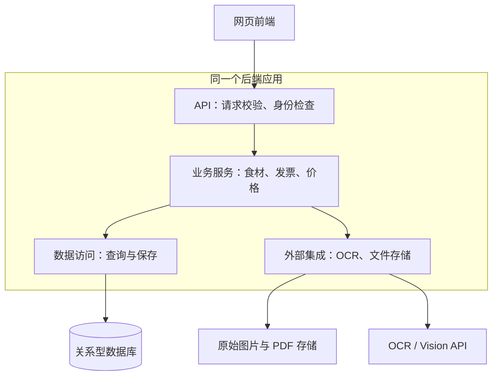

# Inventory 架构说明

## 整体架构

采用简化三层架构，后端各模块运行在同一个应用中。以下用 Python 表示后端目录，具体框架尚未确定。



数据库保存食材、发票审核状态和采购价格记录；文件存储保留原始单据，数据库保存对应文件引用。

## 建议目录

下面是规划结构，不代表已经实现。

```text
inventory/
├── frontend/                      # 网页界面、表单、审核与价格展示
│
├── backend/
│   ├── app.py                     # 应用启动入口
│   ├── src/
│   │   ├── factory.py             # 创建应用、组装依赖、注册路由
│   │   ├── config.py              # 配置与环境变量
│   │   ├── errors.py              # 业务异常与统一错误处理
│   │   ├── db.py                  # 数据库连接、会话与 Service 使用的事务边界
│   │   │
│   │   ├── api/                   # 表示层：处理 HTTP 输入与输出
│   │   │   ├── ingredients.py     # 食材、分类、建议搜索与合并接口
│   │   │   ├── invoices.py        # 上传、提取、审核与确认接口
│   │   │   ├── purchases.py       # 采购记录录入、查询与纠错接口
│   │   │   ├── prices.py          # 价格历史统计、比较与提醒设置接口
│   │   │   └── schemas.py         # 请求与响应的数据格式校验
│   │   │
│   │   ├── services/              # 业务层：组织流程与执行业务规则
│   │   │   ├── ingredients.py     # 食材与分类维护；**单位与名称词表的 owner**
│   │   │   ├── invoices.py        # 识别流程、逐行确认（调用 purchases 保存）
│   │   │   ├── extraction.py      # 真实 OCR 的分流、分层校验、上限与草稿写入
│   │   │   ├── purchases.py       # 采购记录的校验、保存、纠错与修改日志
│   │   │   ├── prices.py          # 标准化价格、加权均价、涨价判断
│   │   │   ├── units.py           # 单位与包装规格换算
│   │   │   ├── matching.py        # 文本相似度原语 + 缩写/噪声/分类词表（步骤 10）
│   │   │   ├── suggestions.py     # 候选食材：模糊匹配、最近 / 常用（步骤 10）
│   │   │   ├── merging.py         # 重复食材合并：预览、拦路冲突、一次事务（步骤 10）
│   │   │   └── validation.py      # 各服务共用的文本/取值/分页校验
│   │   │
│   │   ├── repositories/          # 数据访问层：封装数据库读写
│   │   │   ├── ingredients.py     # 食材、分类与合并日志的数据访问
│   │   │   ├── invoices.py        # 发票、行项目与审核状态的数据访问
│   │   │   ├── extraction.py      # 提取任务与供应商提取路径的数据访问
│   │   │   ├── prices.py          # 箱规与涨价提醒设置的数据访问
│   │   │   └── purchases.py       # 已确认采购价格记录的数据访问
│   │   │
│   │   ├── integrations/          # 封装外部服务与厂商差异
│   │   │   ├── ocr.py             # 识别器接口、Fake 实现与真实适配器的装配
│   │   │   ├── dashscope.py       # 某一家厂商的调用、重试与输出解析
│   │   │   ├── crosscheck.py      # 多模型逐字段裁决：一致才预填，分歧必须人填
│   │   │   └── file_storage.py    # 原始文件保存与读取
│   │   │
│   │   ├── documents/             # 本地文档处理：**一行代码都不访问外部服务**
│   │   │   ├── files.py           # 格式嗅探、HEIC 解码、EXIF 方向、媒体类型
│   │   │   ├── pdf.py             # 文字层 / 扫描页的区分与取用
│   │   │   ├── textlayer.py       # 文字层还原成行列结构
│   │   │   ├── grid.py            # 去斜、格线、行带列带
│   │   │   ├── anchor.py          # 行带↔商品行、列带↔字段的对应与本地校验
│   │   │   ├── ink.py             # 第 0 层墨迹闸门：页内逐像素配准判空
│   │   │   └── classify.py        # 印刷 / 手写的本地判别
│   │   │
│   │   ├── contracts.py           # 与厂商无关的识别结果等内部类型
│   │   ├── normalization.py       # 数值与日期规范化：一份口径，多条通路共用
│   │   ├── worker.py              # 提取任务的后台 worker
│   │   └── models.py              # 数据库表与关联关系的代码定义
│   │
│   ├── migrations/                # 数据库结构变更记录
│   └── tests/                     # 业务、数据访问及接口测试
│
├── imp_notes.md                   # 产品需求与研究笔记
└── struct.md                      # 本架构说明
```

## 分层约定与文档检查

- API 调用 Service；Service 组织业务并调用 Repository 和外部适配器，API 不直接操作数据库。
- OCR 输出作为待审核数据；业务层决定是否允许确认，已确认行才进入采购价格历史。
- 业务层确定事务范围，相关数据库写入共同提交或回滚。
- 初期直接组装依赖，不引入独立 DI 容器或通用 Repository 框架。
- 发票提取状态与审核草稿持久化。**后台 worker 已于步骤 08 加入**：手写件一页约 15 秒，挂在 HTTP 请求里会让人对着转圈等，而浏览器一关这次提取就白花了钱。worker 是应用内线程 + 一张落库的任务表，不引入 Redis 或 Celery。
- **`documents/` 与 `integrations/` 的分界**：`integrations/` 封装**外部服务与厂商差异**，`documents/` 只用 Pillow 与 pypdf 做**本地计算**，一行代码都不访问网络。把本地图像处理放进 `integrations/` 会让「哪些模块会发网络请求」变得说不清；换 OCR 厂商时 `documents/` 不用改。
- **识别层不做业务判断**：某个值能不能预填、某一行能不能确认，属于 Service；识别层多猜一步，错误就会被当成事实存下来。
- 单据的整体状态由各行状态**派生**，不单独存一列：行状态是唯一的事实来源，再存一列就会出现两份互相打架的真相。老板审完所有行要做一次**收口确认**，那一下是漏行唯一会被拦住的时刻。
- **标准化价格同样是派生值，不落列**（步骤 09）：`$/lb` 由 `services/prices.py` 在查询时算，`purchases` 上没有 `normalized_unit_price`。箱规改一下、采购记录改一下，价格立刻跟着对；落一列回填就会出现「列里存着旧值，而它看起来仍然像个可信的数字」。代价是统计要把窗口内的记录取回内存算——一家餐厅一个月几百条，这个量级够用，而触顶时**报错而不是少算**。
- **词表在最下面，上层能力依赖它，它对上层一无所知**（步骤 10 定下）：
  `services/ingredients.py` 是单位与名称**词表的 owner**（`BASE_UNITS`、
  `BASE_UNIT_SYNONYMS`、`PACKAGING_UNITS`、`normalize_name`），`units.py`、
  `matching.py`、`prices.py`、`suggestions.py`、`merging.py` 都 import 它，
  **它一个都不 import 回来**。所以步骤 10 的模糊匹配写不进 `ingredients.py`
  ——那会是循环 import，不是风格问题。代价是看 `ingredients.py` 会以为搜索还是
  步骤 03 的样子，两边的模块文档各写了一段互相指路。
- **`services/matching.py` 只回答「这两段文本有多像」，不回答「要不要用它」**：
  谁算命中、命中之后预填还是直接选中、分数多少才够，全部属于调用方——
  与 `units.py` 不做业务判断是同一条。⚠️ 它的噪声词表**从 `ingredients.py` 的
  三张单位表推导，不另抄一份**；另抄一份就会出现「录入认得、匹配不认得」。
- **`services/units.py` 只做换算，不做业务判断**：它回答「这两个单位能不能换、换过去是多少」；哪条箱规适用于哪一行、换不出来的行怎么呈现属于 `services/prices.py`。包装单位（case / pack / can / cup…）**不在**换算表里——「一箱等于多少」是人确认过一次的事实（`pack_specs` 表），不是单位体系能回答的问题。
- 文档采用 UTF-8，检查 Mermaid 语法、目录与注解一致性，并保持现有源码不变。
