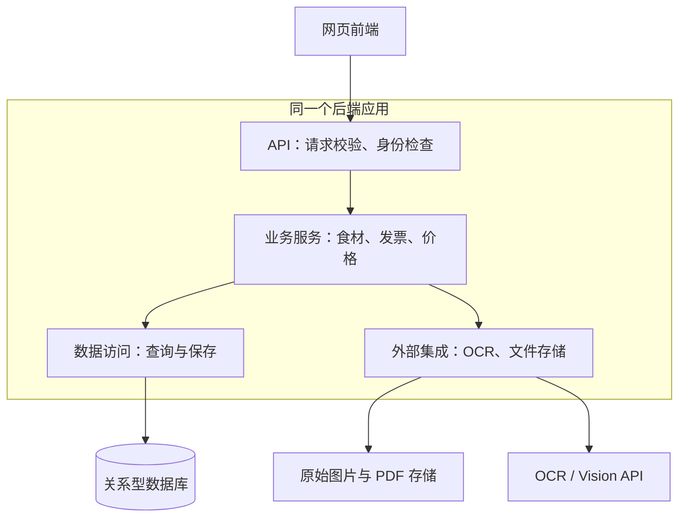

# Inventory 架构说明

## 整体架构

采用简化三层架构，后端各模块运行在同一个应用中。以下用 Python 表示后端目录，具体框架尚未确定。



数据库保存食材、发票审核状态和采购价格记录；文件存储保留原始单据，数据库保存对应文件引用。

## 建议目录

下面是规划结构，不代表已经实现。

```text
inventory/
├── frontend/                      # 网页界面、表单、审核与价格展示
│
├── backend/
│   ├── app.py                     # 应用启动入口
│   ├── src/
│   │   ├── factory.py             # 创建应用、组装依赖、注册路由
│   │   ├── config.py              # 配置与环境变量
│   │   ├── errors.py              # 业务异常与统一错误处理
│   │   ├── db.py                  # 数据库连接、会话与 Service 使用的事务边界
│   │   │
│   │   ├── api/                   # 表示层：处理 HTTP 输入与输出
│   │   │   ├── ingredients.py     # 食材、分类、建议搜索与合并接口
│   │   │   ├── invoices.py        # 上传、提取、审核与确认接口
│   │   │   ├── purchases.py       # 采购记录录入、查询与纠错接口
│   │   │   ├── intake.py          # 整理批次：建/恢复、逐文件上传、状态、回看原件（M03）；
│   │   │   │                      #   商家建议与相似堆、跨批次的商家记忆（M07）
│   │   │   ├── prices.py          # 价格历史统计、比较与提醒设置接口
│   │   │   └── schemas.py         # 请求与响应的数据格式校验
│   │   │
│   │   ├── services/              # 业务层：组织流程与执行业务规则
│   │   │   ├── ingredients.py     # 食材与分类维护；**单位与名称词表的 owner**
│   │   │   ├── invoices.py        # 识别流程、逐行确认（调用 purchases 保存）
│   │   │   ├── extraction.py      # 真实 OCR 的分流、分层校验、上限与草稿写入
│   │   │   ├── purchases.py       # 采购记录的校验、保存、纠错与修改日志
│   │   │   ├── prices.py          # 标准化价格、加权均价、涨价判断
│   │   │   ├── units.py           # 单位与包装规格换算
│   │   │   ├── matching.py        # 文本相似度原语 + 缩写/噪声/分类词表（步骤 10）
│   │   │   ├── suggestions.py     # 候选食材：模糊匹配、最近 / 常用（步骤 10）
│   │   │   ├── merging.py         # 重复食材合并：预览、拦路冲突、一次事务（步骤 10）
│   │   │   ├── intake.py          # 上传整理批次：按采购日 + 商家归组的读写原语（M02）
│   │   │   ├── intake_ingest.py   # 图片/PDF 摄入：存字节、按页切成可归类内容（M03）
│   │   │   ├── intake_recognition.py # 日期/商家候选与日期重解析（M05）
│   │   │   ├── intake_suggestions.py # 商家记忆与相似堆：同文件 / 历史别名 / 版式（M07）
│   │   │   └── validation.py      # 各服务共用的文本/取值/分页校验
│   │   │
│   │   ├── repositories/          # 数据访问层：封装数据库读写
│   │   │   ├── ingredients.py     # 食材、分类与合并日志的数据访问
│   │   │   ├── invoices.py        # 发票、行项目与审核状态的数据访问
│   │   │   ├── extraction.py      # 提取任务与供应商提取路径的数据访问
│   │   │   ├── prices.py          # 箱规与涨价提醒设置的数据访问
│   │   │   ├── intake.py          # 整理批次、原件引用、可归类内容与候选（M02）
│   │   │   ├── intake_suggestions.py # 确认过的来源、别名映射与版式记忆（M07）
│   │   │   └── purchases.py       # 已确认采购价格记录的数据访问
│   │   │
│   │   ├── integrations/          # 封装外部服务与厂商差异
│   │   │   ├── ocr.py             # 识别器接口、Fake 实现与真实适配器的装配
│   │   │   ├── dashscope.py       # 某一家厂商的调用、重试与输出解析
│   │   │   ├── crosscheck.py      # 多模型逐字段裁决：一致才预填，分歧必须人填
│   │   │   └── file_storage.py    # 原始文件保存与读取
│   │   │
│   │   ├── documents/             # 本地文档处理：**一行代码都不访问外部服务**
│   │   │   ├── files.py           # 格式嗅探、HEIC 解码、EXIF 方向、媒体类型
│   │   │   ├── pdf.py             # 文字层 / 扫描页的区分与取用
│   │   │   ├── textlayer.py       # 文字层还原成行列结构
│   │   │   ├── grid.py            # 去斜、格线、行带列带
│   │   │   ├── anchor.py          # 行带↔商品行、列带↔字段的对应与本地校验
│   │   │   ├── ink.py             # 第 0 层墨迹闸门：页内逐像素配准判空
│   │   │   ├── classify.py        # 印刷 / 手写的本地判别
│   │   │   └── layout.py          # 版式指纹：可解释的本地版式特征（M07）
│   │   │
│   │   ├── contracts.py           # 与厂商无关的识别结果等内部类型
│   │   ├── normalization.py       # 数值与日期规范化：一份口径，多条通路共用
│   │   ├── worker.py              # 提取任务的后台 worker
│   │   └── models.py              # 数据库表与关联关系的代码定义
│   │
│   ├── migrations/                # 数据库结构变更记录
│   └── tests/                     # 业务、数据访问及接口测试
│
├── imp_notes.md                   # 产品需求与研究笔记
└── struct.md                      # 本架构说明
```

## 分层约定与文档检查

- API 调用 Service；Service 组织业务并调用 Repository 和外部适配器，API 不直接操作数据库。
- OCR 输出作为待审核数据；业务层决定是否允许确认，已确认行才进入采购价格历史。
- 业务层确定事务范围，相关数据库写入共同提交或回滚。
- 初期直接组装依赖，不引入独立 DI 容器或通用 Repository 框架。
- 发票提取状态与审核草稿持久化。**后台 worker 已于步骤 08 加入**：手写件一页约 15 秒，挂在 HTTP 请求里会让人对着转圈等，而浏览器一关这次提取就白花了钱。worker 是应用内线程 + 一张落库的任务表，不引入 Redis 或 Celery。
- **`documents/` 与 `integrations/` 的分界**：`integrations/` 封装**外部服务与厂商差异**，`documents/` 只用 Pillow 与 pypdf 做**本地计算**，一行代码都不访问网络。把本地图像处理放进 `integrations/` 会让「哪些模块会发网络请求」变得说不清；换 OCR 厂商时 `documents/` 不用改。
- **识别层不做业务判断**：某个值能不能预填、某一行能不能确认，属于 Service；识别层多猜一步，错误就会被当成事实存下来。
- 单据的整体状态由各行状态**派生**，不单独存一列：行状态是唯一的事实来源，再存一列就会出现两份互相打架的真相。老板审完所有行要做一次**收口确认**，那一下是漏行唯一会被拦住的时刻。
- **标准化价格同样是派生值，不落列**（步骤 09）：`$/lb` 由 `services/prices.py` 在查询时算，`purchases` 上没有 `normalized_unit_price`。箱规改一下、采购记录改一下，价格立刻跟着对；落一列回填就会出现「列里存着旧值，而它看起来仍然像个可信的数字」。代价是统计要把窗口内的记录取回内存算——一家餐厅一个月几百条，这个量级够用，而触顶时**报错而不是少算**。
- **词表在最下面，上层能力依赖它，它对上层一无所知**（步骤 10 定下）：
  `services/ingredients.py` 是单位与名称**词表的 owner**（`BASE_UNITS`、
  `BASE_UNIT_SYNONYMS`、`PACKAGING_UNITS`、`normalize_name`），`units.py`、
  `matching.py`、`prices.py`、`suggestions.py`、`merging.py` 都 import 它，
  **它一个都不 import 回来**。所以步骤 10 的模糊匹配写不进 `ingredients.py`
  ——那会是循环 import，不是风格问题。代价是看 `ingredients.py` 会以为搜索还是
  步骤 03 的样子，两边的模块文档各写了一段互相指路。
- **`services/matching.py` 只回答「这两段文本有多像」，不回答「要不要用它」**：
  谁算命中、命中之后预填还是直接选中、分数多少才够，全部属于调用方——
  与 `units.py` 不做业务判断是同一条。⚠️ 它的噪声词表**从 `ingredients.py` 的
  三张单位表推导，不另抄一份**；另抄一份就会出现「录入认得、匹配不认得」。
- **`services/units.py` 只做换算，不做业务判断**：它回答「这两个单位能不能换、换过去是多少」；哪条箱规适用于哪一行、换不出来的行怎么呈现属于 `services/prices.py`。包装单位（case / pack / can / cup…）**不在**换算表里——「一箱等于多少」是人确认过一次的事实（`pack_specs` 表），不是单位体系能回答的问题。
- 文档采用 UTF-8，检查 Mermaid 语法、目录与注解一致性，并保持现有源码不变。

## 多文件整理批次（多文件计划 M02 / M03 / M05 / M07）

混合上传的整理阶段另有一套表（`intake_batches`、`intake_files`、
`intake_batch_files`、`intake_items`、`intake_item_candidates`，M07 再加一张
`intake_source_aliases`），分层照旧：
`services/intake.py` 定事务边界，`repositories/intake.py` 只做读写。五条约定与上面
那几条同源：

- **日期/商家组不落表**，它是 `(实际采购日, 规范化来源)` 的分组结果。与「单据状态
  由行状态派生」、「标准化价格不落列」同一条：另存一份就会出现两份能互相矛盾的
  真相——移动一张卡片之后，组表的成员名单和内容上的决定值谁对？
- **系统建议与人工确认分成两张表**：候选在 `intake_item_candidates`（谁建议的、
  依据是什么），人确认过的值在 `intake_items.decided_*`。「识别层不做业务判断」
  那一条在这里的样子是：再有把握的候选也不会自己变成决定。
- **摄入与落库分成两层**（M03）：`services/intake_ingest.py` 负责字节与页——存
  原件、按内容嗅探格式、数出确定性页数，落库一律经 `intake.py` 的原语，自己不开
  Session；`intake.py` 因此保持「不读磁盘、不认识 PDF」。页数由 `documents/` 本地
  算出，整条摄入通路一行代码都不访问网络。⚠️ 收不收一个文件按**扩展名**白名单
  （步骤 05 的入口口径），怎么切按**字节**嗅探出的真实格式——两者分工不同，不是
  重复。
- **切页的待办状态就是 `intake_batch_files.status`，没有第二张任务表**（M03）。
  `pending` 的含义就是「字节存好了、还没切」。另立一张任务表会出现「任务表说跑完
  了、文件还是 pending」两份能互相矛盾的真相——与上面几条同源。⚠️ 与
  `extraction_jobs` 的差别是**代价**：那边有 `running` 中间态、重跑要再花一次钱，
  所以需要独立任务表与「卡住任务退回排队」；本地切页两者都没有，进程被 kill 之后
  那一条仍是 `pending`，再驱动一次队列就接着切。
- **`invoices` / `invoice_files` 一个字都没改。** `invoice_files.sha256` 全局唯一、
  一份文件只属一张单据，是步骤 05 的既有规则；整理阶段要的是「一份文件的不同页
  属于不同组」，方向相反，所以并存而不是放宽旧约束。代价是原件有两处入口，
  跨路径的同摘要文件只提示不阻断。
- **识别状态是内容上的一列，不是一张任务表**（M05）：`intake_items.recognition_status`
  （NULL / `pending` / `done` / `failed`）就是识别队列，与上一条的切页队列同源。
  ⚠️ **「跑完了」与「有候选」必须分得开**：读完发现纸面上没有商家时是 `done` + 0 条
  候选，没跑过时两者都空；只看候选数就分不开，于是重新打开批次只能把所有没候选的页
  再送一遍模型——那就是对同一页重复收费。⚠️ 这一列**刻意不加 CHECK**：SQLite 改
  CHECK 要批处理重建整张表，而这张表上有两条带 `WHERE` 的局部唯一索引，重建时丢掉
  `WHERE` 的代价远大于一条 CHECK（与 `IntakeItemCandidate.basis` 同一条）。
- **识别的原文整份落在 `intake_items.recognition_payload`**（M05）：读出来的原文、
  出处、provider / 模型 / 提示词版本、歧义日期的两种读法，**以及行项目**。两个理由：
  ①商家确认后要用**保存的日期原文**重新解析（解析不出来的日期不会产生候选，原文只活
  在候选里就丢了）；②整理阶段的结果进入审核时不得重复收费，M08 读它建草稿。
  ⚠️ payload 自报 `purpose` / `rounds`——它是**候选那一轮**的产出，没跑步骤 08 的结构
  提问与行容量，M08 不能当成已过那几层校验。
- **分流按文件结构，不按商家**（M05）：`services/intake_recognition.py` 对有文字层的
  PDF 页抽文字层（**零调用**）、对扫描页与图片送识别器、对表格行读 M04 已存的单元格。
  ⚠️ `ocr_routes` 的 `date_order` **只认人工确认过的商家**（`decided_source_name_normalized`）：
  拿候选里的商家去套它的日/月顺序，等于用相似度定了一个日历日，而那种错误不报错。
  所以商家未确认时 `6/11/2026` **两种读法都留着**，确认之后再用保存的原文重解析。
- **M04 表格行证据**：`intake_batch_files.table_metadata` 保存工作表、列映射与导入选项，
  `intake_items.row_data` 保存该行解析值、原单元格与逐行问题；二者可空，图片/PDF 内容
  不填。`services/intake_spreadsheets.py` 复用旧表格解析器并负责原件和批次写入，
  `repositories/intake_spreadsheets.py` 在一个事务中保存全部行与文件就绪状态。
  表格行初入批次是待分类内容，M05 生成候选，M08 才接入正式审核。
- **M08 审核关联只存内容到草稿的指针**：`intake_review_links.item_id` 是主键，
  一页/行只能送审一次；原件仍在 `intake_files`，不复制字节到具有全局摘要唯一约束的
  `invoice_files`。一次明确选择可组成一张草稿，组本身不变成发票。送审事务同时写关联、
  草稿行、`handed_off_at` 和版本；拆并仅移动待审核行。已入账后的日期/来源修正一次
  同步内容决定、草稿头与沿用头值的采购，并留下采购修订日志。
- **M07 的三样「记忆」只有一样落表**：`intake_source_aliases` 存「纸面上这种写法 =
  人确认过的哪一家」——那是人的决定，推不出来，而且 `docs/multifiles.md` 第 5 节
  明确要求它**可更正**（改指向、删掉）。另两样都是派生值：「这一家现在叫什么」取
  **最近一次人工确认的写法**（`intake_items.decided_source_name` / `purchases`
  聚合），「这个版式属于哪一家」由 `intake_items.layout_fingerprint` 加那一页上的
  确认算出来。所以没有「供应商表」，也没有「版式→商家」表——要更正版式记忆，
  改那一页的确认即可，不会出现两份能互相矛盾的真相。
  ⚠️ 这一组**不是应付账款的供应商模块**（M07 原话）：没有联系人、地址、账期、
  商品目录，与 `ocr_routes`「只有来源名 → 走哪条路」同一条。
- **版式指纹是本地测量的缓存，不是业务判断**（M07）：`documents/layout.py` 用
  pypdf 与 Pillow 量这一页——有文字层的 PDF 取页面尺寸 + **字号集合**，扫描页与
  图片取笔迹风格 + 格线行数 + 有无竖线 + 长宽比，结果落在
  `intake_items.layout_fingerprint` / `layout_features`。落列的理由是**代价**
  （一页 0.3—0.6 秒，而「历史上有哪些版式」要跨批次查几百页），而输入是按 sha256
  寻址、**永不改变**的字节，所以这份测量不会过期——与「标准化价格不落列」不冲突：
  那一列会随箱规变化悄悄过期。⚠️ 量不出格线时 `template_evidence` 为 false，
  那样的堆**不给商家候选**：两张都量不出格线的歪照片「指纹相同」不是证据。
- **建议层结构上花不起钱**（M07）：`services/intake_suggestions.py` 没有识别器这个
  依赖，三层线索（同文件已确认页、历史来源与别名、版式指纹）全是本地计算与数据库
  查询，所以 `/suggest-sources` 的 `model_calls` 恒为 0。⚠️ 纸面读出的来源与同文件
  或外观建议冲突时**单页证据优先**，被压住的那条进响应的 `conflicts` 让人看得见；
  相似度只用于**排序**，代码里没有任何一处拿它与阈值比较后自动确认。
